<!-- _class: title -->

# Advanced Computer Networks

## Kapitel 1 · Anforderungen & Performance

Wintersemester 2026/2027
Master AI – Hochschule Fulda
Sebastian Rieger · MMNet

*Referenz: Computer Networks: A Systems Approach, 7E, Ch. 1*

---

## Kapitelübersicht

**Vorlesung L1 · Anforderungen & Performance**
1. **Anforderungen an Advanced Computer Networks** — §1.1
2. **Anforderungen durch Anwendungen** — §1.2: Bitrate, Latenz, Jitter, Fehlerrate, BDP, QoE

<br/>

**Vorlesung L2 · Skalierbarkeit & Design-Prinzipien**
3. **Skalierbarkeit der Adressierung** — §1.3
4. **Internet Design Principles** — §1.4
5. **Zukünftige Anforderungen** — §1.5

*7E Ch. 1 – Introduction*

---

## Lernziele

Nach diesem Kapitel sollten Sie wissen…

- welche **Anforderungsbereiche** (Performance, Fehlertoleranz, Skalierbarkeit, Management, Sicherheit) an Netze gestellt werden
- wie **Bitrate, Latenz, Jitter** und **Bitfehlerrate** zusammenwirken — und was das **Bandwidth-Delay-Product** bedeutet
- warum **Bursts** die Quality of Experience verderben, obwohl die Durchschnittsrate passt
- warum **Skalierbarkeit** ein Adressierungs- und Routing-Problem ist (BGP, Adressknappheit)
- welche **Design-Prinzipien** das Internet geformt (und erfolgreich gemacht) haben (End-to-End, Robustheit, Einfachheit)
- welche Anforderungen **heute und künftig** dazukommen (IoT, KI, Energieeffizienz)

> **Ziel:** Anforderungen *begründen* können — nicht nur benennen.

---

<!-- _class: section-break -->

# 1.1 Anforderungen an Advanced Computer Networks

Vorlesung L1 · Anforderungen & Performance

*7E §1.1 – Requirements*

---

## Anforderungen an Computer Networks

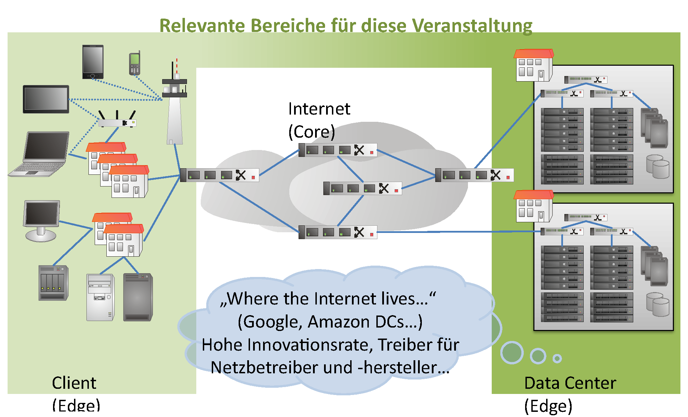

- **Performance** — Latenz, begrenzt durch die Lichtgeschwindigkeit
- **Fehlertoleranz & Resilienz** — Ausfall von Links und Komponenten
- **Effizienz** — Lastverteilung, Flusskontrolle, Energie, Betriebskosten
- **Skalierbarkeit** — schnelles Wachstum, verteiltes Management
- **Sicherheit** — Vertraulichkeit, Integrität, Verfügbarkeit
- **Offene Standards** — Interoperabilität, „ubiquitäre" Netze

**Fazit:** Fokus dieser LVA: **Client (Edge) ↔ Internet (Core) ↔ Data Center (Edge)**

🧠 Welche Anforderung ist heute die härteste — und warum?

*7E §1.1 – Requirements*

---

<!-- _class: section-break -->

# 1.2 Anforderungen durch Anwendungen

Vorlesung L1 · Performance, Latenz, BDP, QoE

*7E §1.5 – Performance*

---

## Anforderungen durch Anwendungen

Das Netz ist kein Selbstzweck: die Anwendungen bestimmen, was „gut" ist.

- **Performance** — Bitrate, Latenz, Jitter, Fehlerrate (QoS am Link)
- **Fehlertoleranz** — Robustheit, Resilience
- **Skalierbarkeit** — Adressierung, Management, Security

**Quality of Service (QoS)** am Link bestimmt maßgeblich die **Quality of Experience (QoE)** der verteilten Anwendung.

<div class="takeaway">

Nicht die Link-Werte allein zählen, sondern der **Nutzen für die Anwendung** — QoE statt QoS

</div>

*7E §1.5 – Performance*

---

## Utility Function

Bewertung des **Nutzens** des Netzes für eine Anwendung — als Funktion von Bitrate, Latenz, Jitter, Fehlerrate

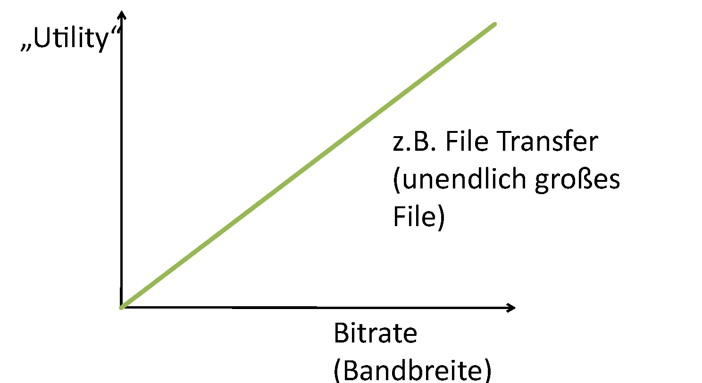

<br/>

**Beispiel:** File Transfer (unendlich großes File) → Utility steigt **linear** mit der Bitrate

*in Anlehnung an Vanbever und Roscoe/Stüdi, Advanced Computer Networks / Topics in Comm Networks, ETHZ*
💡 [ETHZ – Advanced Computer Networks](https://adv-net.ethz.ch/)

---

## Utility Function — typische Verläufe

<div class="columns3">
<div>

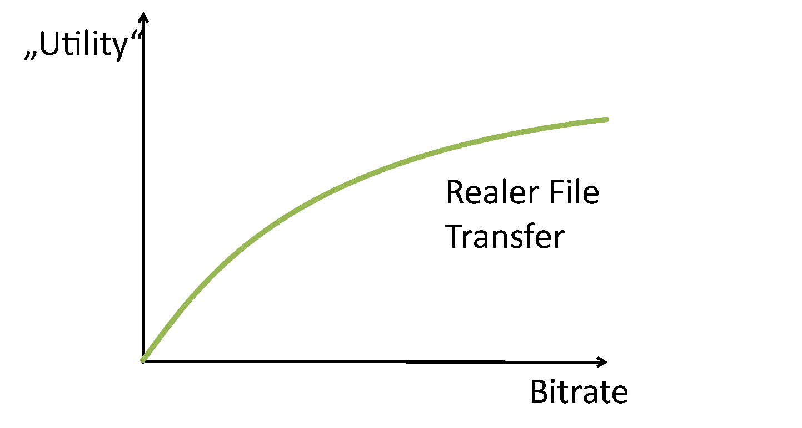

**Realer File Transfer** — abnehmender Grenznutzen

</div>
<div>

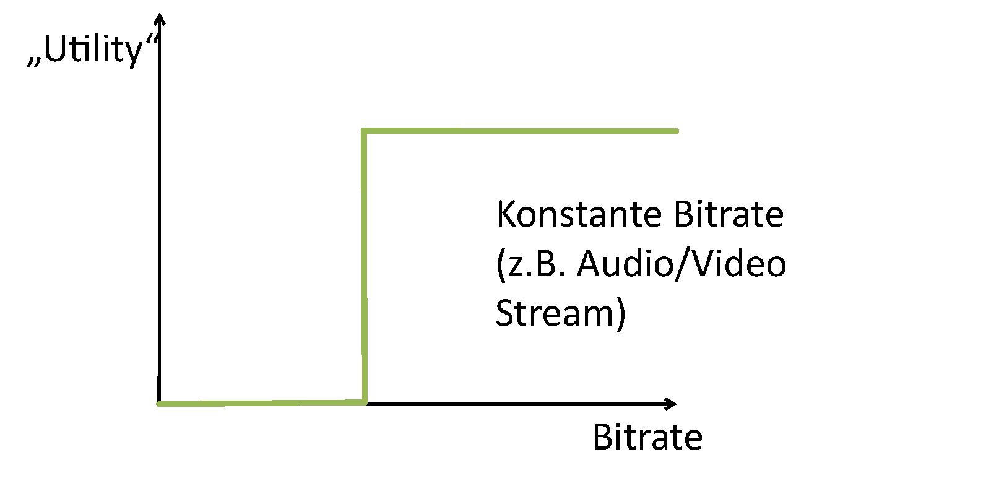

**Konstante Bitrate** — Plateau ab Mindestbitrate

</div>
<div>

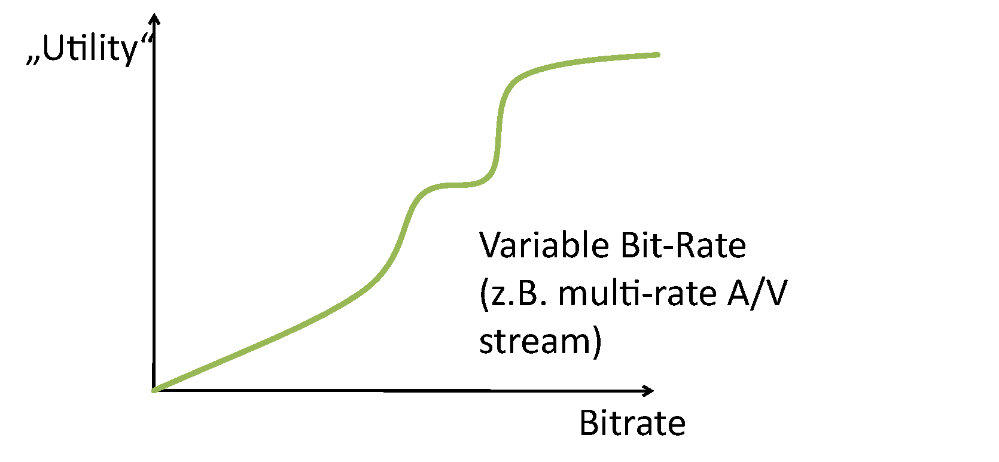

**Variable Bit-Rate** — Stufen mehrerer Qualitätsniveaus

</div>
</div>

<div class="takeaway">

Die Utility-Kurve sagt, wie viel Bitrate sich überhaupt lohnt — und wann Verfügbarkeit wichtiger ist als Durchsatz

</div>

*angelehnt an Roscoe/Stüdi, Advanced Computer Networks, ETHZ*

---

## „Burstiness"

- Die meisten Anwendungen brauchen **wechselnd** viel Bitrate — Bursts sind die Regel
- Analyse und Verwaltung des Bitratenbedarfs entscheiden über die Performance — vgl. Congestion/Flow Control (Queuing Theory, Token Bucket …)
- **Herausforderung:** kein Over- oder Underprovisioning trotz Bursts

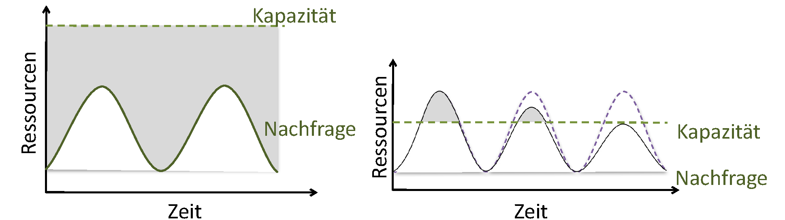

<br/>

🧠 Wie dimensioniert man eine Leitung für den „durchschnittlichen" Bedarf?

*7E §1.5 – Performance*

---

## Netzwerk-Performance: Bitrate und Latenz

- **Bitrate** — Bits pro Zeiteinheit (Durchsatz, Throughput); umgangssprachlich „Bandbreite"
- **Latenz** — Zeit für eine Nachricht über das Netz (Delay; halbe RTT)

**Einfluss des Protokoll-Designs — LAN vs. WAN:**
- Protokolle mit vielen Request/Response-Paaren eignen sich schlecht für WAN
- **SMB/CIFS** (Netzlaufwerk): ~80 Request/Response-Paare pro Zugriff; Fulda → Stanford (200 ms RTT) → **16 s Wartezeit**

<div class="food-for-thought">

🧠 Warum hilft mehr Bandbreite kaum, wenn die Latenz dominiert?

</div>

💡 Demo: `ping -c 3 hs-fulda.de` und `mtr -rwz <US-Host>` — Latenz und Pfad vergleichen · [mtr](https://github.com/traviscross/mtr)

---

## Bandwidth-Delay Product (BDP)

Wie viele Bits müssen unterwegs sein, damit die Leitung nicht leer läuft?

```
BDP = Bitrate × Latenz                        → „continuously fill the pipe"
Durchsatz = Größe / (RTT + Größe / Bitrate)   → First-Byte-Delay
```

- **Beispiel:** Fulda → Stanford, 200 ms RTT, 100 Gb/s → BDP = **2,5 GB** „in flight"
- **1 MB über 1 Gbit/s:** 96 % Minderung gegenüber der Nominalbitrate — die RTT dominiert
- **1 GB** über dieselbe Leitung: nur noch ~2 % Minderung → die **Objektgröße** entscheidet

💡 Leseauftrag: [7E §1.5 – Performance](https://7e.systemsapproach.org/introduction.html#intro-5-performance), bes. *Bandwidth-Delay Product*

<div class="takeaway">

Erst bei großer Objektgröße spielt die Bitrate ihre Stärke aus — vorher regiert die Latenz

</div>

---

## TCP: Window Size und Congestion Control *(Wdh KommProt)*

- **Flow Control:** unquittiert sind höchstens `min(rwnd, cwnd)` Bytes erlaubt — optimal ist<br/>`w = RTT × Bitrate`
- **Congestion Control:** cwnd startet klein (slow-start), wächst bis zum Schwellwert; bei Verlust AIMD, bei Timeout Neustart
- **Protokoll-Limit:** 16-Bit-Window im TCP-Header (≤ 64 kB) — Window Scaling (RFC 7323) erlaubt mehr
- **Beispiel:** 10 Gbit/s, 200 ms RTT → `w ≈ 250 MB` pro Verbindung — welche Ressourcen braucht das Endsystem?

<div class="food-for-thought">

🧠 Large BDP: Warum reicht ein größeres Fenster allein nicht — und was muss noch passieren?

</div>

*7E §1.5 – Performance · RFC 7323*

---

## Large BDP Networks — und wo sie real vorkommen

- Bei großem BDP sind zu viele RTTs nötig; slow-start bleibt trotzdem Pflicht → **Dilemma**
- Kleine Objekte kommen kaum über die Startphase hinaus: die **Latenz** setzt die Grenze, nicht die Bitrate
- **Typische Fälle:** Data-Center-Interconnect (100 ms+), WAN-Strecken, Wireless
- **Gegenmittel:** parallelisieren, aggressivere Congestion Control, passende Puffer
- **Trend:** mit 400/800 GbE erreicht das Problem den Edge

<div class="takeaway">

Steigende Bitrate erhöht die Bedeutung der Latenz — Large BDP ist ein **Protokoll**-Problem, kein Bandbreitenproblem

</div>

*7E §1.5 – Performance · Details in Kapitel 7*

---

## Anforderungen an Latenz, Jitter und Fehlerrate

| Distanz Server → Nutzer | Latenz | Paketverlust | Durchsatz | 4-GB-Download |
|---|---|---|---|---|
| Lokal: < 160 km | 1,6 ms | 0,6 % | 44 Mb/s (HDTV) | 12 min |
| Regional: 800–1600 km | 16 ms | 0,7 % | 4 Mb/s (kein DVD) | 2,2 h |
| Kontinental: ~4800 km | 48 ms | 1,0 % | 1 Mb/s (kein TV) | 8,2 h |
| Interkontinental: ~10000 km | 96 ms | 1,4 % | 0,4 Mb/s (schlecht) | 20 h |

**Fazit:** Mit der Distanz steigen Latenz und Paketverlust, der Durchsatz fällt — die drei Größen hängen zusammen

*Quelle: „Improving Performance on the Internet", T. Leighton, Communications of the ACM, 2/2009*

<div class="food-for-thought">

🧠 Alte Zahlen? Wie sieht es mit Durchsatz heute aus? und Latenz? und Paketverlust?

</div>

---

## Zusammenfassung: Performance und Fehlertoleranz

<div class="columns">
<div>

**Einfluss auf die Performance**
- Links und QoS
- Congestion Control
- zusätzliche RTTs mindern den Durchsatz

</div>
<div>

**Ineffizienz**
- Protokoll-Overhead (~40 Bytes MAC + IP + TCP pro Paket)
- Retransmission bei Verlust — Alternativen?
- Zuverlässigkeit im Netz kann Echtzeit-Anwendungen stören

</div>
</div>

**Fazit:** Die Performance-Grenze entsteht aus dem Zusammenspiel von Latenz, Protokoll und Fehlertoleranz — nicht aus der Bitrate allein

*7E §1.5 – Performance · §1.4 – Resource Sharing*

---

## „Quality of Experience"

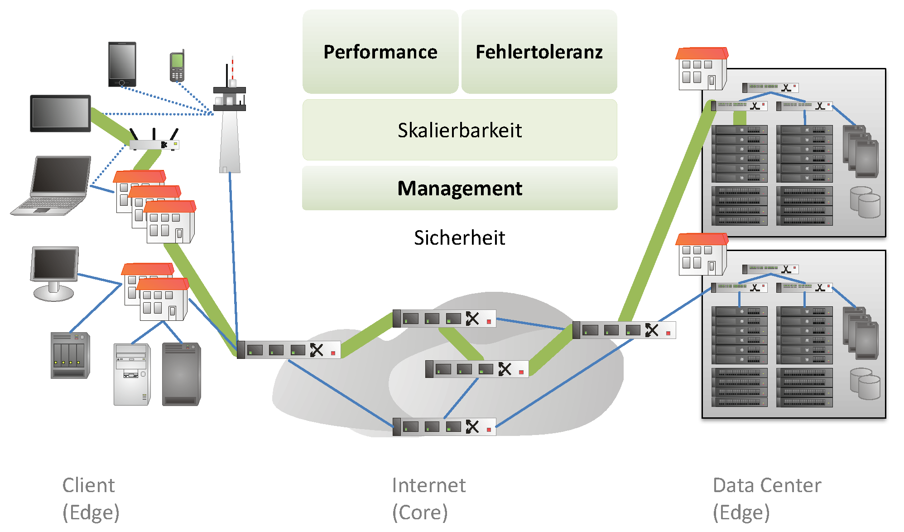

<div class="takeaway">

Die QoS-Bausteine **Performance**, **Fehlertoleranz**, **Skalierbarkeit**, **Management** und **Sicherheit** entlang der Kette Client (Edge) – Internet (Core) – Data Center (Edge) bestimmen die wahrgenommene **QoE**

</div>

*7E §1.5 – Performance*

---

<!-- _class: section-break -->

# 1.3 Skalierbarkeit der Adressierung in Netzen

Vorlesung L2 · Skalierbarkeit der Adressierung

*7E §1.4 – Resource Sharing*

---

## Skalierbarkeit: Routing-Tabellen und AS-Topologie

<div class="columns">
<div>


*BGP-Routing-Tabelle: [bgp.potaroo.net](https://bgp.potaroo.net/)*

</div>
<div>

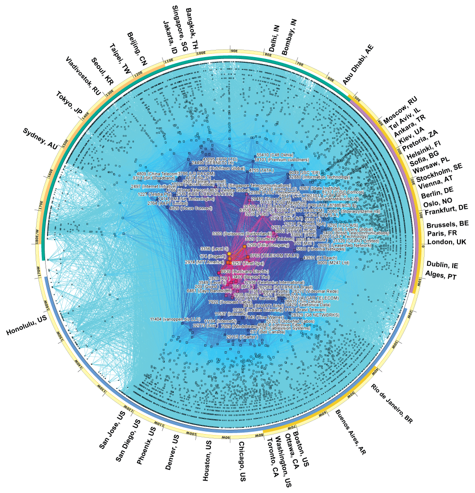

*AS-Topologie: [CAIDA AS-Core](https://www.caida.org/projects/cartography/as-core/)*

</div>
</div>

- IPv4 ist endlich — 32 Bit ≈ 4,3 Mrd. Adressen; jedes Präfix kostet Speicher und Konvergenz
- **Aggregation** (CIDR) und **Hierarchie** halten die Routing-Tabelle beherrschbar; IPv6 entschärft die Knappheit
- **Aber:** die Zahl der AS und Pfade wächst weiter — Skalierbarkeit ist nie fertig

*Quellen: CAIDA, bgp.potaroo.net (Stand 2026) · 7E §1.4 – Resource Sharing*

---

## Zunehmende Linkraten

- **Optik 2026:** 800 Gb/s unregeneriert über 16.608 km (Ciena/Meta)
- **Feldversuch 2026:** 410,5 Tbit/s über eine 7-Core-Faser (Nature)
- **Systemseite:** 400/800 GbE im Rechenzentrum und an Carrier-Rändern
- Grenze ist heute **Elektronik** und Energiebedarf pro Bit, nicht die Faser

<div class="columns">
<div>


</div>
<div>

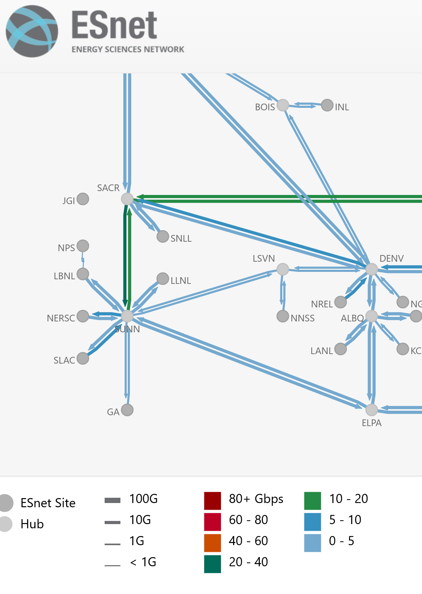

</div>
</div>

💡 [Ciena/Meta 800 Gb/s (2026)](https://www.ciena.com/insights/blog/2026/ciena-and-meta-achieve-world-record-800-gbs-across-16,608-km-on-transpacific-submarine-cable) · [Nature (2026)](https://www.nature.com/articles/s44172-026-00664-x)

*Bilder: Submarine Cable Map · ESnet*

---

## Wachsende Nachfrage: Traffic und Dienste

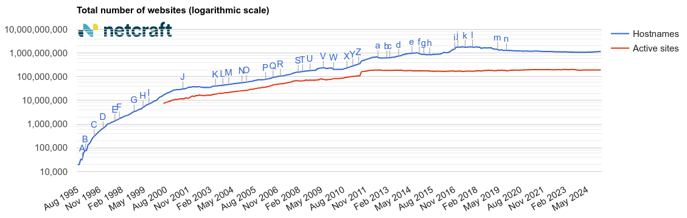

*Web-Server weltweit: [netcraft 7/2026](https://www.netcraft.com/blog/july-2026-web-server-survey/)*

- **DE-CIX Frankfurt** erstmals über **20 Tbit/s** (20,02 Tbit/s am 18.09.2026), global über **30 Tbit/s**
- **Jahresbilanz 2025:** 79 EB global (+16 %), Frankfurt 48 EB, Peak 18,73 Tbit/s am 09.12.2025
- **Peak-Zeiten** folgen den Diensten — Streaming, Gaming, Updates
- Das Web ist nur **ein** Dienst von vielen

💡 [DE-CIX Live-Statistik](https://www.de-cix.net/en/locations/frankfurt/statistics) · 💡 [Cloudflare Radar](https://radar.cloudflare.com/)

*Quellen: DE-CIX-PM 20.01.2026 & 18.09.2026*

---

## Aber auch Seiteneffekte…

<div class="columns">
<div>


*Quelle: codinghorror.com*

</div>
<div>

- Ausfälle durch Naturkatastrophen und Seekabel-Schäden — Europa und die Welt wappnen sich (leider...)
- Politische Einflussnahme: Zensur, Netzsperren, abgeschottete Netze (RU, IR, …)
- Abhörskandale und Überwachung — Transparenzberichte der Anbieter als Gegenmittel
- **Gegenbewegung:** offene Standards und ein erreichbarer Netzverbund als Ganzes

💡 [Cloudflare Radar – Outage Center](https://radar.cloudflare.com/outage-center) <br/> 💡 [Google Transparency Report](https://transparencyreport.google.com/)

</div>
</div>

*7E §1.1 – Requirements · vgl. Kapitel 3 (Overlays) und Kapitel 4 (SDN)*

---

<!-- _class: section-break -->

# 1.4 (Future) Internet Design Principles

Vorlesung L2 · Internet Design Principles

*7E §1.2 – Network Architecture · §1.3 – Network Protocols*

---

## Überblick: Internet Design Principles

Grundlage: [RFC 1958](https://datatracker.ietf.org/doc/html/rfc1958) (1996) · [RFC 3439](https://datatracker.ietf.org/doc/html/rfc3439) (2002)

- **Heterogenität** — „thin waist": alles über IP
- **Skalierbarkeit & Amplification** — Störungen dürfen sich nicht verstärken
- **Robustheit & Anpassungsfähigkeit** — Postel's Law
- **Modularisierung & lose Kopplung** — Schichten, unabhängige Weiterentwicklung
- **Locality** — Information lokal vorhalten
- **End-to-End & Minimal Intervention** — Fate Sharing

💡 [7E §1.2 – Network Architecture](https://7e.systemsapproach.org/introduction.html#intro-2-network-architecture)

---

## Internet Design Principle: End-to-End

Saltzer, Reed & Clark (1984): *End-to-End Arguments in System Design*

> „The function in question can completely and correctly be implemented only with the knowledge and help of the application at the endpoints."

- Das Endsystem muss die Funktion anbieten können, **ohne Hilfe des Netzwerks**
- Zuverlässigkeit, Sicherheit und Fehlerbehandlung liegen damit im Endsystem
- **Aber:** eine unvollständige Funktion im Netz kann als Performance-Verbesserung nützlich sein

💡 [ACM TOCS 2(4), 1984](https://dl.acm.org/doi/10.1145/357401.357402) — das Original-Paper

*7E §1.2 – Network Architecture*

---

## Zuverlässiger File Transfer: naiv vs. End-to-End

<div class="columns">
<div>

**Naiver Ansatz — jeder Schritt sichert sich selbst**

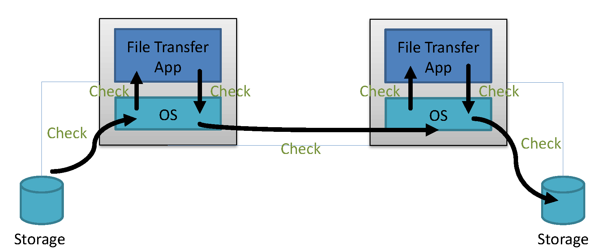

</div>
<div>

Jeder „Check" schützt nur den eigenen Teilschritt: `App → OS → Storage` … `Storage → OS → App`. Fällt eine Komponente aus, erfahren die anderen nichts.

**End-to-End — die Anwendung garantiert**

```
Sender:    erzeuge Checksumme → übermittle Checksumme
Empfänger: überprüfe Checksumme
```

Bei Abweichung: erneuter Transfer. Zuverlässigkeit bleibt im Endsystem.

</div>
</div>

<div class="takeaway">

Regel: keine Funktionalität in tiefere Layer, **außer** sie verbessert die Performance eindeutig, behindert keine Anwendung oder ist regulatorisch zwingend

</div>

*nach Roscoe/Stüdi, Advanced Computer Networks, ETHZ*

---

## Internet Design Principle: Robustness

**Postel's Law:** *be conservative in what you send, be liberal in what you accept*

- **Beispiel E-Mail:** MIME regelt das Format; abweichende Nachrichten werden trotzdem akzeptiert (Preis: Spam)
- **Fehler minimieren:** kleine Fehler dürfen nicht das Netz lahmlegen
- **Erweiterbarkeit:** kleine Protokolländerungen überall umsetzbar
- **Missbrauch einschränken:** defensive Programmierung

🧠 Wann wird „be liberal in what you accept" gefährlich?

💡 [RFC 793 – TCP (1981)](https://www.rfc-editor.org/rfc/rfc793) · 💡 [RFC 9413 (2023)](https://www.rfc-editor.org/rfc/rfc9413)

*7E §1.2 – Network Architecture*

---

## Überblick „Future Internet" Design Principles

Zwei konkurrierende Ansätze bei der Weiterentwicklung:

- **Evolutionary** — das bestehende Internet weiterentwickeln
- **Clean Slate** — neu entwerfen, Anforderungen von Grund auf
- „Everything should be made as simple as possible, but not simpler" (Einstein)
- „End-to-End" und „Fate Sharing" sind für IoT-Sensoren schwierig — Speicher zu knapp
- **Naming & Addressing:** Locator/ID Separation als Antwort auf die Skalierbarkeit

🧠 Braucht das Internet einen „Clean Slate" — oder reicht Evolution?

*Quelle: „Future Internet Design Principles", EC 1/2012 · RFC 1958/3439*

---

<!-- _class: section-break -->

# 1.5 Zukünftige Anforderungen

Vorlesung L2 · Zukünftige Anforderungen

*7E §1.4 – Resource Sharing · §1.5 – Performance*

---

## Große Herausforderungen für die Zukunft

Die Protokollarchitektur ist stabil — die **Treiber** ändern sich:

<div class="columns">
<div>

**Treiber**
- Extremes Wachstum: Bitraten an beiden Edges, Zahl der Endgeräte (IoT)
- **Netze für KI** — Training und Inferenz; und KI für Netze
- Missbrauch und Kriminalität: DDoS mit 2,4 Tbit/s (Azure, 10/2021), 31,4 Tbit/s (Cloudflare, Q4 2025)

</div>
<div>

**Herausforderungen für das Netz**
- Verteilte, heterogene Architektur
- Komplexität der Systeme und Protokolle; Ausfälle
- Konkurrierende Interessen der Hersteller

</div>
</div>

**Fazit:** Nicht die Protokolle sind das Problem, sondern **Skalierung und Betrieb** des verteilten Systems

*7E §1.4 – Resource Sharing · §1.5 – Performance*

---

## Distributed Management

> „… lack of sufficient tools for distributed management, especially in the area of routing." — [David Clark, DARPA, 1988](https://dl.acm.org/doi/abs/10.1145/52324.52336)

- Noch immer zentral — und der Auslöser für Netz-Virtualisierung und SDN (Kapitel 3–5)
- **Langfristiges Ziel:** Vereinfachung und/oder Realisierung eines verteilten Managements
- Ansätze: Telemetrie, zentrale Control Planes, Intent-basierte Automatisierung

**Fazit:** Management ist der eigentliche Skalierungsengpass großer Netze → LVA Network Management and Monitoring - show hands 🙋‍♂️

💡 [7E §10 – Network Operations](https://7e.systemsapproach.org/operations.html)

*7E §1.4 – Resource Sharing*

---

## Woher kommt die Weiterentwicklung in Computer Networks?

- **Great Engineering:** getrieben von F&E der Unternehmen (IETF, IEEE), Standards, Interoperabilität, Tuning — teils Trial and Error...
- **…versus Good Science:** neue Modelle und Grundlagen — und der Beweis, warum Engineering funktioniert
- **Achtung vor Marketing:** Buzzword-Bingo — „advanced" definiert oft der Hersteller
- In großen Netzen sind **offene Standards** essenziell — Interoperabilität schlägt Lock-in

🧠 Wo verläuft die Grenze zwischen belastbarer Technik und Marketing?

*7E Ch. 1 – Introduction*

---

## Lernzielkontrolle ✍️🧠

- Welche Anforderungen dominieren den Entwurf eines Netzes — und wie hängen sie zusammen?
- Was ist der Unterschied zwischen QoS am Link und QoE aus Nutzersicht?
- Warum sagt die Bitrate allein nichts über die Antwortzeit aus?
- Was beschreibt das Bandwidth-Delay Product, und warum wächst damit die Rolle der Latenz?
- Warum bringt mehr Bandbreite bei kleinen Objekten über große Distanz so wenig?
- Was passiert in Large-BDP-Netzen im slow-start — und warum ist das ein Dilemma?
- Warum ist das Wachstum der BGP-Routing-Tabelle ein Skalierbarkeitsproblem der Adressierung?
- Was sagt das End-to-End-Prinzip, und welche Ausnahmen erlaubt es?
- Was fordert Postel's Law — und warum rät RFC 9413 heute davon ab, es wörtlich zu nehmen?
- Wodurch unterscheiden sich „Evolutionary" und „Clean Slate" Future Internet?

*7E Ch. 1 · RFC 1958/3439 · RFC 9413*

---

## Praktische Übungen und Demo-Links 🛠️🧑‍🔬

1. **Latenz messen & BDP rechnen:** `ping -c 5 hs-fulda.de` gegen eine US-Adresse — RTT × Bitrate der eigenen Leitung ergibt das BDP
2. **Pfad zerlegen:** `traceroute` bzw. `mtr -rwz <Ziel>` — wo entsteht die Latenz, welcher Hop springt?
3. **Durchsatz messen:** `iperf3 -s` / `iperf3 -c <server>` — dasselbe über eine WAN-Strecke: Was ändert sich?
4. **DE-CIX beobachten:** 💡 [Live-Statistik Frankfurt](https://www.de-cix.net/en/locations/frankfurt/statistics) — Tagesprofil und Peak mit dem eigenen Messwert vergleichen
5. **Eigenes Heimnetz:** Topologie mit `traceroute` und `nmap` skizzieren — Router, WLAN, Endgeräte und Latenz je Hop
6. **Traffic weltweit:** 💡 [Cloudflare Radar](https://radar.cloudflare.com/) — Latenz und Verlust im Ländervergleich

*7E §1.5 – Performance*

---

## Weiterführende Literatur & Links 💡

<div class="columns3">
<div class="card">

**Referenzliteratur**
- 💡 [7E Ch. 1 – Introduction](https://7e.systemsapproach.org/introduction.html)
- 💡 [7E §1.5 – Performance](https://7e.systemsapproach.org/introduction.html#performance)
- 💡 [SDN-Buch](https://sdn.systemsapproach.org/) — SDN/NFV/P4 (Kap. 3–6)

</div>
<div class="card">

**Design Principles & RFCs**
- 💡 [RFC 1958 – Architectural Principles](https://www.rfc-editor.org/rfc/rfc1958)
- 💡 [RFC 3439 – Architectural Guidelines](https://www.rfc-editor.org/rfc/rfc3439)
- 💡 [RFC 9413 – Maintaining Robust Protocols](https://www.rfc-editor.org/rfc/rfc9413)
- 💡 [RFC 1925 – Twelve Networking Truths](https://www.rfc-editor.org/rfc/rfc1925)

</div>
<div class="card">

**Daten & Live-Quellen**
- 💡 [CAIDA AS-Core](https://www.caida.org/projects/cartography/as-core/) · [bgp.potaroo.net](https://bgp.potaroo.net/)
- 💡 [DE-CIX-Statistik](https://www.de-cix.net/en/locations/frankfurt/statistics) · [Cloudflare Radar](https://radar.cloudflare.com/)
- 💡 [Collier-Brown, *You Don't Know Jack about Bandwidth* (2024)](https://queue.acm.org/detail.cfm?id=3674953)

</div>
</div>

> 🧠 Welche dieser Quellen würden Sie in Ihrer Abschlussarbeit als Maßstab nehmen — und warum?

---

<!-- _class: section-break -->

# Backup

Nicht-Vorlesungsmaterial — Selbststudium und Klausurvertiefung

*7E Ch. 1 – Introduction*

---

## Backup: The 50 Greatest Breakthroughs Since the Wheel

<div class="columns">
<div>

1. The printing press, 1430s
2. Electricity, late 19th century
3. Penicillin, 1928
4. Semiconductor electronics, mid-20th century
5. Optical lenses, 13th century
6. Paper, second century
7. The internal combustion engine, late 19th century
8. Vaccination, 1796
9. **The Internet, 1960s**
10. The steam engine, 1712
11. Nitrogen fixation, 1918
12. Sanitation systems, mid-19th century
13. Refrigeration, 1850s

</div>
<div>


*Quelle: knowledge.wharton.upenn.edu 2009 · [The Atlantic 2013](https://www.theatlantic.com/magazine/archive/2013/11/innovations-list/309536/#list)*

</div>
</div>

---

## Backup: „Unser" kleines Autonomes System: AS 680

…klein = ca. [8 Millionen](https://bgp.he.net/AS680) IPv4-Adressen

- AS 680 (Deutsches Forschungsnetz): [RIPE stat](https://stat.ripe.net/AS680), [bgp.he.net](https://bgp.he.net/AS680), …
- Eigene IP-Adresse und deren Kontext: [stat.ripe.net/widget/whats-my-ip](https://stat.ripe.net/widget/whats-my-ip)
- **Topologie & Anbindung:** [Außenanbindungen des X-WiN](https://www.dfn.de/wp-content/uploads/2022/09/BT77_Plenum_NACS1.pdf#page=8), neue Core-Topologie [10/2024](https://www.dfn.de/wp-content/uploads/2024/10/BT81_Plenum_X-WiN.pdf?page=17)

*Quellen: DFN, RIPE stat, bgp.he.net*

---

## Backup: Lektüre und Recherche

<div class="columns3">
<div class="card">

**Fall, McCanne**
*You Don't Know Jack about Network Performance* (5/2005)

[queue.acm.org/detail.cfm?id=1066069](https://queue.acm.org/detail.cfm?id=1066069)

</div>
<div class="card">

**Collier-Brown**
*You Don't Know Jack about Bandwidth* (7/2024)

[queue.acm.org/detail.cfm?id=3674953](https://queue.acm.org/detail.cfm?id=3674953)

</div>
<div class="card">

**Tom Leighton**
*Improving Performance on the Internet* (2/2009)

[dl.acm.org/doi/10.1145/1461944](https://dl.acm.org/doi/10.1145/1461944)

</div>
</div>

*7E §1.5 – Performance*
