<!-- _class: title -->

# Advanced Computer Networks

## Kapitel 2 · Data Center Networking

Wintersemester 2026/2027
Master AI – Hochschule Fulda
Sebastian Rieger · MMNet

---

## Quellen dieses Kapitels

- 💡 [7E §4.5 – Routing in Datacenters](https://7e.systemsapproach.org/routing.html#routing-5-routing-in-datacenters) – Fabrics, Routing, ECMP
- [7E §9.4 – Virtual Networks for Datacenters](https://7e.systemsapproach.org/virtual.html#virt-4-virtual-networks-for-datacenters) – Brücke zu Kapitel 3
- [SDN-Buch Ch.3 – Basic Architecture](https://sdn.systemsapproach.org/arch.html) · [Ch.7 – Leaf-Spine Fabric](https://sdn.systemsapproach.org/trellis.html)
- [Dell'Oro Group 12/2025](https://www.delloro.com/news/data-center-switch-market-doubled-in-three-years-hits-record-3q-2025/) · Gartner 3/2025 – Marktdaten
- [engineering.fb.com – Building Meta's GenAI Infrastructure (03/2024)](https://engineering.fb.com/2024/03/12/data-center-engineering/building-metas-genai-infrastructure/)

**Fazit:** Grundlage sind „Computer Networks: A Systems Approach" (7E, CC BY 4.0) und das SDN-Buch.

---

## 2 Data Center Networking – Gliederung

**2.1 Data Center: Aufbau & Evolution (L3)**
- RZ, Racks, Strom und Kühlung
- Tree vs. Fat-Tree, Oversubscription, Bisektionsbandbreite

**2.2 Data Center Fabric & Fehlertoleranz (L4)**
- Clos/Leaf-Spine, ECMP, PortLand und VL2
- Fabrics der Hyperscaler und das RZ der HS Fulda

**2.3 Ausblick: alternative Topologien**
- DCell, Jellyfish – und was davon in der Praxis bleibt

---

## Lernziele

Nach diesem Kapitel sollten Sie wissen…

- wie ein **Rechenzentrum** aufgebaut ist (Racks, ToR, Strom, Kühlung) und welche Rolle das Netz darin spielt
- warum die **klassische 3-Tier-Topologie** für East-West-Traffic zum Bottleneck wird
- was **Oversubscription** und **Bisektionsbandbreite** bedeuten und wie man sie berechnet
- wie **Leaf-Spine/Clos-Fabrics** funktionieren und warum sie sich durchgesetzt haben
- wie **Fehlertoleranz und Lastverteilung** im Fabric entstehen (ECMP, BGP, mehrere Pfade)
- wie ein reales Fabric aufgebaut ist — am Beispiel der Hyperscaler und des RZ der HS Fulda

> **Ziel:** Eine Topologie bewerten können — nicht nur zeichnen.

---

<!-- _class: section-break -->

# 2.1 Data Center: Aufbau & Evolution

---

## Data Center (DC) / Rechenzentrum (RZ)

- Gebäude oder Gebäudekomplex für physische IT-Ressourcen: **Compute, Storage, Network**
- Entstanden durch Zentralisierung der IT an einem Ort – vom Großrechner zur Cloud
- Virtualisierung und Automatisierung für alle drei Klassen (einheitliche Verwaltung)
- Häufig Nutzung durch mehrere Kunden („multi tenancy", „shared pool")
- Beispiele: GWDG Göttingen, SCC/KIT, LRZ Garching – sowie Hetzner, OVH, Equinix, Google, Microsoft, Meta

**Fazit:** Ein RZ ist heute ein standardisierter, virtualisierter Ressourcenpool – kein Serverraum mit Sonderfällen.

*Quelle: 7E §4.5 – Routing in Datacenters*

---

## Racks (Cabinets)

Aufbau eines Rechenzentrums – Ressourcen:

- **Compute** (Server)
- **Storage** (SAN/FC, NAS)
- **Network** – „Top of Rack" (ToR) oder „End of Row" (EoR)
- **Infrastruktur** – Strom, Klima, Verkabelung

**Fazit:** 42 Höheneinheiten je Rack, ein ToR-Switch bündelt die Server eines Racks.

*in Anlehnung an Roscoe/Stüdi, Advanced Computer Networks, ETHZ, 2015*

---

## RZ Impressionen …

- Racks mit 20–40 Servern, 42 Höheneinheiten (HE)
- Kühlung über Warm-/Kaltgang-Trennung, teils Freiluftkühlung
- ToR/EoR-Switches mit 48 oder 52 Ports
- Strom: getrennte Phasen und USV, Auslegung auf Redundanz

💡 [DE-CIX Frankfurt – Traffic Statistics](https://www.de-cix.net/en/locations/frankfurt/statistics) – Live-Daten: aktueller Traffic-Peak des größten deutschen IXP

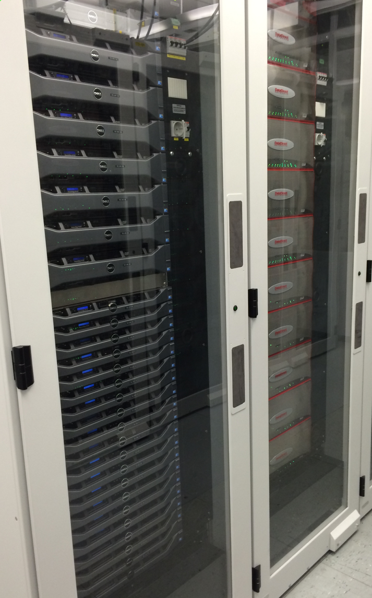

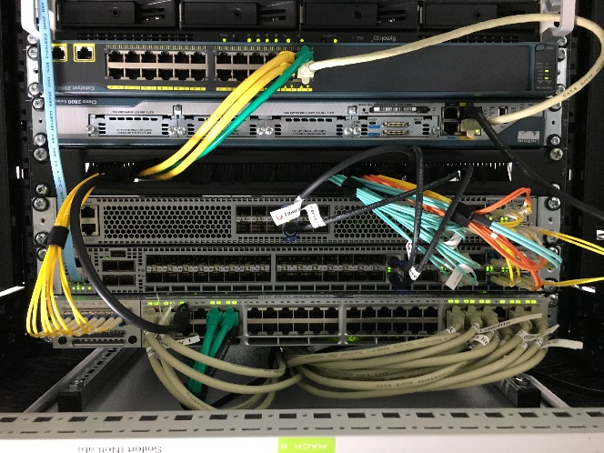

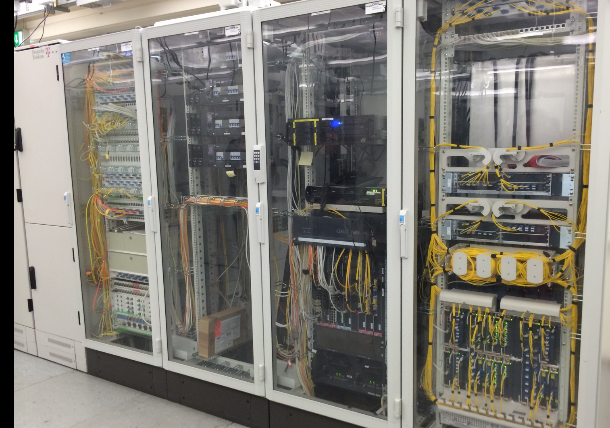

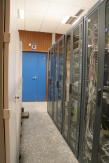

**Fazit:** Strom und Kühlung begrenzen ein RZ härter als die Netztechnik.

*[DE-CIX bei arte 11/2025](https://www.arte.tv/de/videos/120435-000-A/droht-der-digitale-blackout/)* (7:24)

---

## Data Center Evolution

- **Zentralisierung ↔ Dezentralisierung** – eine zyklische Entwicklung
- Treiber: Skaleneffekte, Energie, Latenz und Regulatorik
- Cloud bündelt Rechenleistung in wenigen Hyperscale-RZ, Edge bringt sie näher zum Nutzer

**Fazit:** Die Richtung ist nicht Modewechsel, sondern eine Kosten-Latenz-Abwägung.

*Quelle: Roscoe/Stüdi, Advanced Computer Networks, ETHZ*

---

## Beispiel: Google Data Center Oregon

- Warehouse-Scale: Serverhalle statt Hochsicherheitstrakt
- Kühlung mit Flusswasser und Freiluftkühlung
- [google.com/about/datacenters](https://www.google.com/about/datacenters/) – Touren und Fotos

**Fazit:** Nicht das einzelne RZ ist der Maßstab, sondern die Flotte gleichartiger RZ.

*Quelle: Abts/Felderman, A Guided Tour through Data-center Networking, 2012*

---

## Data Center News

- Heise 1/2023: Amazon investiert 35 Mrd. USD in die AWS-Region Frankfurt
- Heise 10/2023: Google eröffnet sein erstes deutsches Rechenzentrum
- Heise 9/2024: KI-Boom – Europas Rechenzentren halten mit der Nachfrage nicht Schritt
- Heise 10/2024: Rechenzentren sorgen für 250 Mrd. Euro zusätzliche Wertschöpfung

💡 [heise.de/thema/Rechenzentrum](https://www.heise.de/thema/Rechenzentrum) – laufende Meldungen zu Standorten, Strom und Ausbau

**Fazit:** RZ sind ein gesamt­wirtschaftliches Thema – Strom, Standort, Wertschöpfung.

---

## „Where the Internet Lives…"

- Smartphones, Apps und KI sind ohne RZ nicht denkbar – die Leistung entsteht im Hintergrund
- Große Nutzerzahlen, weltweite permanente Zugriffe, Replikation und Failover
- Data Center sind das Rückgrat aktueller IT-Dienste
- Zentralisierung oder Dezentralisierung ist eine Frage der Sichtweise (Nutzung/Betrieb)

💡 [submarinecablemap.com](https://www.submarinecablemap.com/) – Live-Karte der Seekabel: die physische Basis der weltweiten Verteilung (Wer war und was ist Grace Hopper?)

**Fazit:** Aus der Bündelung vieler Nutzer entstehen die harten Anforderungen: **Performance und Skalierung**.

---

## Klassische DC-Netzwerktopologie: Tree – 3 Layer

<!--
-->

- Ausgerichtet auf **north/south**-Traffic (WAN/Internet ↔ Server)
- Drei Ebenen: Core → Distribution/Aggregation → Access (EoR/ToR)
- Hierarchie begrenzt die Flexibilität: redundante Links nur für Failover, Spanning Tree blockiert parallele Pfade
- Large DC ≥ 10.000 Server: Amazon, Google, Microsoft, Meta, Hetzner
- Viele Applikationen, viele Clients, hohe Performance- und Skalierungsanforderungen
- **Die Topologie wird zum Bottleneck** – nicht die Linkrate

**Fazit:** Ein 3-Tier-Tree skaliert north/south – aber nicht east/west.

*Quelle: 7E §4.5 – Routing in Datacenters*

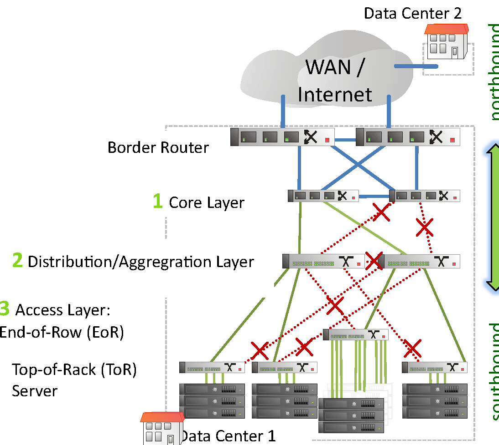

<!-- SR Marker -->
---

  ## Wie äußert sich dieses Bottleneck?

  Beispiel: Meta Data Center – „a typical year":

  - Internet-Traffic (north/south) ist weit geringer als der Intranet-Traffic (east/west)
  - Der Intranet-Traffic wächst exponentiell – woher kommt er?
  - Ursache: verteilte Anwendungen, Replikation, Shuffle und AllReduce im Cluster

  

  🧠 Wo verliert ein 3-Tier-Tree bei East-West-Traffic – und um welchen Faktor?

  

  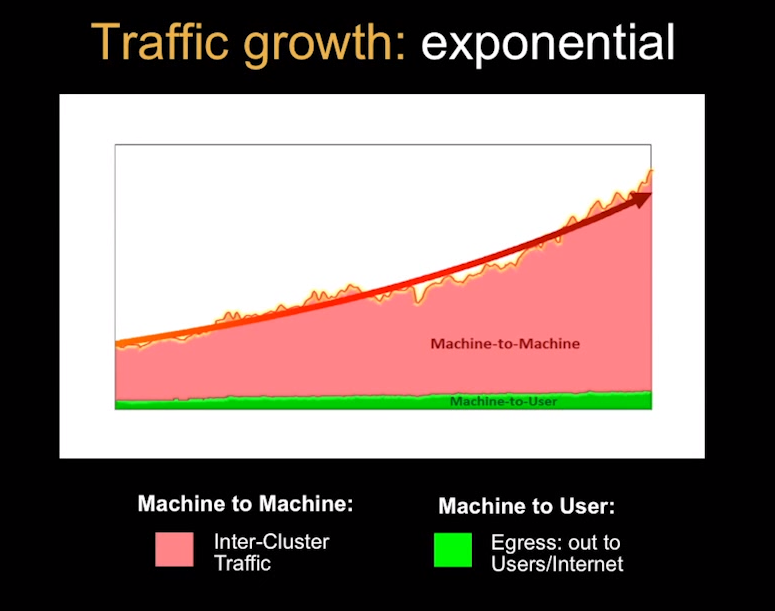

 

**Fazit:** Der Engpass liegt im RZ selbst – zwischen den Racks, nicht zum Internet.

*Quelle: Meta, „a typical year"; 7E §4.5*

---

## Aktuelle DC-Netzarchitektur: Leaf-Spine

- Lastverschiebung: hoher Durchsatz **zwischen** Racks (east/west) – Cloud, Microservices, KI
- **Leaf/Spine (Clos)**: jedes Leaf an jedes Spine, kleine und gleiche Hop-Anzahl
- Parallele Links mit **ECMP** statt Spanning Tree – alle Pfade werden genutzt
- Redundanz durch Pfadvielzahl; das Fabric wächst um einen Spine
- Fabrics laufen mit **BGP** (RFC 7938), sonst übernimmt ein Controller

💡 [7E §4.5 – Routing in Datacenters](https://7e.systemsapproach.org/routing.html#routing-5-routing-in-datacenters) – Fabric-Routing und ECMP

**Fazit:** Leaf-Spine ersetzt die Hierarchie durch Breite: Bandbreite horizontal statt vertikal.

*Quelle: 7E §4.5 – Routing in Datacenters; SDN-Buch Ch.7*

---

## Beispiel: GWDG Data Center Netz

- Fabric der GWDG (RZ für Uni Göttingen und Max-Planck-Institute)
- Leaf-Spine-Struktur – ähnlich der neuen Netzstruktur an der HS Fulda

**Fazit:** Dasselbe Grundmuster trägt auch ein universitäres Rechenzentrum/Campus-Netz.

*Quelle: GWDG 2/2020*

---

## Im Detail wird es schnell komplex …

- 60 Leaf-Switches à 48 Ports (25 Gbit/s zum Server, 100 Gbit/s zu den Spines)
- Damit maximal ~2880 Ports – für Server **und** ihre virtuellen Maschinen
- Herausforderung für Performance, Fehlertoleranz und Betrieb des Netzes
- Und das ist „nur" das Rechenzentrumsnetz an **einem** Standort

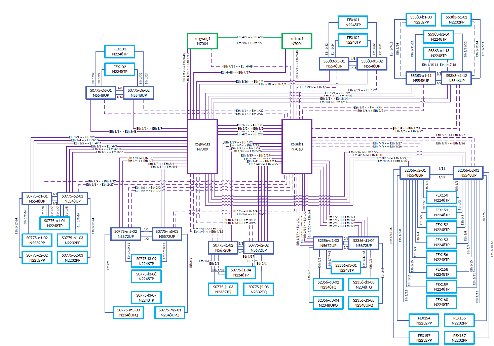

**Fazit:** Komplexität entsteht durch Nebenläufigkeit und Betrieb, nicht durch Switch-Zahlen.

*Quelle: GWDG, Stand 2/2020*

---

## Markt & Konsolidierung 2026

- **Konsolidierung:** Umsatz über 8 Mrd. USD/Quartal (3Q 2025) – Anteile gewinnen Accton, Celestica und NVIDIA, Arista führt den Gesamtmarkt
- Treiber ist das **AI-Back-end-Netz** (GPU-zu-GPU), nicht der Enterprise-Zugang
- Bis 2028: ungeeignete Switches für KI-Workloads verschwenden ≥ 30 % Rechenleistung (Gartner 3/2025)
- **SONiC:** bis 2027 Verdopplung auf 10 % der großen DC-Netze (> 250 Switches, Gartner 3/2025)

**Fazit:** KI-Traffic und offene Software sortieren den Markt neu – das Design bleibt Leaf-Spine.

*Quelle: Dell'Oro Group 16.12.2025; Gartner 3/2025*

---

## Oversubscription in DC-Netzen

**Problem**
- Switches mit hoher Portzahl sind teuer
- Deshalb Oversubscription nach oben: ToR z. B. 4:1 bis 20:1, EoR 4:1
- Günstiger, aber hohe Last auf den Uplinks → schlechte Bisektionsbandbreite

**Lösung: „Fat Tree"**
- Linkkapazitäten nehmen hierarchieaufwärts zu
- Volle Bisektionsbandbreite möglich (Subscription 1:1)
- Zusätzlich redundante Pfade

🧠 Warum ist Oversubscription eine Auslegungsentscheidung und kein Fehler?

**Fazit:** Wer Oversubscription nicht bewertet, dimensioniert am Bedarf vorbei.

---

## Einschub: Bisektionsbandbreite

> „Die Summe der Bandbreite der kleinsten Anzahl von Links, die entfernt werden müssen, um das Netz in zwei (etwa) gleich große Hälften zu teilen."

- Beispiel 10-GE-Links: Tabelbild - je nach Schnitt 10, 20 oder 40 Gbit/s
- Bestimmt, wie viel Verkehr zwischen zwei RZ-Hälften möglich ist (east/west)
- Zielgröße der Fabric-Auslegung: 1:1 zu den Serverports

**Fazit:** Bisektionsbandbreite ist die ehrliche Kennzahl für „non-blocking" – Portzahlen allein sagen nichts.

*Quelle: 7E §4.5*

---

<!-- _class: section-break -->

# 2.2 Data Center Fabric & Fehlertoleranz

---

## PortLand: Fat-Tree-Topologie

- Beispiel 16-Host-Netz: identische 4-Port-Switches (NetFPGA), 4 Hosts je Pod
- Volle Bandbreite im Pod: 4 Links von den Hosts, 4 Links innerhalb des Pod
- Volle Bandbreite zwischen allen Hosts: 16 Links Edge↔Aggregation und Aggregation↔Core
- Verallgemeinert: Fat Tree aus k-Port-Switches (k = 4 ⇒ 16 Hosts)
- Jeder Schnitt ist 1:1 – Bandbreite wächst mit der Hierarchie

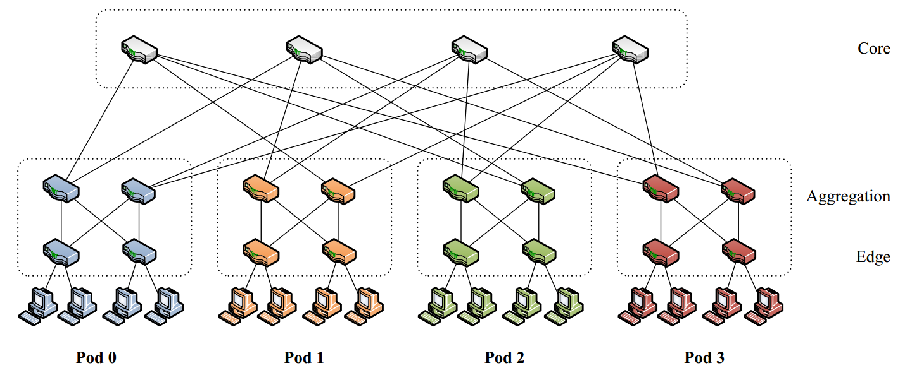

**Fazit:** Fat Tree liefert non-blocking Bandbreite aus billigen, identischen Switches.

*Mysore et al., PortLand, SIGCOMM 2009*

---

## Konzept von PortLand

- **Flaches Layer-2-Netz** auf Fat-Tree – bis ~100k Ports, Multi-Pathing
- **Host-IP:** fix, bleibt auch nach einer VM-Migration
- **Pseudo-MAC (PMAC):** kodiert die Position im Netz und wird für das Routing genutzt
  - PMAC = pod.position.port.vmid
- **Fabric Manager:** zentraler Lookup (IP → PMAC) und ersetzt ARP per Unicast

**Fazit:** PortLand ersetzt Broadcast-ARP durch zentrale Zuordnung – die Idee lebt in EVPN/Controller-Fabrics weiter.

*Mysore et al., PortLand, SIGCOMM 2009; 7E §9.4*

---

## VL2: A Scalable and Flexible Data Center Architecture

- Alternative zu PortLand – **serverzentriert**: Intelligenz in den Servern (Microsoft Research)
- Jeder Server hat zwei Adressen:
  - **AA** (Application Address) – lokationsunabhängig und stabil
  - **LA** (Location Address) – Position des ToR-Switch
- VL2-Agent auf dem Server ersetzt ARP; Pakete werden per IP-in-IP zum LA des Ziel-ToR getunnelt
- **Valiant Load Balancing:** ein zufälliger Core-Switch als Zwischenhop verteilt die Last

**Fazit:** VL2 trennt Namen von Ort – dasselbe Muster nutzen heutige VXLAN/EVPN-Fabrics.

*Greenberg et al., VL2, SIGCOMM 2009; 7E §9.4*

---

## Weitere DC-Netzarchitekturen: DCell und Jellyfish

**DCell** – serverzentrisch, rekursiv: Server sind Forwarding-Elemente (Guo et al., SIGCOMM 2008)

**Jellyfish** – Zufallsgraph der Switches, inkrementell erweiterbar (Singla et al., NSDI 2012)

- 💡 [Jellyfish, NSDI 2012](https://www.usenix.org/conference/nsdi12/technical-sessions/presentation/singla) – ~25 % mehr Server als Fat-Tree bei gleichem Switch-Budget
- 💡 [Überblick DC-Topologien (arXiv 2016)](https://arxiv.org/abs/1605.01777) · [MODRIC (arXiv 2025)](https://arxiv.org/abs/2503.12200)

🧠 Forschungsgedanke: Wann lohnt ein Zufallsgraph statt Clos – und warum wird er kaum produktiv gebaut?

**Fazit:** Alternative Topologien optimieren Kosten und Fehlertoleranz – gebaut wird fast immer Clos.

---

## Große Data Center Networks – die Landschaft

- **Google:** Jupiter – Clos aus handelsüblichen Switches, Fehlerbehebung zentral **und** lokal ([7E §4.5](https://7e.systemsapproach.org/routing.html#routing-5-routing-in-datacenters))
- **Microsoft:** VL2 (2009) als Ursprung serverzentrierter Fabrics
- **Meta:** Altoona-Fabric (2014) → F16 (2019) → KI-Cluster (2024)
- **Gemeinsam:** 2-Tier-Leaf-Spine, ECMP über mehrere Pfade, eigenes Monitoring

**Fazit:** Die Designs unterscheiden sich im Detail – das Grundmuster Leaf-Spine ist Industriestandard.

*Quelle: 7E §4.5 – Routing in Datacenters; SDN-Buch Ch.7*

---

## Meta: Altoona Data Center, Iowa

- Eines der ersten Meta-RZ mit eigenem Fabric-Design (Fabric-Paper 2014)
- Maßstab: Serverhalle mit Zehntausenden Servern, Kühlung im Warm-/Kaltgang

**Fazit:** Hyperscaler bauen RZ nicht als Einzelprojekt, sondern als wiederholbares Baukastensystem.

*Quelle: Meta/Facebook*

---

## Meta: Altoona Netztopologie

[engineering.fb.com – Introducing Data Center Fabric (2014)](https://engineering.fb.com/2014/11/14/data-center-engineering/introducing-data-center-fabric-the-next-generation-facebook-data-center-network/) · [YouTube: Data Center Fabric](https://www.youtube.com/watch?v=mLEawo6OzFM#t=170)

*„Many ways to picture it"*

*„Many paths between servers"*

*Altoona-Fabric*

**Fazit:** Ein flaches Clos-Fabric – je nach Zweck anders gezeichnet, aber immer dieselbe Topologie.

*Quelle: Meta/Facebook 2014*

---

## Meta: Fabric für das KI-Zeitalter

- **F16 (2019):** 4 × 400 G pro Rack statt 16 × 100 G – mehr Bandbreite, weniger Kabel
- **KI-Cluster (2024):** zwei Cluster mit je 24.576 H100-GPUs für Llama 3, RoCE bzw. Quantum2-InfiniBand
- Entscheidend sind topologiebewusstes Scheduling und Routing — nicht die Wahl des Transports allein

💡 [Meta Engineering 03/2024](https://engineering.fb.com/2024/03/12/data-center-engineering/building-metas-genai-infrastructure/) · [RDMA over Ethernet, SIGCOMM 2024](https://cs.stanford.edu/~keithw/sigcomm2024/sigcomm24-final246-acmpaginated.pdf)

*F16: Spine/ToR*

*F16-Fabric*

*4×400G vs. 16×100G*

**Fazit:** Das Fabric entscheidet über den Trainingsdurchsatz – RoCE und InfiniBand sind beide tragfähig.

*Quelle: Meta Engineering 03/2024*

---

## RZ HS-Fulda: Bauphase und Aufbau

- Gemeinsamer Serverraum von HS Fulda und Fachbereich AI – 9 Racks
- Anlieferung und Aufstellung der Racks, danach Aufbau des doppelten Bodens
- Stromtrassen mit getrennten Phasen und USV (A/B-Versorgung)
- Klimatisierung aus Gebäudeklima und Freiluftkühlung (Redundanz)
- Patchfelder bestückt, Verkabelung folgt

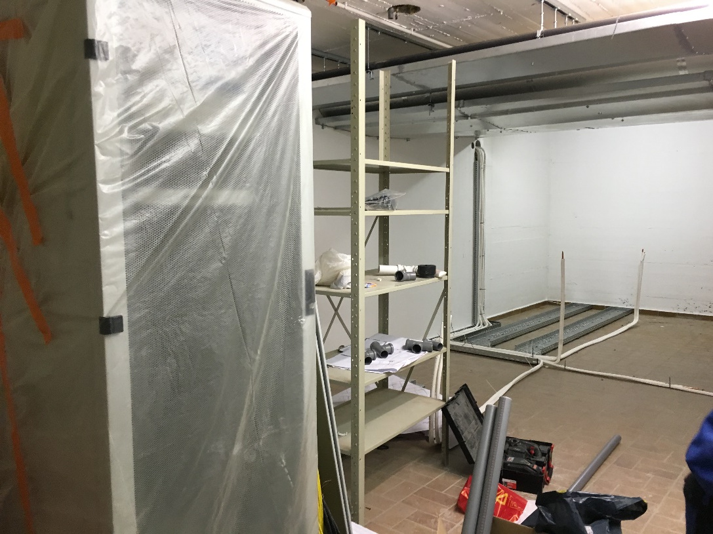

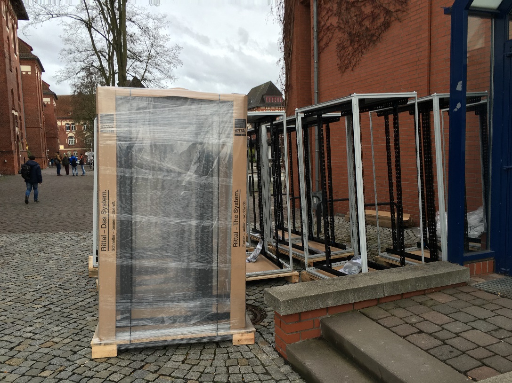

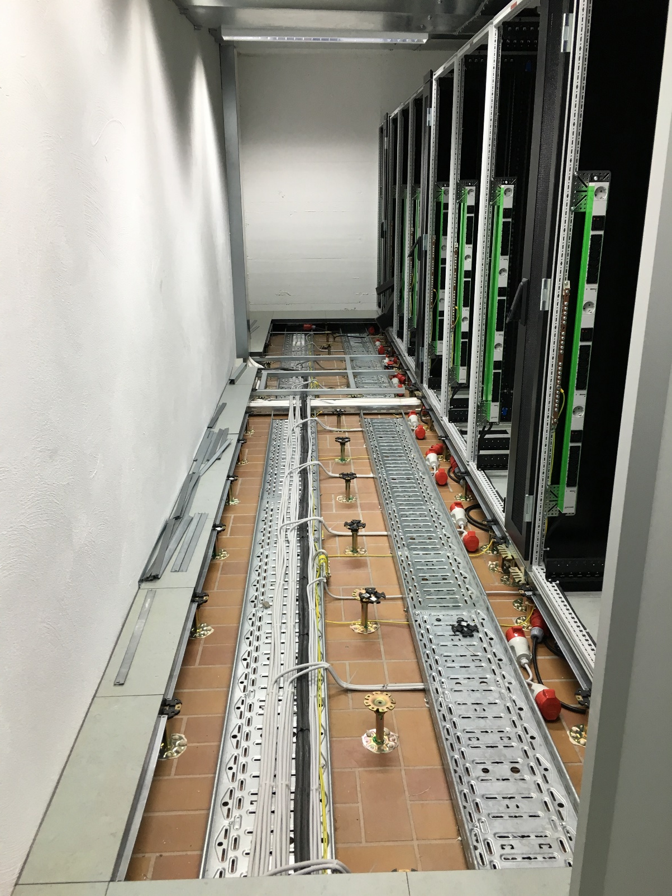

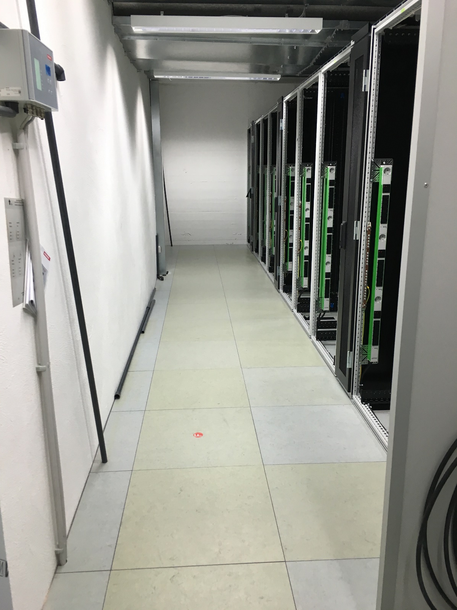

**Fazit:** Vor dem ersten Paket stehen Monate Bau: Boden, Strom, Kühlung – dann erst die Racks.

---

## RZ HS-Fulda: Verkabelung und Kühlung

- LWL-Patchpanel: Blau = Monomode-Faser, Beige = Multimode, LWL: gelb = Monomode, orange/türkis = Multimode, beige: Twisted-Pair-Kupferkabel, schwarz: DACs (Twinax als Ersatz für SFP + LWL)
- InRow-Kühler mit Trennung von Kalt- und Warmgang
- ToR-Switches im Bestand: Cisco z.B. 3850, Arista z.B. 7050S-52 und NVIDIA/Mellanox MSN2410
- Faser- und Stromführung über den doppelten Boden und die Kabeltrassen

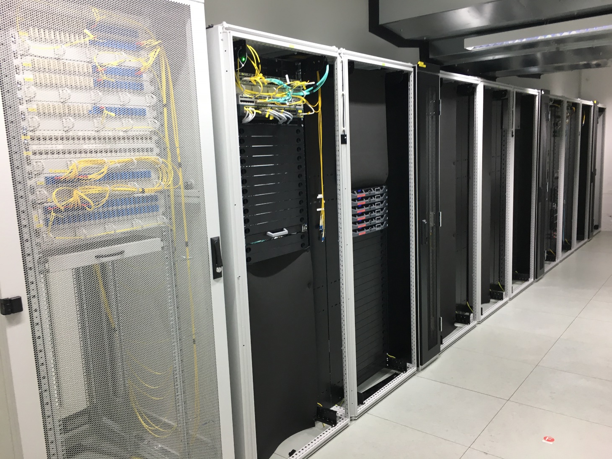

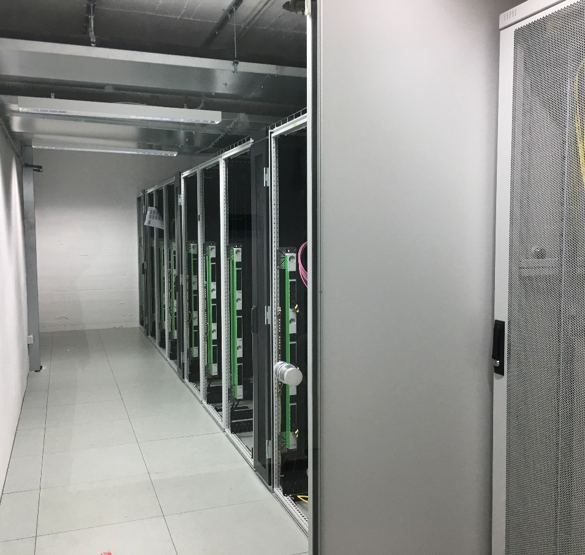

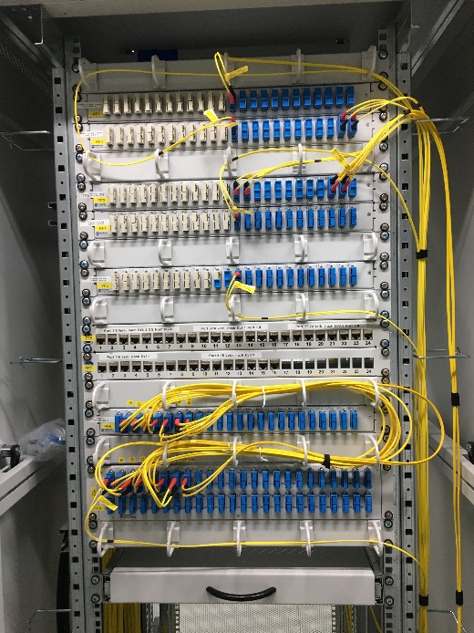

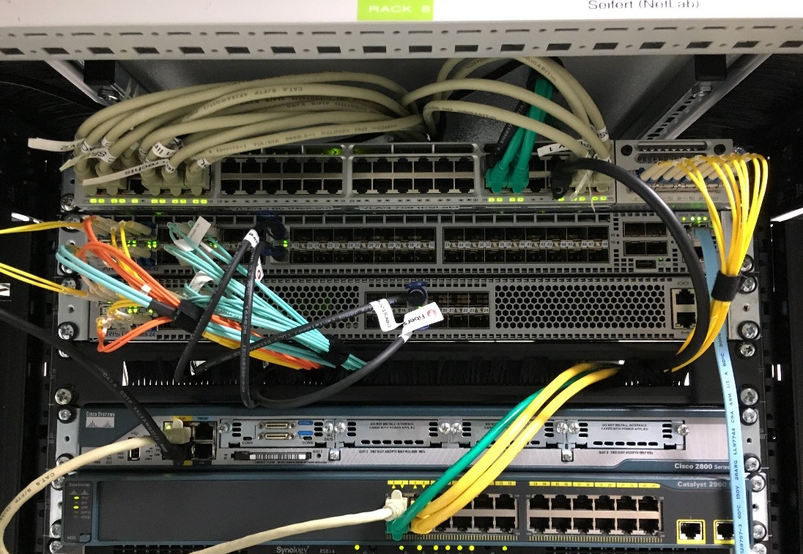

**Fazit:** Kühlung und Fasertypen sind die Auslegungsentscheidungen – Switch-Modelle wechseln.

---

## NetLab Rack: Server, Storage und Anbindung

- 4 Private-Cloud-Server (1 HE), FC-Storage, NAS und PDUs
- Netzwerk- und SAN-Anschlüsse der Server im Detail
- Anbindung an das RZ-Netz der HS Fulda

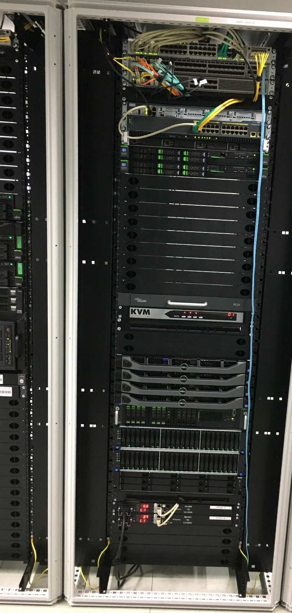

*vorne*

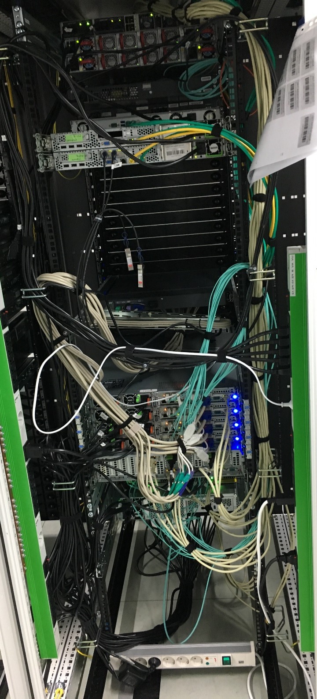

*hinten*

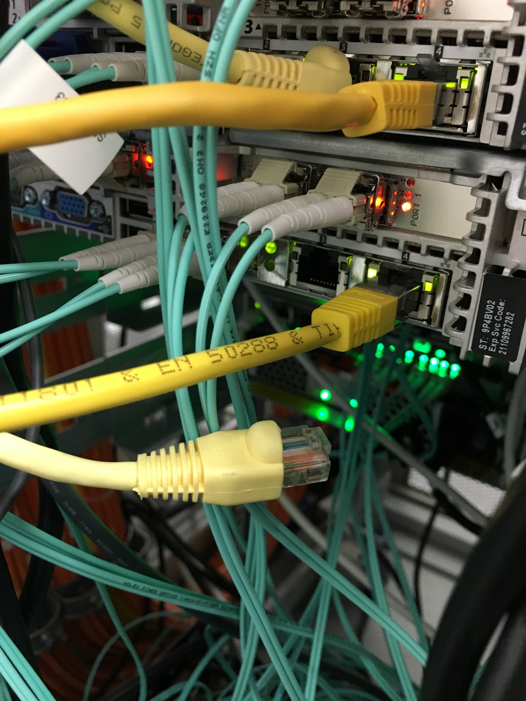

*Netzwerk-/SAN-Anschlüsse*

[Serverraum-Tour](https://mmnet.informatik.hs-fulda.de/serverraum-46/serverraum.html) → **Fazit:** Das NetLab-Rack macht die RZ-Theorie sichtbar: Server, Storage und Netz in 42 HE.

---

## Lernzielkontrolle ✍️🧠

- Warum wird Ost-West-Verkehr in DC-Netzen zum dominierenden Lastfall?
- Was bedeutet Oversubscription – und wann ist ein 1:1-Fabric wirtschaftlich?
- Wie berechnet man die Bisektionsbandbreite eines Fat-Tree aus k-Port-Switches?
- Wodurch unterscheiden sich north/south und east/west Traffic?
- Wie verteilen PortLand und VL2 die Intelligenz im Netz – und mit welcher Folge?
- Warum nutzt man ECMP statt Spanning Tree?
- Was leistet ein Fabric Manager, was ein Directory Server?
- Warum bleibt Clos/Fat-Tree trotz DCell und Jellyfish das Standarddesign?
- Welche Rolle spielt das Fabric für KI-Training?

---

## Praktische Übungen und Demo-Links 🛠️🧑‍🔬

1. **Bisektionsbandbreite rechnen:** Fat Tree aus k-Port-Switches (k = 4, 8, 48) – Ports, Links und Bisektion je Ebene
2. **Oversubscription bewerten:** 3-Tier-Tree mit 4:1-Uplinks – ab welcher Rack-zu-Rack-Last blockiert Ost-West-Verkehr?
3. **Fabric mit containerlab (Lab 2):** Leaf-Spine mit FRR deployen, ECMP prüfen, einen Spine abschalten
   - 💡 [containerlab](https://containerlab.dev/) – Topologien als YAML, `deploy` / `inspect` / `destroy`
4. **Link-Impairments:** 💡 [containerlab tools netem](https://containerlab.dev/cmd/tools/netem/set/) – Delay und Loss auf einem Uplink, Wirkung auf ECMP
5. **Durchsatz messen:** `iperf3` zwischen zwei Leafs, parallel `ip -s link` – Uplink-Auslastung prüfen

---

## Weiterführende Literatur & Links 💡

**Referenzliteratur**
- 💡 [7E §4.5 – Routing in Datacenters](https://7e.systemsapproach.org/routing.html#routing-5-routing-in-datacenters)
- 💡 [7E §9.4 – Virtual Networks for Datacenters](https://7e.systemsapproach.org/virtual.html#virt-4-virtual-networks-for-datacenters)
- 💡 [SDN-Buch Ch.3 – Basic Architecture](https://sdn.systemsapproach.org/arch.html)
- 💡 [SDN-Buch Ch.7 – Leaf-Spine Fabric](https://sdn.systemsapproach.org/trellis.html)

**Praxis & Betrieb**
- 💡 [Meta: Building GenAI Infrastructure (03/2024)](https://engineering.fb.com/2024/03/12/data-center-engineering/building-metas-genai-infrastructure/)
- 💡 [Meta: RDMA over Ethernet (SIGCOMM 2024)](https://cs.stanford.edu/~keithw/sigcomm2024/sigcomm24-final246-acmpaginated.pdf)
- 💡 [Dell'Oro: DC-Switch-Markt 3Q 2025](https://www.delloro.com/news/data-center-switch-market-doubled-in-three-years-hits-record-3q-2025/)
- 💡 [DE-CIX Frankfurt – Traffic-Statistik](https://www.de-cix.net/en/locations/frankfurt/statistics)

**Grundlagen & Forschung**
- 💡 [PortLand, SIGCOMM 2009](https://cseweb.ucsd.edu/~vahdat/papers/portland-sigcomm09.pdf)
- 💡 [VL2, SIGCOMM 2009](https://research.microsoft.com/pubs/80693/vl2-sigcomm09-final.pdf)
- 💡 [Jellyfish, NSDI 2012](https://www.usenix.org/conference/nsdi12/technical-sessions/presentation/singla)
- 💡 [MODRIC, arXiv 2025](https://arxiv.org/abs/2503.12200)

> 🧠 Welches Design würden Sie für 5.000 GPU-Server wählen – und welchen Preis zahlen Sie dafür?

---

<!-- _class: section-break -->

# Backup Slides

Nicht Teil der Vorlesung – Selbststudium und Klausurvertiefung

---

## Skalierbares Ethernet in Data Centern (1/2)

**Ethernet ist primäre Netztechnologie in Data Centern**

- Hohe Bandbreite zu vergleichsweise geringen Kosten
- Self-configuration (Spanning Tree, Flooding & Filtering, …)
- Geringe Komplexität im Vergleich zu multiplen IP-Subnetzen
- Leichte Migration von virtuellen Maschinen (VM) im Vergleich zu IP (keine Adressänderung)

**Nachteile von Ethernet**

- Klassisches Spanning Tree Protokoll verhindert Nutzung mehrerer Pfade
- Flooding & Filtering bzw. Erlernen der Forwarding-Tabelle im Switch verschwendet Bandbreite im Gesamtnetz
- Größe der Forwarding-Tabellen in Switches ist begrenzt, zusätzlich Timeout für Einträge (Mobilität von Hosts)

*nach Roscoe/Stüdi, Advanced Computer Networks, ETHZ, 2013*

---

## Skalierbares Ethernet in Data Centern (2/2)

- Speicher für Forwarding-Tabellen (TCAM) ist teuer
  - bei flacher Struktur viele Einträge, große Speicher nötig
- Hierarchische Lösung vgl. IP-Routing günstiger, aber für DC unflexibel

| Technologie | Plug-and-Play | Skalierbarkeit | TCAM Kosten | VM Migration |
|---|---|---|---|---|
| Layer 2 Switch | + | − | − | + |
| Layer 3 Router | − | ~ | + | − |

**Layer 2**
- Plug-and-Play durch Spanning-Tree, Link Layer Discovery (LLDP), …
- Skalierbarkeitsprobleme: ARP, O(n) Routing State, Spanning Tree, …
- VM Migration: VM kann IP beibehalten

**Layer 3**
- VM Migration: Wechsel des Subnetzes und IP-Adresse, unterbricht TCP
- Kein Plug-and-Play: Subnetzkonfiguration, DHCP, …
- Bessere Skalierbarkeit durch hierarchisches Routing

---

## PortLand – Auto Configuration

- Autokonfiguration der PMACs in Switches
- **Location Discovery Message (LDM)** zwischen benachbarten Switches, kein Broadcast!
- Switch lernt: Tree Level, Pod Number, Position Number
- Registrierung der erzeugten PMACs im Fabric Manager
- Z. B. IP: `10.5.1.2`, PMAC: `00:00:1:2:00:01` (pod.position.port.vmid)
  - **pod** (16 bits): reflects pod number of edge switch
  - **position** (8 bits): Position in Pod
  - **port** (8 bits): Switch-lokale Sicht auf die Portnummer, an der der Host angeschlossen ist
  - **vmid** (16 bits): zum Multiplexen mehrerer virtueller Maschinen oder Hosts

*Mysore, R. N. et al., PortLand, SIGCOMM 2009*

---

## PortLand – Proxy ARP Routing

- Edge Switch fängt ARP ab, kontaktiert Fabric Manager, verwendet OpenFlow
- ARP Reply enthält PMAC, Routing basierend auf PMAC (Host Location)
- Routing an Aggregation Switch im gleichen Pod, sonst über Core Switch
- Load Balancing (ECMP) anhand PMAC: Hash über Flow definiert Pfad/Port

*Mysore, R. N. et al., PortLand, SIGCOMM 2009*

---

## VL2 (Virtual Layer 2) Beispiel

- Sender S sendet an D: mittels IP-in-IP-Tunnel über zufällig gewählten Intermediate Switch
- AAs aus 20/8 und LAs aus 10/8, H(ft) = Hash über „Five Tuple"
- Jede AA hat assoziierte LA (LA von „ToR"), Mapping im VL2 Directory
- Routing über Tunnel an LA von Destination Switch, ToR nutzt zufälligen Intermediate Switch → Load Balancing bzw. ECMP

*Greenberg, A. et al., VL2, SIGCOMM 2009*

