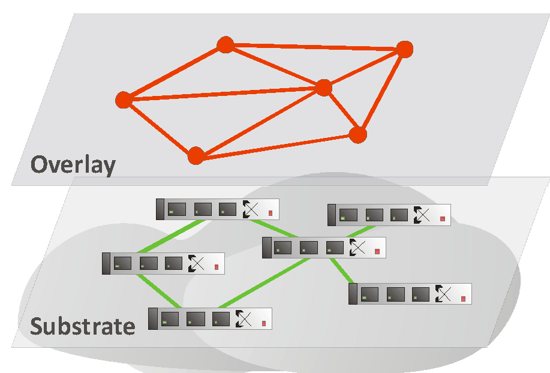
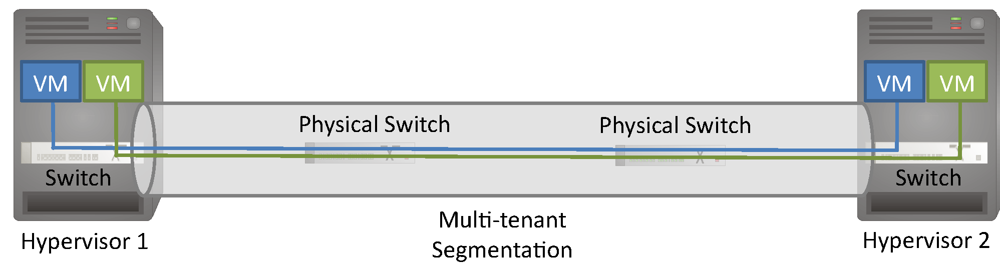
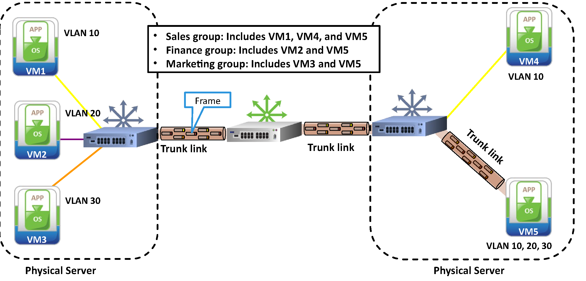
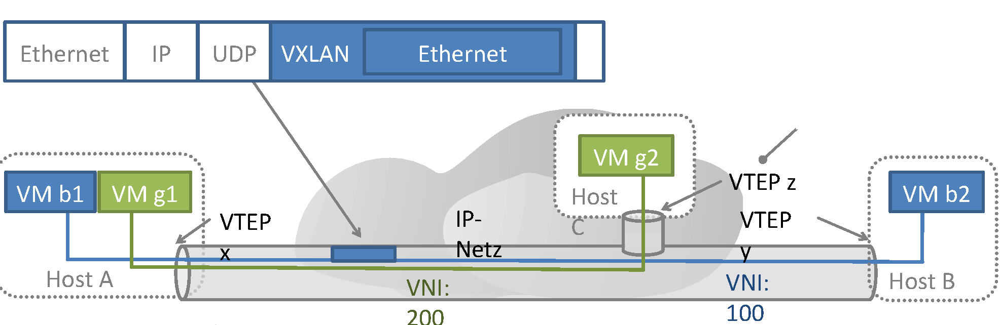

<!-- _class: title -->

# Advanced Computer Networks

## Kapitel 3 · Netzvirtualisierung & Overlays

Wintersemester 2026/2027
Master AI – Hochschule Fulda
Sebastian Rieger · MMNet

---

## Kapitelübersicht

**3.1 Motivation – warum virtuelle Netze?**
- Mandantentrennung · Skalierung · Beweglichkeit von Endpunkten · Virtualisierung vs. Slicing

**3.2 VLANs – getrennte Broadcast-Domänen**
- 802.1Q-Tag (12 Bit VID) · Access- und Trunk-Ports · Konfiguration · Grenzen

**3.3 Overlays – VXLAN und EVPN**
- Kapselung · VNI und VTEP · Flood & Filter vs. EVPN · Abgrenzung zum VLAN

**3.4 VPN und Segmentierung**
- Tunneling und Verschlüsselung · Zero Trust · Microsegmentation

---

## Lernziele

Nach diesem Kapitel sollten Sie wissen…

- warum virtuelle Netze **trennen**, **skalieren** und **Endpunkte beweglich** machen
- was **Netz-Virtualisierung** von **Network Slicing** unterscheidet
- wie **VLANs** Broadcast-Domänen trennen und was das **802.1Q-Tag** tut
- warum VLANs an Grenzen stoßen und wie **VXLAN** (RFC 7348) ein Overlay legt
- welche Rolle **VNI, VTEP, Flood & Filter und EVPN** spielen
- wie **VPNs** und **Microsegmentation** Netze absichern

> **Referenzliteratur:** *Computer Networks: A Systems Approach*, 7E, Kap. 9 ([7e.systemsapproach.org](https://7e.systemsapproach.org/virtual.html))

---

<!-- _class: section-break -->

# 3.1 Motivation – warum virtuelle Netze?

Mandantentrennung · Skalierung · Beweglichkeit von Endpunkten · Virtualisierung vs. Slicing

---

## Warum virtuelle Netze?

- **Mandantentrennung:** viele Kunden teilen dieselbe Infrastruktur — und bleiben isoliert
- **Skalierung:** logische Netze entstehen in Software, unabhängig von Rack und Kabelweg
- **Beweglichkeit:** VMs und Container wandern — Adressen und Policies bleiben
- **Betrieb:** die Netzkonfiguration war der „long pole“ vor dem Start einer Workload



**Fazit:** Virtualisierung entkoppelt das logische Netz von der physischen Topologie.

*7E §9.1 – Design Issues*

---

## Virtualisierung ≠ Slicing

<div class="columns">
<div>

**Netz-Virtualisierung**
- mehrere **eigene Netz-Instanzen** auf gemeinsamer Infrastruktur
- jede mit eigener Topologie, Adressierung und Policy
- Beispiel: Tenant-Netz in der Cloud

</div>
<div>

**Network Slicing**
- **Zuteilung von Ressourcen** an einen Teil des Verkehrs
- Priorisierung und Scheduling per Packet Scheduler
- Beispiel: 5G-Slice mit garantierten Raten

</div>
</div>

**Fazit:** Slicing verteilt Ressourcen — Virtualisierung schafft getrennte Netze.

*7E §9.1 – Design Issues*

---

<!-- _class: section-break -->

# 3.2 VLANs – getrennte Broadcast-Domänen

Konzept · 802.1Q-Tag · Access- und Trunk-Ports · Konfiguration · Grenzen

---

## VLANs: getrennte Broadcast-Domänen

- Eine **logische** Layer-2-Topologie oberhalb des physischen LANs — gleiche Kabel, andere Netze
- Jedes VLAN ist eine **eigene Broadcast-Domäne**: Broadcasts bleiben im VLAN
- Nutzen: Gruppierung nach Organisation oder Anwendung — z. B. Vertrieb über mehrere Gebäude
- Nutzen: mehr Effizienz und Sicherheit bei voller Layer-2-Transparenz
- Folge: pro VLAN ein IP-Subnetz; zwischen VLANs vermittelt ein Router (**Layer 3**)



**Fazit:** VLANs trennen Netze, ohne Kabel zu ziehen — die logische Topologie wird Konfiguration.

*7E §9.2 – Virtual LANs*

---

## Das 802.1Q-Tag: 12 Bit VID

- Ein getaggtes Frame trägt **32 Bit** zusätzlich zwischen Quelladresse und Type-Feld
  - 16 Bit EtherType `0x8100` — Kompatibilität: „dieses Frame hat ein Tag“
  - 4 Bit Priorität (PCP) und 1 Bit DEI → QoS-Klassen
  - **12 Bit VID** → 2¹² = **4096** virtuelle Netze
- Der Eintrittspunkt bestimmt das VLAN: ein ungetaggtes Frame gehört zum VLAN seines **Access-Ports**

**Fazit:** Ein Tag im Header entscheidet, zu welchem virtuellen Netz ein Frame gehört.

*7E §9.2 – Virtual LANs* · *IEEE 802.1Q*

---

## Access- und Trunk-Ports

<div class="columns">
<div>

- **Access-Port:** gehört zu genau **einem** VLAN, Frames verlassen ihn ungetaggt
  - Endgeräte, Server-NICs, virtuelle Switches
- **Trunk-Port:** trägt mehrere VLANs **getaggt** zum nächsten Switch
  - Uplinks, Switch-zu-Switch-Strecken, Hypervisor



</div>
<div>

```bash
interface GigabitEthernet0/1
 switchport mode access
 switchport access vlan 10

interface GigabitEthernet0/24
 switchport mode trunk
 switchport trunk allowed vlan 10,20,30
```

</div>
</div>

**Fazit:** Access-Ports geben Frames ihr VLAN — Trunk-Ports tragen viele VLANs dazwischen.

*7E §9.2 – Virtual LANs* · *(Grafik: EMC AA, Cloud Infrastructure and Services Course)*

---

## Grenzen von VLANs

| Grenze | Konsequenz |
|---|---|
| **12 Bit VID → 4096 Netze** | zu wenig für mandantenfähige Clouds |
| **manuelle Konfiguration** pro Switch und Port | VM-Migration und Self-Service kaum abbildbar |
| **flaches Layer 2**, Spanning Tree | begrenzte Größe, Umwege, im WAN kaum nutzbar |
| **kein Mobility-Konzept** | Adressen hängen an der physischen L2-Domäne |

<div class="food-for-thought">

🧠 Wann reicht ein VLAN — und ab wann braucht es ein Overlay wie VXLAN?

</div>

**Fazit:** VLANs skalieren nicht mit der Cloud: zu wenige IDs, zu viel Handarbeit, zu flaches Netz.

*7E §9.1 und §9.2*

---

<!-- _class: section-break -->

# 3.3 Overlays – VXLAN und EVPN

Kapselung · VNI und VTEP · Flood & Filter vs. EVPN · Abgrenzung zum VLAN

---

## VXLAN: Ethernet über IP kapseln



- **Kapselung:** äußeres Ethernet → IP → UDP → VXLAN → inneres Ethernet
- **VNI:** 24 Bit im VXLAN-Header → **16 Mio.** Segmente statt 4096 VLANs
- **VTEP:** Tunnel-Endpunkt — kapselt am Host oder vSwitch ein und am Ziel aus
- Overlay und Underlay haben **getrennte Adressräume**: Layer 3 im Underlay ist erlaubt

**Fazit:** VXLAN trennt die Adressierung des virtuellen Netzes von der des physischen.

💡 [RFC 7348](https://www.rfc-editor.org/rfc/rfc7348) – VXLAN: Layer 2 über Layer 3, UDP-Port 4789

*7E §9.4 – Virtual Networks for Datacenters*

---

## VXLAN-Control-Plane: Flood & Filter vs. EVPN

<div class="columns">
<div>

**Flood & Filter (Data Plane)**
- unbekannte Ziele werden geflutet — Multicast oder Unicast-Tunnel je VTEP
- gelernt wird aus dem Verkehr: viel Broadcast, wenig Kontrolle

</div>
<div>

**EVPN (Control Plane)**
- **BGP** verteilt MAC- und IP-Routen statt zu fluten
- kein Unknown-Unicast-Flooding, kürzere Wege
- Standardweg in Data-Center-Fabrics

</div>
</div>

**Fazit:** VXLAN kapselt nur — die Kontrolle kommt aus der Control Plane, heute meist EVPN.

💡 [7E §9.4](https://7e.systemsapproach.org/virtual.html#virt-4-virtual-networks-for-datacenters) – Overlay, Virtual Switch und Controller-API

*RFC 7348 · RFC 7432 (BGP EVPN)*

---

## VXLAN vs. VLAN — und was danach kam

| | VLAN (802.1Q) | VXLAN |
|---|---|---|
| Kennung | 12 Bit VID → 4096 | 24 Bit VNI → 16 Mio. |
| Unterlage | physisches L2 | IP-Underlay mit L3 |
| Endpunkte | Switch-Ports | VTEPs an Hosts/vSwitches |
| Mobilität | Adresse hängt am Subnetz | Endpunkt wandert, Adresse bleibt |

- **Nachfolger:** GENEVE (RFC 8926) — gleiche Idee, erweiterbarer Header
- **Container:** CNI-Overlays wie Cilium nutzen zusätzlich eBPF

**Fazit:** VXLAN löst die Grenzen des VLAN — auf Kosten einer Control Plane.

💡 [Cilium](https://cilium.io/) – eBPF-CNI mit Overlay und Policy

*7E §9.4 · SDN-Buch Kap. 8*

---

<!-- _class: section-break -->

# 3.4 VPN und Segmentierung

Tunneling · verschlüsselte Tunnel · Site-to-Site, Remote Access, Mesh · Microsegmentation

---

## Tunneling: private Netze über fremde Netze

- **Tunnel:** ein Paket wird Nutzlast eines neuen Pakets — logisch eine Direktverbindung
  - Endpunkte sind Router, VTEPs oder Endgeräte; der Weg dazwischen ist beliebig
- **Verschlüsselung** sichert die Vertraulichkeit: **WireGuard** (kernel-nah, UDP), **OpenVPN** (TLS), **IPsec** (Router-Hardware)
- Klassisch ohne IP: **MPLS** oder Frame Relay — heute meist Overlay über IP

**Fazit:** Ein Tunnel macht aus dem fremden Internet eine private Punkt-zu-Punkt-Strecke.

*7E §9.3 – Virtual Private Networks (VPNs)*

---

## VPN-Topologien: vom Standort zum Zero Trust

<div class="columns3">
<div class="card">

**Site-to-Site**
Tunnel zwischen Routern oder Gateways — verbindet Niederlassungen über das Internet, klassisch mit IPsec

</div>
<div class="card">

**Remote Access**
Ein einzelnes Endgerät wird Teilnehmer — der „Home-Office-Tunnel“, klassisch mit OpenVPN

</div>
<div class="card">

**Mesh / Zero Trust**
Viele Peers direkt, oft per WireGuard — kein vertrautes LAN: jeder Zugriff wird pro Verbindung geprüft (ZTNA)

</div>
</div>

**Fazit:** Der Trend geht vom Standort-Tunnel zur Verbindungs-Policy: Zero Trust statt vertrauter Zone.

*7E §9.3*

---

## Microsegmentation statt Firewall-Zonen

- Klassisch: wenige **Zonen** mit Firewall-Appliances — viele Maschinen teilen eine Zone
- Mit Netz-Virtualisierung entstehen **Microsegments** in Software: Policy je VM oder Container
- **Distributed Firewalling** im Hypervisor oder vSwitch: die Regel wirkt bei der Workload
- Beispiel 3-Tier-App: Web-Tier erreicht App-Tier auf definierten Ports — Web-Tier nicht sich selbst
- Vorher lag vieles in einem Segment: ein Angriff konnte sich ausbreiten

**Fazit:** Virtualisierung erlaubt feine Isolation pro Workload — die grobe Zone verliert ihre Rolle.

*7E §9.5 – Microsegmentation · SDN-Buch §8.5*

---

## Lernzielkontrolle ✍️🧠

- Warum brauchen Clouds virtuelle Netze — nennen Sie drei Treiber.
- Was unterscheidet Netz-Virtualisierung von Network Slicing?
- Was steht im 802.1Q-Tag — und warum sind 12 Bit schnell zu wenig?
- Wann reicht ein VLAN, wann braucht es VXLAN? Was leisten VNI und VTEP?
- Wie unterscheiden sich Flood & Filter und EVPN als Control Plane?
- Was ändern Zero Trust und Microsegmentation an klassischer Segmentierung?

---

## Praktische Übungen und Demo-Links 🛠️🧑‍🔬

1. **VLANs im containerlab (Lab L1, FRR):** zwei VLANs auf Linux-Bridges, Trunk zum zweiten Switch — mit `tcpdump -e` prüfen, ob das Tag sichtbar ist
2. **VXLAN-Tunnel aufbauen:** `ip link add vxlan0 type vxlan id 100 remote <VTEP> dstport 4789` auf zwei Hosts, dann Ping über das Overlay und Kapselung in Wireshark ansehen
3. **Overlay mit und ohne Control Plane:** gleiches Szenario einmal per Flood & Filter, einmal mit statischen FDB-Einträgen
4. **Microsegmentation:** Netzwerk-Policies mit Cilium beobachten — was passiert ohne Policy, was mit?
5. **VPN-Analyse:** WireGuard-Tunnel zwischen zwei Containern, Mitschnitt auf dem Underlay
   - 💡 [containerlab](https://containerlab.dev/) · 💡 [Wireshark](https://www.wireshark.org/) · 💡 [Cilium Demo](https://docs.cilium.io/en/stable/gettingstarted/demo/)

---

## Weiterführende Literatur & Links 💡

<div class="columns3">
<div class="card">

**Referenzliteratur**
- 💡 [7E §9.2 – Virtual LANs](https://7e.systemsapproach.org/virtual.html#virt-2-virtual-lans-vlans)
- 💡 [7E §9.3 – VPNs](https://7e.systemsapproach.org/virtual.html#virt-3-virtual-private-networks-vpns)
- 💡 [7E §9.4 – Virtual Networks for DCs](https://7e.systemsapproach.org/virtual.html#virt-4-virtual-networks-for-datacenters)
- 💡 [7E §9.5 – Microsegmentation](https://7e.systemsapproach.org/virtual.html#virt-5-microsegmentation)

</div>
<div class="card">

**Standards und Vertiefung**
- 💡 [RFC 7348 – VXLAN](https://www.rfc-editor.org/rfc/rfc7348)
- 💡 [RFC 7432 – BGP EVPN](https://www.rfc-editor.org/rfc/rfc7432)
- 💡 [RFC 8926 – Geneve](https://www.rfc-editor.org/rfc/rfc8926)
- 💡 [SDN-Buch Kap. 8](https://sdn.systemsapproach.org/netvirt.html) (CC BY-NC-ND)

</div>
<div class="card">

**Praxis und Werkzeuge**
- 💡 [Cilium](https://cilium.io/) – eBPF-CNI mit Overlay und Policy
- 💡 [WireGuard](https://www.wireguard.com/) – moderner VPN-Tunnel
- 💡 [containerlab](https://containerlab.dev/) – Netze im Praktikum
- 💡 [Kapitel 4 – SDN](4-AdvCompNet-SDN.md) – wie Control Planes das steuern

</div>
</div>

> 🧠 Welche dieser Techniken würden Sie im eigenen Rechenzentrum zuerst einsetzen — und warum?
