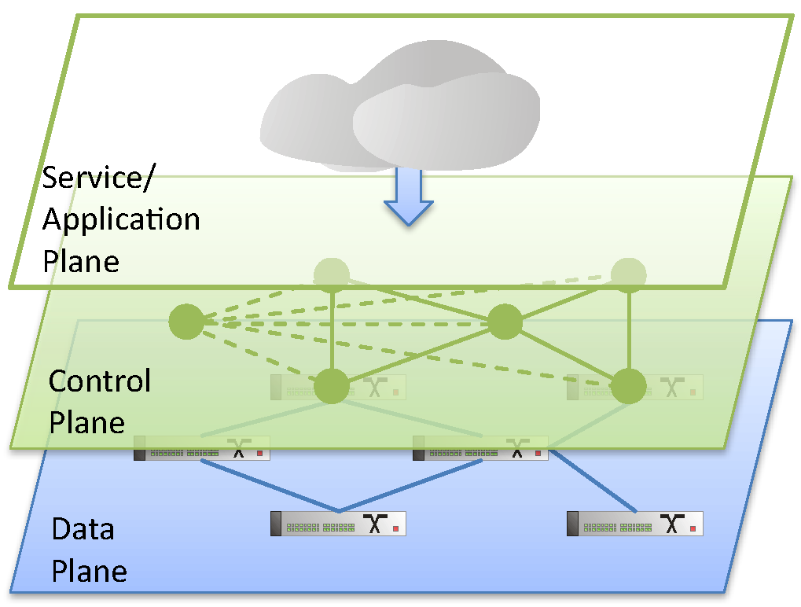
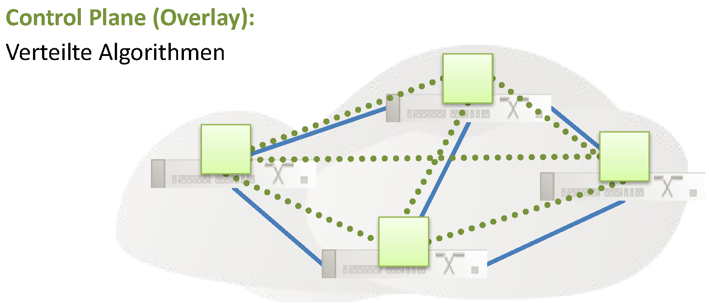
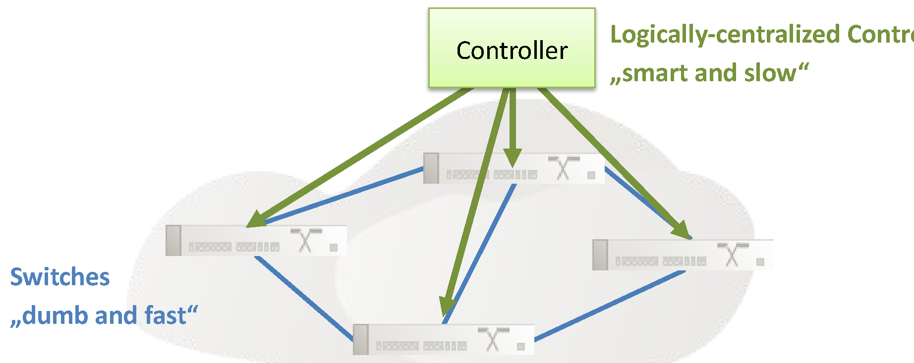
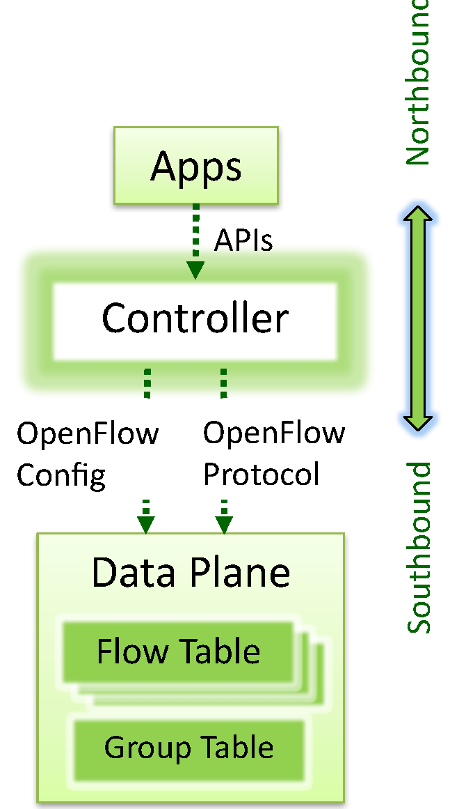
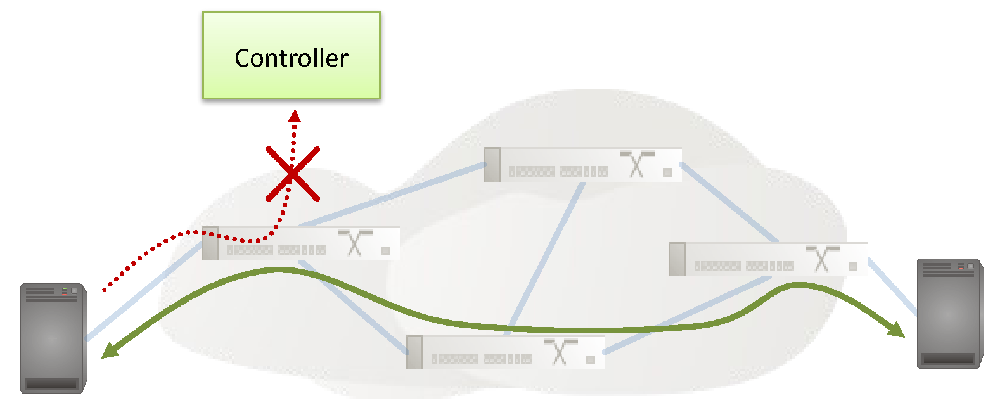
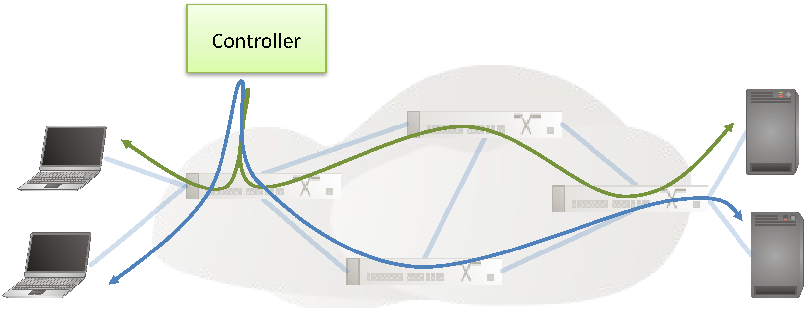
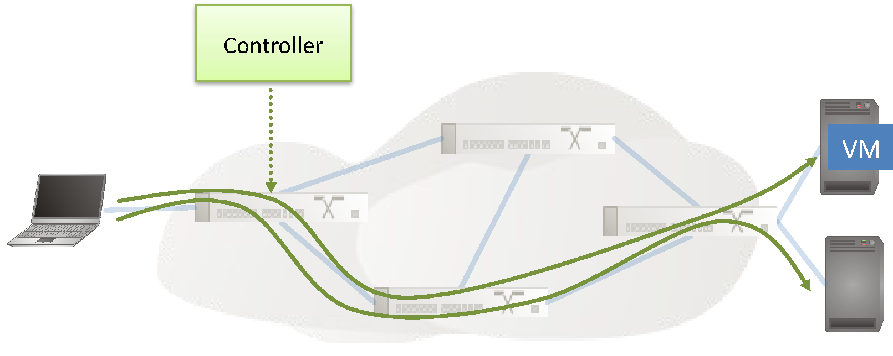
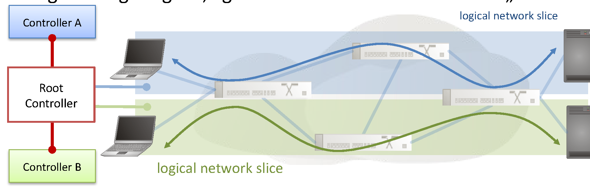
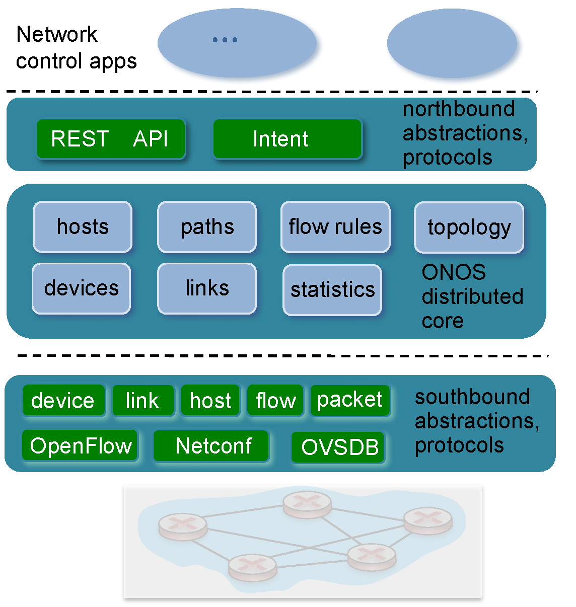
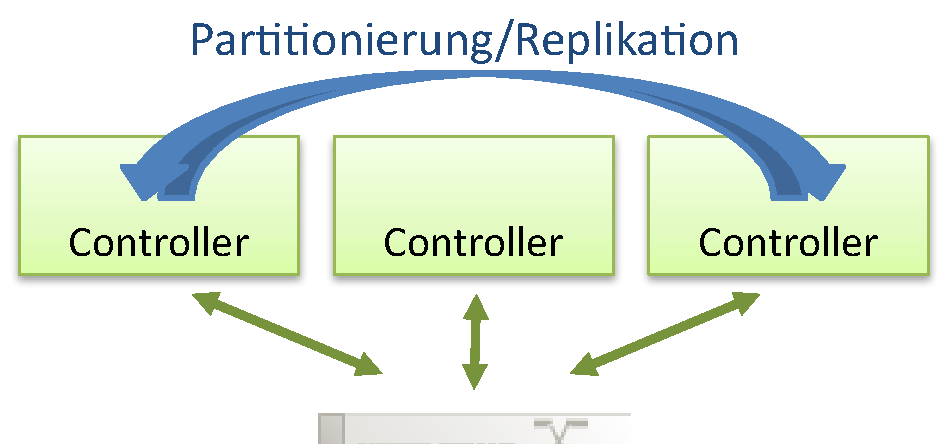

<!-- _class: title -->

# Advanced Computer Networks

## Kapitel 4 · Software-defined Networking (SDN)

Wintersemester 2026/2027
Master AI – Hochschule Fulda
Sebastian Rieger · MMNet

---

## Kapitelübersicht

**4.1 Vom verteilten Netz zur zentralen Control Plane**
- Data, Control und Management Plane · SDN als Paradigma · Traffic Engineering

**4.2 OpenFlow – was es war und was davon blieb**
- Flow Tables und Controller · Beispiele · Grenzen des Protokolls

**4.3 Control Plane: Controller, Gremien, Google**
- ONOS und die Controller-Landschaft · ONF und die Linux Foundation · B4, Jupiter, Orion · Verifikation

**4.4 Betrieb: Telemetrie und Feature Velocity**
- Herausforderungen im Betrieb · Metrics, Logs, Traces · Feature Velocity

---

## Lernziele

Nach diesem Kapitel sollten Sie wissen…

- was **Data, Control und Management Plane** unterscheiden — und was SDN ändert
- warum **SDN ein Paradigma** ist und nicht ein Protokoll
- was **OpenFlow** war und was davon geblieben ist
- welche **Controller und Gremien** das Feld prägen — ONOS, OpenDaylight, Linux Foundation
- wie **Google** B4, Jupiter und Orion betreibt und warum Verifikation wichtig ist
- was **Telemetrie, Observability und Feature Velocity** im Betrieb bedeuten

> **Referenzliteratur:** SDN-Buch Kap. 1–3 · 7E Kap. 10 ([sdn.systemsapproach.org](https://sdn.systemsapproach.org/))

---

<!-- _class: section-break -->

# 4.1 Vom verteilten Netz zur zentralen Control Plane

Data, Control und Management Plane · SDN als Paradigma · Traffic Engineering

---

## Data, Control und Management Plane

| Ebene | Aufgabe | Beispiele | Zeitskala |
|---|---|---|---|
| **Data Plane** | weiterleiten, filtern, puffern, markieren | Forwarding-Tabelle, TCAM, ASIC | ns bis µs |
| **Control Plane** | Topologie, Routen, Tabellen füllen | Spanning Tree, OSPF, BGP | ms bis s |
| **Management Plane** | konfigurieren, überwachen, Fehler suchen | SNMP, SSH, Controller-API | Minuten bis Tage |

**Fazit:** Drei Ebenen, drei Zeitskalen — der Engpass der klassischen Architektur sitzt in der Mitte.

*SDN-Buch Kap. 1 · 7E §10.1* · *(Grafik angelehnt an J. Rexford, Princeton)*

---

## Traditionelle Netze: verteilte Control Plane

- Jeder Router und Switch entscheidet **selbst** über Routen und Forwarding
- Kein Gerät kennt das Netz als Ganzes, nur das, was seine Nachbarn ihm erzählen
- Konfiguriert wird **pro Gerät** — Fehlkonfiguration ist die häufigste Ausfallursache
- Neue Dienste brauchen neue Protokolle und Software auf **allen** Geräten
- Monitoring sieht nur, was ein einzelnes Gerät meldet

**Fazit:** Verteiltes Denken skaliert gut — aber netzwerkweite Aussagen sind so kaum möglich.

*SDN-Buch Kap. 1 · 7E §10.1*

---

## SDN: Intelligenz wandert in den Controller

- **Trennung** von Control Plane und Data Plane: Switches forwarden, der Controller entscheidet
- **Logisch zentraler** Controller mit globaler Sicht auf Topologie, Last und Policies
  - „smart and slow“ steuert „dumb and fast“
- **Programmierbarkeit:** Anwendungen beschreiben, *was* das Netz tun soll
- Southbound-Schnittstellen: OpenFlow, OVSDB, OpFlex, P4Runtime, gNMI

SDN ist ein **Paradigma** — logisch zentralisierte, programmierbare Control Plane. OpenFlow war nur der erste Versuch.

💡 [SDN-Buch §1.3 – Definition](https://sdn.systemsapproach.org/intro.html#sdn-a-definition)

---

## Warum eine logisch zentrale Control Plane?

- **Einfacheres Management:** Fehlkonfigurationen vermeiden, Verkehr flexibler führen
- **Tabellenbasiertes Forwarding** macht Router „programmierbar“
  - zentral berechnen und verteilen ist einfacher als in jedem Router verteilt rechnen
- **Offene, herstellerunabhängige** Control-Plane-Implementierungen
- „Logisch“ heißt nicht physisch: der Controller selbst wird **repliziert und skaliert**

**Fazit:** Der Gewinn liegt im *logisch* zentralen Blick bei verteilter Ausführung.

*Kurose/Ross, Computer Networks 8e (2023)*

---

## Traffic Engineering: der Unterschied wird sichtbar

- Frage: Kann das Netz blaue und rote Flüsse **unterschiedlich** führen?
- Mit zieladressiertem Forwarding und OSPF/BGP: **nein** — alle folgen demselben Weg
- Mit zentraler Control Plane: Regeln pro Fluss und Zeitpunkt
  - Umleitung bei Congestion, Wartung oder Anomalie
- Nebeneffekt: Last landet dort, wo Kapazität frei ist

**Fazit:** Erst die zentrale Sicht erlaubt, Traffic nach dem Ziel der Anwendung zu führen.

💡 [SDN-Buch §2.3 – Traffic Engineering for WANs](https://sdn.systemsapproach.org/uses.html#traffic-engineering-for-wans)

*Kurose/Ross, Computer Networks 9 (2025)*

---

<!-- _class: section-break -->

# 4.2 OpenFlow – was es war und was davon blieb

Flow Tables und Controller · Beispiele · Grenzen des Protokolls

---

## Was OpenFlow war

- Die erste **offene Southbound-API**: ein Controller installiert Flow-Regeln in den Switches
- **Flow Table Entry = Rule | Action | Stats** — Match auf Header-Felder plus Zähler
- **Pipeline** über Tabellen 0…n mit Action Set, in Hardware als TCAM umgesetzt
- **Northbound** die Anwendungen, **southbound** die Geräte; mehrere Controller möglich
- **Asynchrone Events** (Packet-In, Port-Status, Fehler) melden Ereignisse an den Controller

OpenFlow trennte Forwarding und Kontrolle — und machte SDN demonstrierbar.

💡 [McKeown et al.: OpenFlow (2008)](https://dl.acm.org/doi/10.1145/1355734.1355746) – das Paper, das die Idee verbreitete

---

## Was davon geblieben ist

- **OpenFlow ist gescheitert:** 12 Match-Felder in 1.0, 41 in 1.5 — kein Switch erfüllte alles
- Die Standardisierung endete: letzte Version **1.5.1 (2015)** — danach übernahm P4
- **Geblieben ist die Idee:** programmierbare Tabellen und zentrale Policy
- **Der Geist in neuer Form:** P4Runtime, eBPF im Host, Segment Routing
- **Die Praxis:** Open vSwitch wird bis heute über Flows programmiert

🧠 Warum hat sich OpenFlow als Protokoll nicht durchgesetzt — SDN als Idee aber schon?

**Fazit:** OpenFlow war der historische Auslöser; geblieben ist das Paradigma — und P4 als sein Erbe.

*SDN-Buch Kap. 4 · Kapitel 6 (P4)*

---

## Beispiel: Firewall und Lastverteilung

**Dynamische Access Control**
- der Controller inspiziert das erste Paket einer Verbindung
- er prüft seine Policy und installiert passende Regeln
- weitere Pakete laufen im **Fast Path** am Controller vorbei

**Load Balancer**
- der Controller verteilt Flüsse mehrerer Clients auf mehrere Server
- Regeln dürfen über mehrere Switches führen → **Multipathing**
- Health-Checks sind Teil der Control-Plane-Anwendung

**Fazit:** Die klassischen Control-Plane-Anwendungen sind Traffic Engineering und Policy.

*(angelehnt an Roscoe/Stüdi, ETH Zürich, 2013)* · *SDN-Buch §2.2*

---

## Beispiel: Mobility und Slicing

**Seamless Mobility**
- der Controller erfährt die neue Position einer VM — aus Paketen oder vom Hypervisor
- er passt die Flow Tables an und leitet den Verkehr um
- die Verbindung bleibt bestehen, die Adresse bleibt gleich

**Slicing und Multi-Tenancy**
- jeder Tenant bekommt einen eigenen „logical network slice“
- Tenants sehen nur ihre eigene Topologie, teils mit eigenem Controller
- ein Root-Controller begrenzt deren Rechte

**Fazit:** Mobility und Slicing wurden später als Cloud-Netzvirtualisierung produktiv.

*(angelehnt an Roscoe/Stüdi, ETH Zürich, 2013)* · *SDN-Buch §2.1*

---

<!-- _class: section-break -->

# 4.3 Control Plane: Controller, Gremien, Google

ONOS und die Controller-Landschaft · ONF und die Linux Foundation · B4, Jupiter, Orion · Verifikation

---

## Controller im Detail: ONOS

- Control-Apps laufen **oberhalb** des Controllers, getrennt von der Plattform
- **Intent Framework:** der Betreiber beschreibt *was* gelten soll, nicht *wie* es umgesetzt wird
- **verteilter Core:** Replikation, Skalierung und Verfügbarkeit sind Kernziele
- produktiv bei Betreibern wie AT&T, Comcast, Deutsche Telekom und NTT Communications

💡 [ONOS](https://github.com/opennetworkinglab/onos) – Netz-Betriebssystem unter der Linux Foundation

*Kurose/Ross, Computer Networks 8e (2023) · SDN-Buch Kap. 6*

---

## Controller-Landschaft, Switches und Testbeds

**Controller**
- **ONOS** — betreibergetrieben, Intent-basiert
- **OpenDaylight** — breite Industrieunterstützung; proprietär daneben ACI und NSX
- **os-ken** — gepflegter Ryu-Nachfolger; Ryu selbst ist eingestellt

**Switches und Labore**
- **Open vSwitch** (Standard) und **Stratum** (P4Runtime, gNMI)
- White-Box- und OpenFlow-fähige Switches
- **Mininet** (OpenFlow, Lab L3/L4), **containerlab** (Data Center, Lab L1/L2)

💡 [OpenDaylight](https://www.opendaylight.org/) · 💡 [Stratum](https://stratumproject.org/)

*SDN-Buch Kap. 3 und 5*

---

## Gremien: die ONF ist Geschichte – die Projekte leben weiter

- **ONF** hat sich am **14.12.2023 aufgelöst** und den Betrieb an die LF übergeben
- Die Projekte wurden zu **community-geführten Funds** unter der Linux Foundation
  - **LF Broadband** (SEBA, VOLTHA), **Aether** (5G-Core, RAN), **P4** (Sprache, Runtime)
  - **Stratum** und **SD-Fabric** im P4-Fund; **ONOS** hostet die LF ebenfalls

💡 [Linux Foundation: ONF-Auflösung (14.12.2023)](https://www.linuxfoundation.org/press/onf-merges-market-leading-portfolio-of-networking-projects-into-linux-foundation)

**Fazit:** Nicht der Gremienname zählt, sondern wer das Projekt weiterentwickelt.

---

## Google: B4 → Jupiter → Orion

- **B4 (2013):** SDN im WAN — zentrales Traffic Engineering hebt die Auslastung
- **Jupiter (2015/2022):** das DC-Fabric — SDN plus Optical Circuit Switches für mehr Kapazität
- **Orion (2021):** eine Control Plane für Jupiter und B4 — Routing und Policy als Microservices

💡 [Google B4 (SIGCOMM 2013)](https://dl.acm.org/doi/10.1145/2534169.2486019) · 💡 [Jupiter Evolving (SIGCOMM 2022)](https://dl.acm.org/doi/10.1145/3544216.3544265)

**Fazit:** Google baut SDN nicht als Produkt, sondern als eigene Control Plane für alle Netze.

*Kurose/Ross, Computer Networks 8e (2025) · Google Research Blog 10/2024*

---

## Google: Forschung aus dem eigenen Netz

- Google veröffentlicht **Betriebserfahrung** statt Produkte
- **Aquila (NSDI 2022):** ein einheitliches, latenzarmes Fabric für DC und WAN
- **Bolt (NSDI 2023):** Congestion Control im programmierbaren Data Plane

💡 [Google Research – Networking](https://research.google/research-areas/networking/) · 💡 [Aquila (NSDI 2022)](https://www.usenix.org/conference/nsdi22/presentation/gibson) · 💡 [Bolt (NSDI 2023)](https://www.usenix.org/conference/nsdi23/presentation/arslan)

**Fazit:** Zehn Jahre Produktionsbetrieb sind das beste Anschauungsmaterial für SDN.

*SDN-Buch §2.3 und Kap. 10 – Future of SDN*

---

## Die zentrale Sicht nutzen: Verifikation

- Eine zentrale Sicht macht das Netz **vor** der Änderung prüfbar statt danach
- **netPlumber:** prüft Regeländerungen im Backbone in etwa einer Millisekunde
- **Veriflow:** findet Zustände, in denen Pakete ihr Ziel nicht erreichen
- Heute Praxis: **Batfish** prüft Konfigurationen vor dem Rollout in der CI
- Ziel: Fehlkonfiguration ausschließen, bevor sie den Verkehr trifft

💡 [Batfish](https://www.batfish.org/) – Verifikation vor dem Rollout

**Fazit:** Verifikation ist der eigentliche Gewinn der zentralen Sicht: prüfen statt reparieren.

*Kurose/Ross 8e (2025) · SDN-Buch Kap. 3*

---

<!-- _class: section-break -->

# 4.4 Betrieb: Telemetrie und Feature Velocity

Herausforderungen im Betrieb · Metrics, Logs, Traces · Feature Velocity

---

## Herausforderungen im Betrieb

- **Ausfall der Control Plane:** die Data Plane forwardt weiter — aber nichts Neues wird installiert
  - Gegenmittel: mehrere Controller, Replikation, klare Ausfallregeln
- **Konsistenz:** replizierte Controller müssen denselben Zustand kennen
- **Performance:** was kein Switch gelernt hat, landet im langsamen Pfad über den Controller
- **Skalierung:** Föderation über Betreibergrenzen ist bis heute offen

🧠 Was passiert bei Ausfall der Control Plane — und warum ist das der wichtigste Ausfallmodus?

**Fazit:** SDN verschiebt das Risiko: Die Data Plane bleibt schnell, die Control Plane wird kritisch.

*SDN-Buch Kap. 3*

---

## Monitoring und Telemetrie

- **Observability:** die Fakten sichtbar machen, die Betriebsentscheidungen brauchen
  - was man nicht aufzeichnet, fehlt später — Telemetrie ist eine Design-Entscheidung
- Drei Datensorten: **Metrics**, **Logs** (ereignisbezogen), **Traces** (Kausalität über Dienste)
- Ziel: Dashboards, Anomalie-Erkennung, Root-Cause-Analyse — ggf. mit geschlossenem Regelkreis

💡 [7E §10.4 – Monitoring and Telemetry](https://7e.systemsapproach.org/operations.html#ops-4-monitoring-and-telemetry)

**Fazit:** Wer Telemetrie nicht einplant, hat im Störfall keine Daten — auch nicht mit SDN.

*7E §10.4 – Monitoring and Telemetry*

---

## Feature Velocity

- Cloud-Anbieter liefern Netz-Funktionen wie Software aus: **agile Praktiken auf Commodity-Hardware**
- Voraussetzung ist eine **programmatische Schnittstelle** (GET/SET) statt CLI pro Gerät
  - dazu ein herstellerunabhängiges Schema (YANG/gNMI)
- **Zero-Touch Provisioning:** von „Day 0“ bis „Day 2 Operations“ automatisiert
- **Inventory** über physische und virtuelle Ressourcen ist Voraussetzung für Automatisierung

💡 [7E §10.5 – Feature Velocity](https://7e.systemsapproach.org/operations.html#ops-5-feature-velocity)

**Fazit:** Netzänderungen sollen so schnell wie Software-Änderungen werden.

*7E §10.5 – Feature Velocity*

---

## Wo SDN heute steckt — und wohin es geht

- **Produkte:** praktisch jeder Hersteller hat „SDN“ — offen oder proprietär (ACI, NSX)
- **Cloud und Container:** Netz-Virtualisierung und CNI-Overlays in Kubernetes, Neutron, Proxmox
- **WAN:** SD-WAN, Segment Routing im Betreibernetz, 5G-Core als verteiltes System
- Der Begriff wird unscharf: gemeint sind **Programmierbarkeit und Automatisierung**, nicht OpenFlow

💡 [SDN-Buch Kap. 10 – Future of SDN](https://sdn.systemsapproach.org/future.html)

**Fazit:** Ob es weiter „SDN“ heißt oder „Network Automation“ — die Idee ist Mainstream geworden.

*SDN-Buch Kap. 10 · 7E §10*

---

## Lernzielkontrolle ✍️🧠

- Was unterscheidet Data, Control und Management Plane — und was ändert SDN daran?
- Warum ist SDN ein Paradigma und nicht ein Protokoll?
- Was konnte OpenFlow, und woran ist das Protokoll gescheitert?
- Was passiert, wenn die Control Plane ausfällt, die Data Plane aber weiterläuft?
- Wie hängen ONOS, OpenDaylight und Stratum zusammen — und wer hostet sie heute?
- Was zeigen Googles B4, Jupiter und Orion — und wozu braucht es Verifikation?

---

## Praktische Übungen und Demo-Links 🛠️🧑‍🔬

1. **Mininet starten (Lab L3):** `sudo mn --topo=tree,2 --controller=remote,ip=127.0.0.1`, dann Flows ansehen mit `ovs-ofctl dump-flows s1`
2. **Ohne Controller:** Hosts anpingen, während kein Controller läuft — was passiert, und warum?
3. **Eigener Controller:** os-ken (Ryu-Nachfolger) oder ONOS starten und einen Learning Switch implementieren
4. **Regeln beobachten:** einen Flow-Eintrag löschen und den Effekt in `dump-flows` und im `tcpdump` sehen
5. **Lab L2 (containerlab, FRR):** BGP-Fabric aufbauen — welcher Teil ist „verteilte“, welcher „zentrale“ Control Plane?
   - 💡 [Mininet](https://mininet.org/) · 💡 [os-ken](https://github.com/openstack/os-ken) · 💡 [SDN-Buch: Hands-on Programming](https://sdn.systemsapproach.org/exercises.html)

---

## Weiterführende Literatur & Links 💡

**Referenzliteratur**
- 💡 [SDN-Buch Kap. 1–3](https://sdn.systemsapproach.org/) (CC BY-NC-ND)
- 💡 [7E Kap. 10 – Operating Networks](https://7e.systemsapproach.org/operations.html)
- 💡 [SDN-Buch Kap. 10 – Future of SDN](https://sdn.systemsapproach.org/future.html)
- 💡 [Kurose/Ross, Computer Networks](https://gaia.cs.umass.edu/kurose_ross/index.php)

**Paper**
- 💡 [Google B4 (SIGCOMM 2013)](https://dl.acm.org/doi/10.1145/2534169.2486019)
- 💡 [Jupiter Evolving (SIGCOMM 2022)](https://dl.acm.org/doi/10.1145/3544216.3544265)
- 💡 [ORION Control Plane (NSDI 2021)](https://www.usenix.org/conference/nsdi21/presentation/ferguson)

**Projekte und Werkzeuge**
- 💡 [ONOS](https://github.com/opennetworkinglab/onos) · [OpenDaylight](https://www.opendaylight.org/)
- 💡 [Stratum](https://stratumproject.org/) · [Open vSwitch](https://www.openvswitch.org/)
- 💡 [Batfish](https://www.batfish.org/) – Verifikation vor dem Rollout
- 💡 [Mininet](https://mininet.org/) – unser Labor L3

> **Leseempfehlung:** *Computer Networks: A Systems Approach*, 7E, §10.4/§10.5 und das SDN-Buch Kap. 1–3 — beide Fassungen sind kostenlos online. Die Data Plane programmieren Sie in **Kapitel 6** mit P4 selbst.
