<!-- _class: title -->

# Advanced Computer Networks

## Kapitel 6 · P4 / Programmable Data Plane

Wintersemester 2026/2027
Master AI – Hochschule Fulda
Sebastian Rieger · MMNet

---

## Kapitelübersicht

**5.1 Programmable Data Plane (P4)**
- PISA: Protocol-Independent Switch Architecture
- Von OpenFlow zu P4 · Grenzen der Programmierbarkeit
- Toolchain, P4Runtime, programmierbare Bausteine

**5.2 Programmable Network Elements**
- „P4 by Example“: Repeater → L2-Switch → Learning Switch
- Runtime: Tabellen füllen, Broadcast-Gruppen, CPU-Port

**5.3 Applications, Use-Cases and Outlook**
- P4 auf echter Hardware (TNA/PSA) · Status nach dem Tofino-Ausstieg · Forschung am NetLab

---

## Lernziele

Nach diesem Kapitel sollten Sie wissen…

- warum die **Data Plane** programmierbar wurde — und wo die Grenzen liegen
- was **PISA** ist (Parser → Match-Action → Deparser) und wie ein **P4-Programm** aufgebaut ist
- wie **P4Runtime** die Trennung von Data Plane und Control Plane umsetzt
- wie man **Repeater, L2-Switch und Learning Switch** in P4 implementiert
- welche **Hardware** P4 ausführt — und was der **Tofino-Ausstieg** für das Ökosystem bedeutet

> **Ziel:** Sie können ein gegebenes P4-Programm lesen, seine Tabellen zur Laufzeit füllen und es zu einem neuen Netz-Element erweitern.

---

<!-- _class: section-break -->

# 5.1 Programmable Data Plane (P4)

PISA · Von OpenFlow zu P4 · Grenzen · Toolchain & Runtime · Programmierbare Bausteine

---

## Genesis of Programmable Data Plane

- Der klassische Trade-off: **Management Plane** klüger/am langsamsten, **Control Plane** klug/langsam, **Data Plane** dumm/schnell
- SDN/OpenFlow verschob die Arbeitsteilung: logisch zentraler Controller statt verteilter Control Plane → schneller als der Mensch, aber langsamer als die Data Plane
- Ziel war eine **offene Control-Plane-API** für Netz-Elemente
- **Aber:** OpenFlow wurde immer komplexer — 12 Felder in 1.0, 41 in 1.5
  - Switches unterstützen nur Teile der Spezifikation → als *einheitliche* offene API unbrauchbar

<div class="food-for-thought">

🧠 Die Control Plane ist zu langsam für die Data Plane — warum ist der logisch zentrale Controller trotzdem die richtige Antwort?

</div>

---

## Von OpenFlow zu P4

- **2005 (OpenFlow):** Die Data-Plane-Logik ist unveränderlich; der Controller entscheidet nur über *Regeln*
- OpenFlow 1.x: Tabellen mit vordefiniertem Match/Action — **fest definierte** Felder und Aktionen
- **P4 („OpenFlow 2.0“):** Das Programm definiert Parser, Tabellen und Aktionen — neue Protokolle werden mitprogrammiert
- Damit wird die **Forwarding-/Data Plane** selbst programmierbar → „Deep Network Programmability“

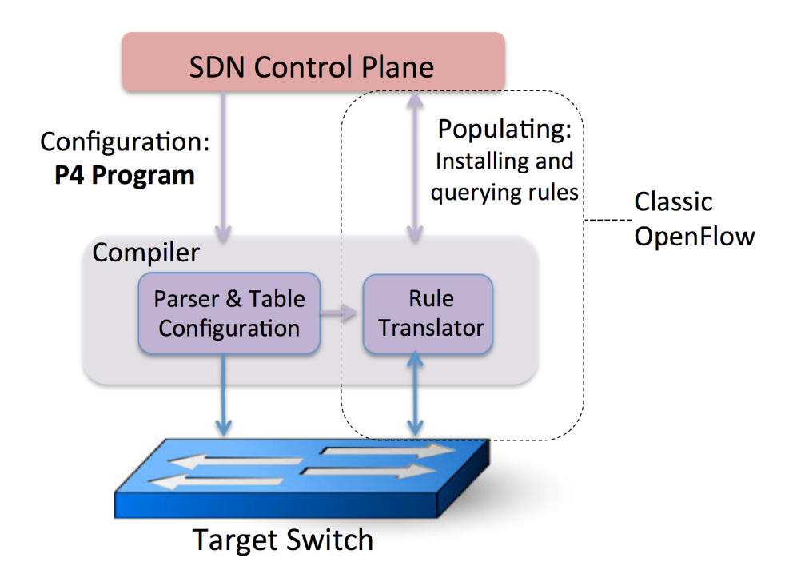

*Quelle: Bosshart et al.: „P4: Programming Protocol-Independent Packet Processors“, 2014*

---

## Bottom-up vs. Top-down Design

<div class="columns">
<div>

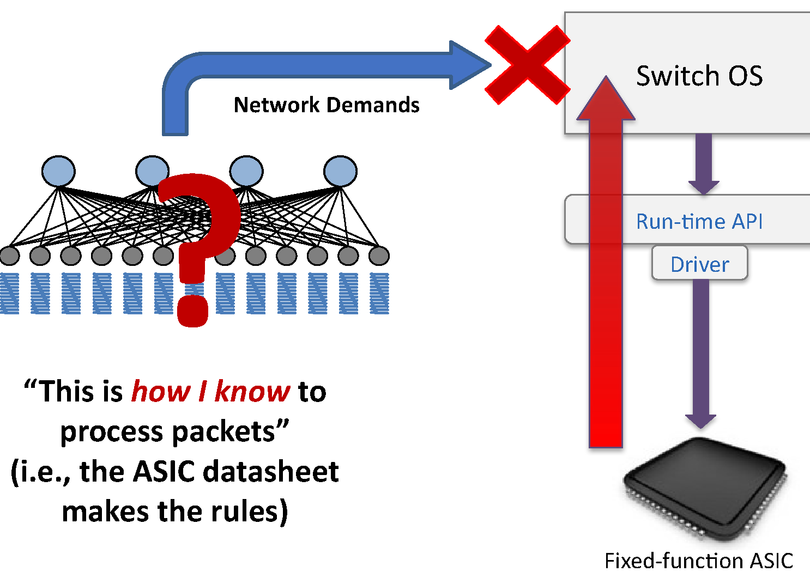

**Bottom-up (bis OpenFlow):** Der fixed-function ASIC definiert über Treiber/Runtime-API, *wie* Pakete verarbeitet werden — unabhängig von den Netz-Anforderungen

</div>
<div>

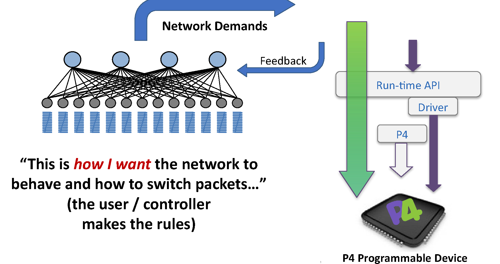

**Top-down (mit P4):** Wir definieren per P4-Programm, *was* das Netz-Element tun soll — Rückkopplung der Anforderungen auf das Programm

</div>
</div>

*Quelle: P4 Language Tutorial 2018/2019*

---

## Designziele von P4

<div class="columns3">
<div class="card">

**Reconfigurability**
Logik/Funktionen der Paketverarbeitungs-Pipeline können geändert werden

</div>
<div class="card">

**Protocol Independence**
Protokolle, die das Element verarbeiten kann, sind nicht festgelegt

</div>
<div class="card">

**Target Independence**
Unabhängig von Switch-Hardware/Hersteller; auch ein virtueller Switch ist ein Target

</div>
</div>

| | OpenFlow | P4 |
|---|---|---|
| Parser | fest | programmierbar |
| Match/Action | feste Stufen | seriell **und/oder** parallel, frei definierbar |
| Aktionen | einheitliches Set | protokoll-unabhängige Primitive des Targets |

---

## Was Data-Plane-Programmierbarkeit bringt

- **Neue Features** – neue Protokolle ergänzen
- **Komplexität reduzieren** – ungenutzte Protokolle entfernen
- **Ressourcen flexibler nutzen** – Tabellen so einsetzen, wie sie gebraucht werden
- **Mehr Sichtbarkeit** – neue Verfahren für Telemetrie und Diagnose
- **Software-artiger Entwicklungszyklus** – Fehler in der Data Plane im Feld beheben
- **Eigene Ideen umsetzen** – in Pipelines denken statt in Protokollen

<div class="food-for-thought">

🧠 Ist damit der Trade-off der Ebenen aufgelöst — also klug **und** schnell? Wo bleibt der Unterschied?

</div>

*Quelle: P4 Language Tutorial 2018/2019*

---

## Grenzen: das Zeitbudget pro Paket

- Wie flexibel (= klug) darf ein Netz-Element sein, wenn es schnell bleiben muss?
- Minimale Frames sind der Worst Case: 64-Byte-Frame + Preamble/IFG ≈ 84 Byte „on the wire“
- Daraus folgt das Zeitbudget zwischen zwei Paketen:

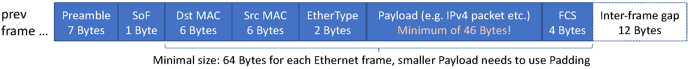

| | 10 GbE | 100 GbE |
|---|---|---|
| Min. Frame (84 B) | 67,2 ns | 6,7 ns |
| MTU 1500 | 1,23 µs | 123 ns |

- Bei 1 GHz Takt bleiben **~67 Taktzyklen** pro Paket @10 GbE — und **~6,7** @100 GbE
- Konsequenz für die Sprache: **keine Schleifen, keine Zeiger, kein Floating Point**, nur begrenzte Lookups und Register
- Bei einem 48-Port-ToR teilen sich die Pakete dieselbe Pipeline → entsprechend weniger Spielraum pro Port

*Quelle: McKeown, Advanced Computer Networks, „Programmable Forwarding Planes“*

---

## Was ein Switch tun muss — und PISA

- Typische Verarbeitung pro Paket:
  - Empfangen und **Deserialisieren** am Ingress-Port, **Parsen** der Kopfzeilen, **Matchen** auf Felder
  - **Aktionen** anwenden: Felder ändern (Egress-Port), replizieren/spiegeln, an die Control Plane senden
  - **Serialisieren** (Deparsen) und am Egress-Port senden
- **PISA** ist die dazu passende Referenzarchitektur, 2014 gemeinsam mit P4 vorgeschlagen (PSA 1.1: 11/2018)
- PISA wird mit P4 programmiert → **P**rogramming **P**rotocol-**I**ndependent **P**acket **P**rocessors

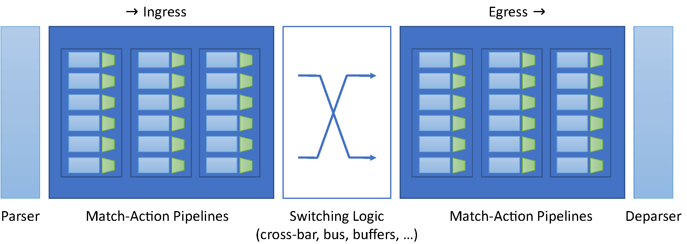

---

## Vom P4-Programm zur Pipeline

- Das P4-Programm wird auf die PISA-Pipeline **kompiliert**:
  Parser → Match-Action (z. B. Ethernet, IPv4, IPv6, ACL) → Replikation/Traffic-Management → Match-Action → Deparser
- Ein eingehendes Paket ergibt genau **ein** Ergebnis: **drop** oder **forward** — plus das Egress-Paket

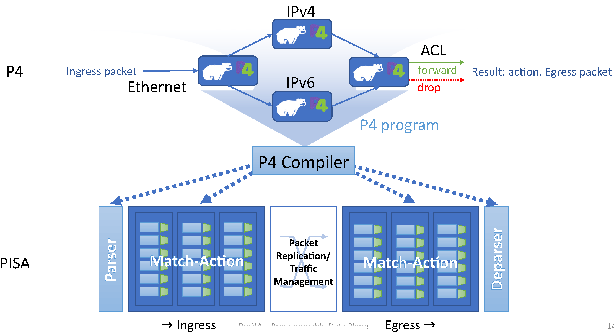

---

## P4 als Programmiersprache

- C-ähnlich, aber **ohne** Schleifen, Rekursion, Zeiger, `malloc`/`free`
- P4 ist **keine** Allzweck-Sprache — bewusst nicht:
  - ohne Schleifen/Rekursion ist der Aufwand pro Paket zur **Compile-Zeit** begrenzbar
  - ohne Zeiger/Dynamik gibt es keine beliebig großen Strukturen; Bäume nur mit fester Tiefe (z. B. drei Tabellen für einen Depth-3-Tree)
- Spezialkonstrukte: **Parser** (Kopfzeilen extrahieren) und **Tabellen** (Suchschlüssel + Aktionen)
- Heute die De-facto-*lingua franca* für Deep Network Programmability

<div class="hands-on">

💡 [P4 Language Specification](https://p4.org/specifications/) · [p4-guide](https://github.com/jafingerhut/p4-guide) – Referenz und Beispiele zum Nachschlagen

</div>

---

## Aufbau eines P4-Programms

Fünf Bestandteile — mehr braucht ein Programm nicht:
**Includes/Typen** → **Headers** → **Parser** → **Ingress/Egress** (Match-Action) → **Deparser**

```p4
header ethernet_t { macAddr_t dstAddr; macAddr_t srcAddr; bit<16> etherType; }
struct headers { ethernet_t ethernet; }

parser MyParser(packet_in pkt, out headers hdr, /* … */) {
    state start { pkt.extract(hdr.ethernet); transition accept; } }
control MyIngress(inout headers hdr, /* … */) {
    apply { dstMacAddr.apply(); } }   // Tabelle wird zur Laufzeit gefüllt
control MyDeparser(packet_out pkt, in headers hdr) {
    apply { pkt.emit(hdr.ethernet); } }

V1Switch(MyParser(), MyVerifyChecksum(), MyIngress(), MyEgress(),
         MyComputeChecksum(), MyDeparser()) main;
```

<div class="takeaway">

**Fazit:** Der vollständige Code steht im Detaildeck `5-AdvCompNet-…-PDP-Detail.md` — hier zählt die Struktur.

</div>

---

## Toolchain, Runtime und Control Plane

- **Compile-Time:** der P4-Compiler (`p4c`) erzeugt aus dem Programm die Artefakte für das Ziel (z. B. BMv2 oder ein ASIC)
- **Kein** dynamisches Ändern des P4-Codes zur Laufzeit — nur der **Objekte**: Tabelleneinträge, Multicast-Gruppen, Mirror-Sessions
- **P4Runtime** ist die API dafür (gRPC; nutzbar aus CLI, Python, C/C++, …)
- Zusammenspiel: Control-Plane-App ⇄ P4Runtime ⇄ Tabellen/Externs/CPU-Port der Data Plane


<div class="hands-on">

💡 Im Praktikum: `simple_switch_CLI` zum Füllen der Tabellen und die Python-App mit P4Runtime — siehe Detaildeck und Lab L4 ([p4-guide](https://github.com/jafingerhut/p4-guide)).

</div>

---

## Programmierbare Netz-Elemente

| Kategorie | Beschreibung | Beispiele (2026) |
|---|---|---|
| **PISA** | flexible Match+Action-ASICs | Xsight Labs **X2**; ❗ Intel **Tofino** ist End-of-Life |
| **PNA** (Portable NIC Architecture) | NPU / SmartNIC (DPU/IPU) | AMD **Pensando** (P4-Pipeline), NVIDIA **BlueField**, Intel **IPU** |
| **CPU** | Software-Switching | Open vSwitch, **eBPF**, DPDK, VPP |
| **FPGA** | programmierbare Logik | AMD/Xilinx, Altera |

- Alle diese Bausteine lassen sich mit P4 programmieren — **PNA** ist die P4-Architektur für NICs/DPUs
- Der Trend zur **NIC/DPU** verlagert Programmierbarkeit vom Switch in den Server

<div class="food-for-thought">

🧠 Programmierbare Switches sind teuer und selten, DPUs stecken in jedem KI-Server. Verschiebt sich Programmierzubarkeit damit vom Netz ins Endsystem?

</div>

---

<!-- _class: section-break -->

# 5.2 Programmable Network Elements

„P4 by Example“: Repeater → L2-Switch → Learning Switch · Runtime · Control Plane

---

## „P4 by Example“: Vorgehen

- Boilerplate für **P4₁₆** auf der quelloffenen **BMv2/V1Model**-Architektur (verhält sich wie ein Switch)
- Testbed auf **Mininet**-Basis: P4-Programm laden, Hosts verbinden, Verhalten beobachten
- Wir starten bei dummen Netz-Elementen und ergänzen schrittweise Komplexität:
  Repeater/Hub → L2-Switch → Learning Switch → (Ausblick) Router

```bash
p4@p4:~/ProNA$ make           # p4c → bmv2-JSON
p4@p4:~/ProNA$ sudo python3 run_exercise.py --topo topology.json
mininet> h1 ping h2           # …funktioniert NICHT
```

- Grund: ohne Match-Action-Logik weiß das Element nicht, was es mit Paketen tun soll

<div class="hands-on">

💡 Code: [p4-boilerplate (ProNA)](https://github.com/prona-p4-learning-platform/p4-boilerplate) · [learn-sdn-hub](https://github.com/prona-p4-learning-platform/learn-sdn-hub)

</div>

---

## Beispiel 1: Repeater

- Ein Repeater/Hub leitet Daten, die auf einem Port eingehen, auf **alle anderen** Ports weiter
- Er muss **keine** Header kennen — wörtlich protokoll-unabhängig (arbeitet wie auf Layer 1)
- Topologie: H1 an Port 1, H2 an Port 2 → „H1 ping H2“ soll funktionieren

```p4
control MyIngress(inout headers hdr, inout metadata meta, inout standard_metadata_t std_meta) {
    apply {
        if (std_meta.ingress_port == 1) { std_meta.egress_spec = 2; }
        if (std_meta.ingress_port == 2) { std_meta.egress_spec = 1; }
    }
}
```

- `standard_metadata` ist der Kontext aus der Switch-Pipeline: `ingress_port` (Eingangsport), `egress_spec` (Zielport)
- **Fazit:** zwei Zeilen im Boilerplate genügen für ein lauffähiges Netz-Element
- Grenzen: dumm, keine Tabellen, kein Lernen, mehr als zwei Ports kaum sinnvoll abbildbar

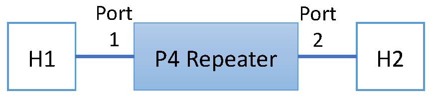

---

## Beispiel 2: L2-Switch

- Ein Switch leitet Frames anhand der **Ziel-MAC-Adresse** weiter → der **Ethernet-Header muss geparst** und in einer **Tabelle** gematcht werden
- `00:00:00:00:00:01` → Port 1, `00:00:00:00:00:02` → Port 2
- Unbekannte Ziele und Broadcasts dürfen nicht verworfen werden → **Broadcast-Gruppe**
- `extract(ethernet)` liest 48+48+16 Bit (14 Byte) vom Paketanfang; im Egress wird alles wieder `emit()`et, was geparst oder geändert wurde

```p4
table dstMacAddr {
    key     = { hdr.ethernet.dstAddr: exact; }
    actions = { forward; broadcast; }
    default_action = broadcast;
}
```

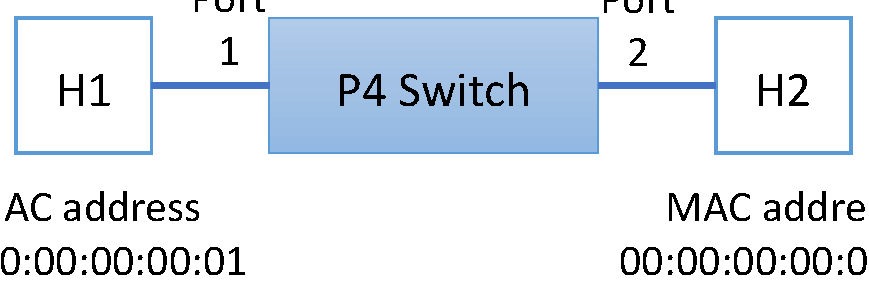

<div class="takeaway">

**Fazit:** Aus zwei `if`-Zeilen wird eine Tabelle — ab hier ist das Verhalten **konfigurierbar statt hartcodiert**.

</div>

---

## Beispiel 2: Broadcast-Schutz und Runtime

- Ein Broadcast darf nicht auf dem Port zurückgehen, auf dem er hereinkam → sonst entsteht eine Schleife
- Im Egress: wenn `mcast_grp` gesetzt **und** `egress_port == ingress_port` → `mark_to_drop()`
- Die Tabelle ist beim Start **leer** und wird zur Laufzeit gefüllt — per CLI oder API (P4Runtime):

```text
RuntimeCmd: table_add MyIngress.dstMacAddr forward 0x00000a000001 => 1
RuntimeCmd: mc_mgrp_create 1
RuntimeCmd: mc_node_create 0 1 2
RuntimeCmd: mc_node_associate 1 0
```

<div class="columns">
<div>

**Warum das nötig ist**
- Der P4-Code beschreibt nur die **Data-Plane-Logik**
- Tabelleneinträge, Broadcast-Gruppen und Mirror-Sessions sind **Laufzeit-Objekte**
- Ohne Einträge arbeitet der Switch nicht sinnvoll — alles wird geflutet

</div>
<div>

<div class="hands-on">

💡 Die vollständige CLI-Session steht im Detaildeck; im Lab L4 führen Sie sie selbst aus — [p4-guide](https://github.com/jafingerhut/p4-guide) hat die passenden Kommandos.

</div>

</div>
</div>

---

## Beispiel 3: Learning Switch

- Der Switch lernt **Quell-MAC-Adressen** aus empfangenen Frames und trägt sie mit dem Eingangsport in die Tabelle ein
- **Flood & Filter** wie bei einem echten L2-Switch:
  - Ziel bekannt → nur auf den gelernten Port weiterleiten
  - Ziel unbekannt oder Multicast/Broadcast → auf alle anderen Ports fluten
- Der Verarbeitungsschritt liegt in der **Data Plane**, das Eintragen in die Tabelle in der **Control Plane**

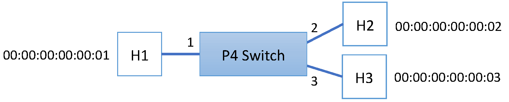

---

## Beispiel 3: Learning im Zusammenspiel

<div class="columns">
<div>

**Data Plane:** unbekannte Quell-MAC melden
- Tabelle `srcMacAddr`: bei Treffer `NoAction`, sonst `learnSrcMacAddr()`
- Die Aktion klont das Paket (I2E) und schickt es über den **CPU-Port** an die Control Plane
- Ein **eigener CPU-Header** transportiert MAC-Adresse und Eingangsport — ein selbst erfundenes Protokoll

**Control Plane:** Tabelle füllen
- Die Python-App lauscht am CPU-Port (`scapy`) und liest den CPU-Header
- Sie trägt die MAC-Adresse per API ein: `table_add("dstMacAddr", "forward", [mac], [port])`
- Beim nächsten Paket ist der Pfad bekannt — ohne Fluten

</div>
<div>

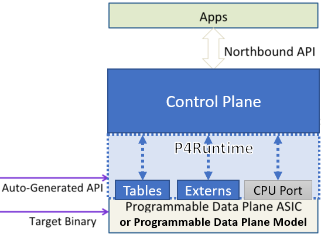

</div>
</div>

<div class="takeaway">

**Fazit:** Die Data Plane entscheidet schnell, die Control Plane lernt langsam — genau diese Arbeitsteilung macht P4 möglich.

</div>

---

## Diskussion: Was wir gesehen haben

- Der Learning Switch implementiert Flood & Filter korrekt — mit allen wesentlichen Bausteinen:
  Header parsen, Tabellen matchen, Aktionen ausführen, Control Plane einbeziehen
- Grenzen gegenüber echten Switches: kein Aging/Delearning der Einträge, keine VLANs, keine Priorisierung
- Prüfen Sie im Praktikum, was passiert, wenn Sie das `table_add` weglassen — alles wird geflutet,
  wie bei einem Switch mit voller Weiterleitungstabelle

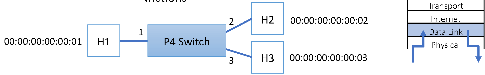

<div class="food-for-thought">

🧠 Was müsste man ergänzen, damit daraus ein **Router** wird? Sammeln Sie die Punkte, bevor Sie umblättern.

</div>

---

## Von Beispielen zum Router

- Vom Learning Switch zum Router fehlen im Wesentlichen:
  - IP-Header (IPv4/IPv6) parsen und deparsen, Match mit **Longest Prefix Match** (`lpm`)
  - TTL dekrementieren, L2-Adressen umschreiben (ARP/ND), Checksummen neu berechnen
- Dieselben Erweiterungen gelten analog für **Firewall, Load Balancer** usw. auf höheren Schichten

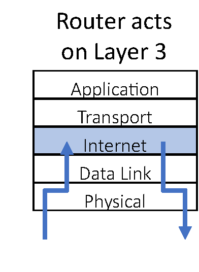

<div class="takeaway">

**Fazit:** P4 liefert die Bausteine, nicht das fertige Gerät — die Arbeit liegt in der Vollständigkeit der Pipeline.

</div>

---

<!-- _class: section-break -->

# 5.3 Applications, Use-Cases and Outlook

Echte Hardware (TNA/PSA) · Status nach dem Tofino-Ausstieg · Forschung am NetLab

---

## P4 auf echter Hardware

- Dasselbe Zusammenspiel gilt physisch: App ⇄ Control Plane ⇄ **P4Runtime** ⇄ Tabellen/CPU-Port im ASIC
- „Whitebox“-Switches sind genau das: CPU, ASIC, Ports, Netzteile, Lüfter — plus ein offenes NOS
- Der Entwickler wählt **P4-Programm** und **NOS/Anwendung** unabhängig — nur unterhalb bleibt die Bindung an einen konkreten Chip
- Ein realer Build läuft so: Programm → Compiler für die Ziel-Architektur → Laden auf das Gerät

<div class="columns">
<div>


</div>
<div>


</div>
</div>

*Quellen: GEANT Whitebox-Wiki · STORDIS*

---

## Von BMv2 zu TNA — und darüber hinaus

- Für echte Hardware wechselt man Architektur und Modell, nicht die Sprache:
  **V1Model → TNA** (Tofino Native Architecture), basierend auf **PSA** (Portable Switch Architecture)
- Praktisch ändern sich der Architektur-Include, Namen von Variablen/Konstanten und der Pipeline-Aufbau
- Im NOS läuft neben dem Laden des P4-Programms die Initialisierung der Hardware — heute über **SAI** (Switch Abstraction Interface) und **SONiC**


<div class="hands-on">

💡 [SDN-Buch, Kap. 4: Bare-Metal Switches](https://sdn.systemsapproach.org/switch.html) — P4 im Kontext der Pipeline-Abstraktion

</div>

---

## Status 2026: Was nach Tofino kommt

<div class="columns">
<div>

**Der Einschnitt**
- Intel hat **Tofino abgekündigt**: PCN 827577-00, Last-Time-Buy **30.10.2024**, Auslieferung bis **28.02.2025**
- Der bekannteste PISA-Switch ist nicht mehr beschaffbar

**Was bleibt**
- Die P4-**Toolchain** wurde von Intel quelloffen gestellt (`p4c`-Tofino-Backend, `open-p4studio`); **SONiC/SAI/P4Runtime** sind die produktiven Abstraktionen

</div>
<div>

**Wohin es geht**
- Programmierbare Pipelines in anderem Silizium: **Xsight Labs X2**
- **DPUs/IPUs** tragen die Idee weiter: AMD **Pensando** (P4-Pipeline), NVIDIA **BlueField**, Intel **IPU**
- Lehre und Forschung: weiterhin **BMv2** (Software) und FPGAs

</div>
</div>

<div class="food-for-thought">

🧠 Ist P4 gescheitert — oder hat es sich in DPUs und Telemetrie längst durchgesetzt?

</div>

*Quellen: Intel PCN 827577-00 (08/2024) · p4.org: „Intel’s Tofino P4 Software is Now Open Source“ (01/2025) · Xsight Labs/Oxide Case Study*

---

## P4 am NetLab und in unserer Forschung

- Testbed am NetLab der HS Fulda: P4-fähige Whitebox-Switches („STORDIS“), betrieben mit ProNA-Repeater-Code — daraus entstandene Themen der Arbeitsgruppe:

<div class="columns">
<div>

**Forschung**
- Hardegen/Rieger: *Prediction-based Flow Routing in Programmable Networks with P4*, CNSM 2020
- Hardegen et al.: *Predicting Network Flow Characteristics using Deep Learning*, TNSM 2020
- Geier/Rieger: *Tenant code updates on multi-tenant programmable switches*, CNSM 2023 / NOMS 2024

</div>
<div>

**Projekt VERCA (BMBF FHprofUnt)**
- Kollaboratives Intrusion-Detection-System (CIDS) gegen verteilte Angriffe
- In-Network-Computing: Angriffserkennung in der Data Plane; In-Band-Telemetrie für Monitoring

</div>
</div>

<div class="hands-on">

💡 Abschlussarbeit oder HiWi in diesem Bereich? → [mmnet.informatik.hs-fulda.de](https://mmnet.informatik.hs-fulda.de)

</div>

---

## Evolution: vertikal → horizontal

<div class="columns">
<div>


**Mainframe-Ära:** vertikal integriert, geschlossen, proprietär, langsame Innovation

</div>
<div>


**Netz-Ära heute:** horizontal, offene Schnittstellen, schnelle Innovation — Whitebox + SDN + NFV + P4

</div>
</div>

- Dieselbe Bewegung wie Mainframe → PC: aus geschlossenen Boxen werden offene Bausteine
- Entscheidend ist nicht der einzelne Chip, sondern dass **Schnittstellen offen** sind

*Quelle: McKeown, Advanced Computer Networks, „Programmable Forwarding Planes“*

---

## Open Compute Project und Bare-Metal

<div class="columns">
<div>

**Open Compute Project (OCP)**
- 2014: erste **„Wedge“-Switch**-Designs als Open-Source-Hardware (Meta/Facebook)
- Ausgangspunkt für Whitebox-Switches in Hyperscaler-Rechenzentren


</div>
<div>

**Bare-Metal-Switch**
- Switch-Chips von Broadcom (Trident, Tomahawk, Jericho), Marvell, … — eigene ASICs sind die Ausnahme
- Offene NOS: Meta **FBOSS**, **SONiC** (Microsoft), OpenSwitch, DANOS, DENT
- Linux-NOS-Distributionen: Cumulus Linux, Pica8, Open Network Linux

</div>
</div>

<div class="takeaway">

**Fazit:** Erst trennten sich Hard- und Software (Whitebox), dann wurde auch die Pipeline programmierbar (PISA/P4).

</div>

---

## Programmierbarkeit im Silizium

<div class="columns">
<div>

**Wege zu neuen Funktionen**
- **Fixed-function ASIC:** neue Features nur mit der nächsten Chip-Generation
- **Programmierbarer ASIC/NPU/FPGA:** Feature-Code wird unabhängig entwickelt und geladen
- Beispiel: **Open/R** — Routing-Erweiterung für FBOSS (Meta, Arista, Juniper, Linux)


</div>
<div>

**Domain Specific Processors**
- Analogie: Computer : CPU = Netz-Element : **PISA**
- Wie die CPU für das Rechnen wurde PISA die spezialisierte, aber programmierbare Basis für Paketverarbeitung


</div>
</div>

*Quelle: McKeown, Advanced Computer Networks, „Programmable Forwarding Planes“*

---

## Lernzielkontrolle ✍️🧠

- Warum reichte OpenFlow nicht aus, um die Data Plane zu programmieren?
- Was bedeuten **Reconfigurability**, **Protocol Independence** und **Target Independence** in P4?
- Wie ist ein P4-Programm aufgebaut — welche fünf Teile sind Pflicht?
- Was ist der Unterschied zwischen **Compile-Time** und **Runtime** in P4?
- Welche Rolle spielt der **CPU-Port** beim Learning Switch?
- Warum braucht ein Learning Switch überhaupt eine Control Plane?
- Was ist **PISA**, und wodurch unterscheidet sich **TNA** davon?
- Was folgt aus dem **Tofino-End-of-Life** für die Lehre und für eigene Experimente?
- Wo liegt das Zeitbudget pro Paket — und welche Sprach-Einschränkungen folgen daraus?

---

## Praktische Übungen und Demo-Links 🛠️🧑‍🔬

1. **Toolchain starten (Lab L4):** `prona/p4-container` bzw. p4-guide → `p4c` und BMv2 lauffähig machen
2. **Boilerplate kompilieren und laden:** `make` und Testbed starten → `h1 ping h2` scheitert erwartungsgemäß
3. **Repeater zum Laufen bringen:** zwei Zeilen im Ingress ergänzen → Ping funktioniert
4. **Tabelle füllen:** `simple_switch_CLI` → `table_add`, `mc_mgrp_create`, `mc_node_associate`
   - 💡 [p4-guide](https://github.com/jafingerhut/p4-guide) – Troubleshooting und Beispiele
5. **Learning Switch:** Control-Plane-App starten, CPU-Port mit Wireshark beobachten, Tabellen füllen lassen
6. **Beobachten und verändern:** Was passiert bei voller Tabelle? Was, wenn Sie das Lernen deaktivieren?
   - 💡 [Wireshark](https://www.wireshark.org/) · [Mininet](http://mininet.org/)
7. **Recherche:** Wie würde ein **Router** in P4 aussehen? Skizzieren Sie Parser und Tabellen (TTL, `lpm`, Checksum)

---

## Weiterführende Literatur & Links 💡

<div class="columns3">
<div class="card">

**Kurse & Tutorials**
- 💡 [CS244 (Stanford, Spring 2025)](http://web.stanford.edu/class/cs244/)
- 💡 [Advanced Computer Networks (ETH Zürich, Fall 2025)](https://adv-net.ethz.ch/)
- 💡 [p4lang/tutorials](https://github.com/p4lang/tutorials)
- 💡 [p4-guide](https://github.com/jafingerhut/p4-guide)

</div>
<div class="card">

**Projekt & Referenz**
- 💡 [P4 Language & Spezifikation](https://p4.org/)
- 💡 [SDN-Buch, Kap. 4/5](https://sdn.systemsapproach.org/switch.html)
- 💡 [ProNA Learning Platform](https://github.com/prona-p4-learning-platform)
- 💡 [p4-boilerplate](https://github.com/prona-p4-learning-platform/p4-boilerplate)

</div>
<div class="card">

**Ausblick**
- 💡 [Intel PCN 827577-00 – Tofino EOL](https://www.intel.com/content/www/us/en/content-details/827577/intel-tofino-products-pcn-827577-00-product-discontinuance-tofino-end-of-life.html)
- 💡 [Tofino-P4-Software jetzt Open Source](https://p4.org/intels-tofino-p4-software-is-now-open-source/)
- 💡 [7E §15.5 – Optimizing Ethernet for RDMA](https://7e.systemsapproach.org/message.html) *(Brücke zu Kapitel 8)*

</div>
</div>

> 🧠 Eigene Ideen für eine P4-Übung oder eine Abschlussarbeit? Sprechen Sie uns an — das NetLab hat die Hardware.
