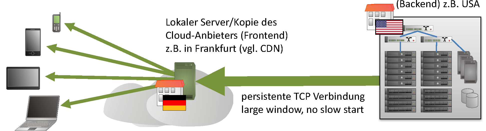

<!-- _class: title -->

# Advanced Computer Networks

## Kapitel 7 · Network Application Performance — Detailfolien

Wintersemester 2026/2027
Master AI – Hochschule Fulda
Sebastian Rieger · MMNet

---

## Detailfolien zu Kapitel 7

Ergänzendes Material — nicht Teil der Vorlesung, aber klausurrelevant als Hintergrund:

- **Advanced Layer 3?** — offene Punkte (Skalierung, Mobility, BGP-Weiterentwicklung)
- **Dateidienste:** SMB 3 und NFS — Entwicklung der Layer-7-Protokolle
- **Flusskontrolle bei TCP:** Buffer Bloat, TCP Splitting, Multipath, Coded TCP
- **Hardware:** AMD Pensando „Elba" DPU-Architektur
- **Trends** im Advancement von Computer Networks

---

## Advanced Network Layer?

- Advanced Layer 7 (inkl. 5, 6) und Layer 4 in diesem Kapitel diskutiert
- Advanced Layer 2 in den vorherigen Kapiteln
- **Advanced Layer 3?**
  - Scalability (IPv6), seit >20 Jahren jetzt wirklich/endlich/überall … ;)
  - Mobility von IP-Adressen? vgl. Naming/Binding (Saltzer) – wie ist das umsetzbar? Tunnel z.B. mit LISP?
  - Weiterentwicklung von BGP? Ablösung von BGP?
  - Ausfallsicherheit Standard-Gateway/Internetzugriff (VRRP, SD-WAN, …) – ist das nicht eigentlich ein Problem im Betriebssystem? ;)
- **Trends?** Welche zusätzlichen Anforderungen kommen in der Zukunft?
  - Internet of Things (IoT)?
  - In-band Telemetry/Network Management? Machine Learning?
  - Microservices/Container? Overlay-Netze/Service Mesh mit VXLAN etc.
  - Mobile Edge Computing (MEC)?

---

## Advanced Layer 7 Protokoll: SMB 3

Server Message Block (SMB) – Windows File Share

| Version | Wesentliche Neuerungen |
|---|---|
| SMB 2.1 (2009) | Bessere Unterstützung von „large BDP": Performance auf 10 GbE, große MTU, verbessertes Operation-Locking-Modell, Branch Cache, Credits für mehrere 64k-Segmente |
| SMB3 (früher 2.2), Windows 8/2012, Samba ≥4.0 | Clusters (active/active), Distributed Caching, Multipath (Trennung von Session und Connections, Aggregation), RDMA, Encryption, … |
| SMB 3.1.1, Windows Server 2016 | Verbesserte Negotiation/Encryption, Cluster Fencing/Failover |

*Quelle: Windows 8 SMB 2.2 File Sharing Performance, MSDN, 9/2011*

---

## Advanced Layer 7 Protokoll: NFS

Entwicklungen beim Network File System (NFS)

| Version | Wesentliche Neuerungen |
|---|---|
| NFS v4.1 (RFC 5661, 1/2010) | Unterstützung von Cluster-Server-Deployments, Caching, skalierbarer paralleler Zugriff auf über mehrere Server verteilte Dateien (**pNFS**) |
| NFS v4.2 (RFC 7862, 11/2016) | Local-File-System-Unterstützung, Local-Copy, Server-Side-Copy, Sparse-File-Support/Space Reservation, Federated Access (Namespace-Traversal über Fileserver verschiedener Organisationen) |

[datatracker.ietf.org/wg/nfsv4/documents](https://datatracker.ietf.org/wg/nfsv4/documents/)

**Fazit aus der Weiterentwicklung von SMB/NFS für Advanced Layer 7?**

---

## Trends im Advancement von Computer Networks

- Sieht man z.B. auf „den großen Konferenzen": SIGCOMM, INFOCOM … „NANOG"
- Google-Scholar-Kennzahlen zu Computer Networks – warum veröffentlichen, warum Paper schreiben?
- Oder bei den Herstellern und Analysten ;-)
- Erinnern Sie sich? „Great Engineering" vs. „Good Science" ;-)

---

## Weitere Beispiele

- … Sie sind herzlich eingeladen, zu einem Paper beizutragen ;-) Es wäre nicht das erste Mal, dass Studierende beteiligt waren ;-)
- Siehe auch: [Google Scholar](https://scholar.google.com)
- … das gilt auch für Forschungsprojekte, aktuelle Themen z.B.:
  - Network Digital Twins (NDT)
  - Intent-based Routing
- Allgemein:
  - Einsatz von SDN/NFV/P4 für Traffic Engineering, Network Attack Detection
  - Netzwerk-Management/Monitoring/Telemetry & Machine Learning

---

## Flusskontrolle bei TCP

**Problembereiche**
- Hohe Bitrate bei gleichzeitig hoher Latenz → viele RTTs
- (Zu große) Puffer (Router, Endgeräte etc.) führen zusätzlich zu hoher Latenz, behindern effektive Congestion Control (vgl. „Buffer Bloat")
- Im Wireless-Bereich (WLAN, UMTS/LTE …) mehr Timeouts durch Paketverluste (Bitfehler)

**Aktuelle Entwicklungen**
- Verbesserte Congestion Control: **BBR** (Bottleneck Bandwidth and Round-Trip propagation time)
- **TCP Splitting** (Cloud)
- **Multipath TCP** (parallele Streams über mehrere/verschiedene Links)
- **Coded TCP** (Wiederherstellung defekter empfangener Segmente)

---

## Cloud-Anforderungen: TCP Splitting

- Einfache Variante, um den Durchsatz von TCP zu verbessern: mehrere TCP-Verbindungen parallel
- **Kaskadiert (hintereinander): TCP Splitting**
  - Persistente TCP-Verbindung im Backend, bleibt lange offen, daher kein Slow-Start – ist auf RTT und Bandbreite „getuned"
  - Beispiel: Verbindung zu regionalem Server eines Cloud-Anbieters (Frontend), dieser unterhält eine Verbindung zum Cloud-Rechenzentrum (Backend)
- **Parallel (nebeneinander):** mehrere TCP-Sitzungen oder z.B. Multipath TCP

---

## AMD Pensando „Elba" DPU – Architektur

Interne Blockarchitektur des Pensando-DPU-ASICs „Elba": P4-programmierbare Egress-/Ingress-Pipelines, Traffic-Manager/Packet-Buffer, Arm-Kerne mit Coherent NOC, Offload-Engines (Crypto, Kompression, CRC) sowie DDR4/5-Speicheranbindung – Basis u.a. der AMD-Pensando-SmartNIC-Familie.

*Quelle: ServeTheHome / Pensando*
