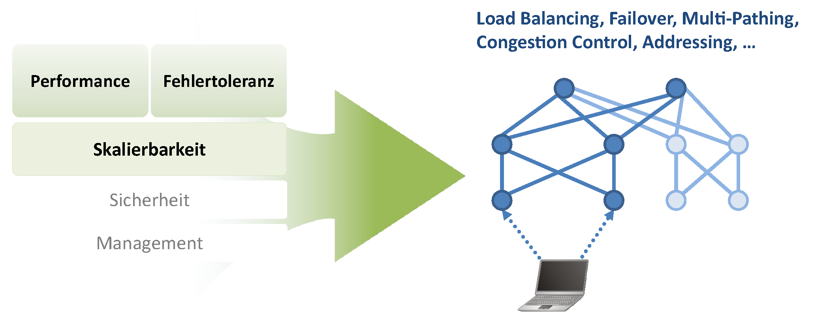
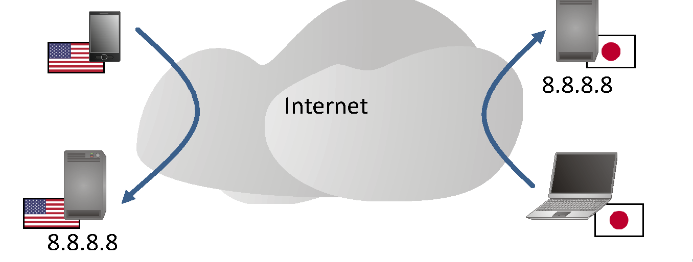
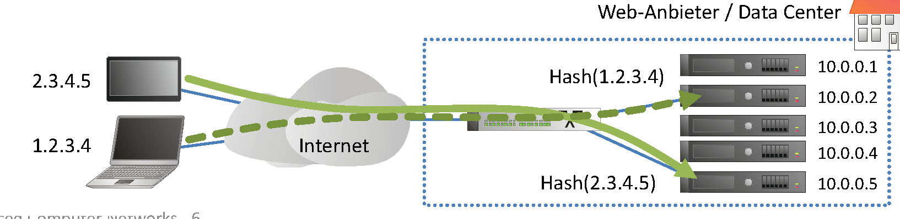
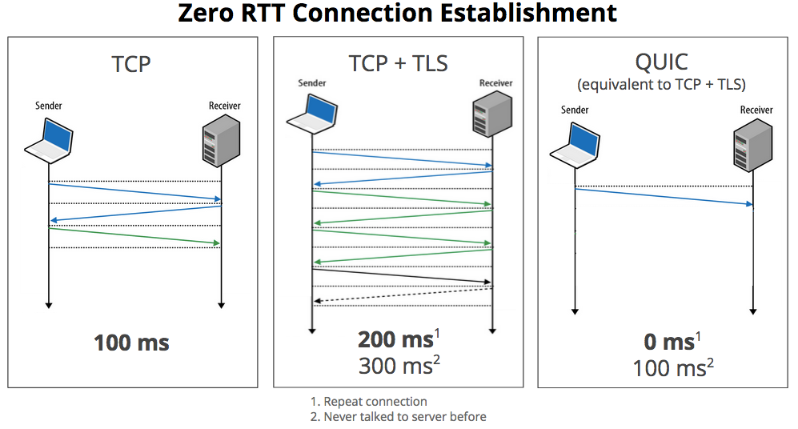
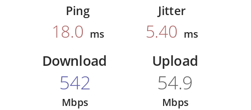
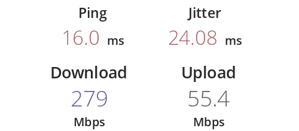
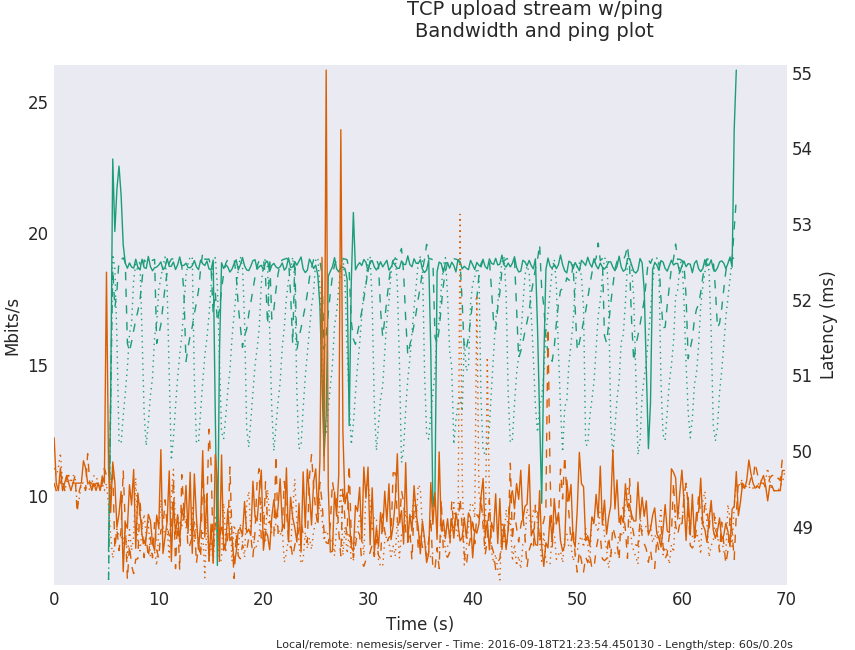
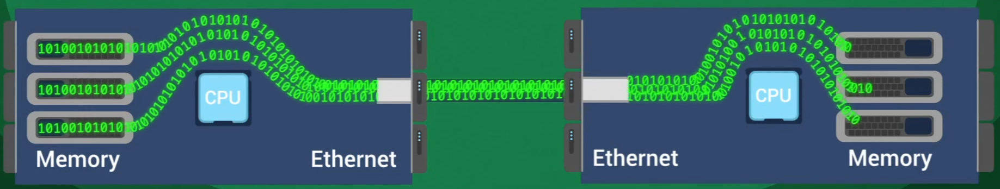

<!-- _class: title -->

# Advanced Computer Networks

## Kapitel 7 · Network Application Performance

Wintersemester 2026/2027
Master AI – Hochschule Fulda
Sebastian Rieger · MMNet

---

## Kapitelübersicht

**7.1 Recap: Performance über mehrere Layer**
- Performance, Fehlertoleranz, Skalierbarkeit — wo greift welcher Layer?

**7.2 Load Balancing für Anwendungen im Data Center**
- Anycast, DNS Round Robin, L4/L7-Load-Balancing

**7.3 Advanced Transport- und Anwendungsprotokolle**
- HTTP/3 und QUIC · Congestion Control (CUBIC/BBR)
- Multipath QUIC und Transport Services (TAPS) · RDMA

---

## Lernziele

Nach diesem Kapitel sollten Sie wissen…

- auf welchen **Layern** Performance und Fehlertoleranz umgesetzt werden können
- wie **Anycast** und **L4/L7-Load-Balancing** Clients auf Server verteilen
- warum **QUIC/HTTP/3** entstanden ist und was es gegenüber TCP+TLS ändert
- wie **CUBIC** und **BBR** die Senderate bestimmen — und worin sie sich unterscheiden
- was **Multipath QUIC** und **Transport Services (TAPS)** leisten sollen
- warum **RDMA** in Rechenzentren an Bedeutung gewinnt

> **Bezug zur Referenzliteratur:** *Computer Networks: A Systems Approach*, 7E, Kap. 12–15 ([7e.systemsapproach.org](https://7e.systemsapproach.org/))

---

<!-- _class: section-break -->

# 7.1 Recap: Performance über mehrere Layer

Performance · Fehlertoleranz · Skalierbarkeit — Lastverteilung, Failover, Multipathing, Congestion Control

---

## Performance, Fehlertoleranz, Skalierbarkeit — auf welchem Layer?

- Load Balancing, Failover, Multi-Pathing, Congestion Control, Addressing, …
- Welche Layer im OSI-Modell sind das? Und was wäre „Advanced Layer 1"? 😉
- Passt das noch ins Schichtenmodell — oder gelten diese Anforderungen auf **mehreren Layern gleichzeitig**?

<div class="columns">
<div>

| Layer | Technologie |
|---|---|
| 2 (und 1) | Mehrere Links, ECMP, MLAG, Leaf-Spine-Fabric, SDN |
| 3 | BGP-Multipathing, Anycast, OSPF |
| 4 | Congestion Control (CUBIC/BBR), L4-Load-Balancing |
| 7 | L7-Load-Balancing, HTTP/3 (QUIC), NFV |

</div>
<div>



</div>
</div>

<div class="hands-on">

💡 Messwerkzeug: `iperf3` ([iperf.fr](https://iperf.fr/)) — `iperf3 -s` / `iperf3 -c <server>` messen den Durchsatz zwischen Endsystemen

</div>

---

<!-- _class: section-break -->

# 7.2 Load Balancing für Anwendungen im Data Center

Anycast · DNS Round Robin · L4/L7-Load-Balancing

---

## Network Layer Load Balancing

- Wie bekommt man hohe Performance und Fehlertoleranz für Anwendungen?
  - Lastverteilung auf **mehrere Server** (Data Center) und **mehrere Standorte** (SDN/WAN)
  - Anschlussfrage: Wie findet ein Client den „richtigen" Standort?
- Einfaches Beispiel auf IP-Ebene: **Anycast**
  - Dieselbe IP-Adresse wird an mehreren Standorten per BGP annonciert
  - Pakete gehen an den aus Sicht des Routings **nächstgelegenen** Standort



*angelehnt an Roscoe/Stüdi, Advanced Computer Networks, ETHZ, 2012*

---

## Anycast — Chancen und Grenzen

- **Vorteile:** Lastverteilung, kürzere Wege, Robustheit gegen Ausfälle und DDoS
- **Grenzen:**
  - IP ist verbindungslos → Anycast passt primär zu **UDP**; mit TCP nur mit Einschränkungen (Session kann bei Pfadwechsel „umziehen")
  - Ein Ausfall ändert das Routing → bestehende Verbindungen brechen ab
  - Die Service-Lokation wird im BGP abgebildet → Routing vermischt sich mit der Platzierung von Endsystemen
- **Anwendungen:** DNS-Root-Server, Google Public DNS (`8.8.8.8`), CDNs

<div class="hands-on">

💡 Demo: `dig +short www.hs-fulda.de @8.8.8.8` gegen verschiedene Resolver, danach `mtr` — wo landet die Antwort? · [RIPE Atlas](https://atlas.ripe.net/)

</div>

*angelehnt an Roscoe/Stüdi, Advanced Computer Networks, ETHZ, 2012*

---

## Load Balancing im Data Center

- Einfach: **DNS Round Robin**
  - Individuelle Auflösung je Client (Quell-IP, Server-Status) → Adresse eines **nahen** Load Balancers
  - Probleme: DNS-Caching — TTL zu hoch (Änderungen greifen spät) oder zu niedrig (Last auf DNS)?
- Fortgeschritten: Load Balancing auf **Layer 4 und 7**
  - Verteilung per **Hash über das 5-Tupel** auf Flows, z. B. `(TCP, 193.174.26.1, 1.2.3.4, 4711, 80)` — dieselbe Idee wie ECMP
  - Offene Fragen: Session-Persistenz (welcher Client gehört zu welchem Server)? Verhalten bei Server-Ausfall? Gleichmäßigkeit?



<div class="food-for-thought">

🧠 Ein Hash über das 5-Tupel ist stabil — bis ein Server ausfällt. Was passiert dann mit den betroffenen Flows?

</div>

---

<!-- _class: section-break -->

# 7.3 Advanced Transport- und Anwendungsprotokolle

HTTP/3 und QUIC · CUBIC und BBR · Multipath QUIC & TAPS · RDMA

---

## Warum neue Transport- und Anwendungsprotokolle?

- Was, wenn schon **eine einzelne Verbindung** zur Anwendung zu langsam ist?
  - Beispiel: Dateizugriff über große Distanz — Load Balancing hilft hier nicht
- Was, wenn die Bitrate so hoch ist, dass die **Latenz** zum Problem wird?
  - Bekannt aus Kapitel 1: „large BDP networks", „big fat pipes" — und die Schwächen des Protokolls
- Das Anwendungsprotokoll müsste angepasst werden — als Anwender geht das nicht, und Hersteller sind träge
- Auswege: **neue Protokolle** (QUIC/HTTP/3), **mehrere Pfade** (Multipath), **mehrere Verbindungen** (Splitting) oder **Hardware** (Offload/RDMA)

---

## HTTP/3 und QUIC

- **QUIC:** RFC 9000 (5/2021) — Transport über **UDP**, TLS 1.3 integriert
- **HTTP/3:** RFC 9114 (6/2022) — HTTP-Semantik auf QUIC; QUIC v2: RFC 9369 (5/2023)
- Ziele: schnellerer Verbindungsaufbau (1 RTT, optional 0-RTT), **kein Head-of-Line-Blocking** zwischen Streams, bessere Verlustwiederherstellung, anpassbare Congestion Control
- Nebenwirkung: Transport-Funktionen wandern in den **Application Layer** — Vor- und Nachteile
- Robust gegen „Protocol Ossification": Verschlüsselung macht Middleboxes das Mitreden schwer

<div class="hands-on">

💡 Live-Check im Browser: DevTools → Netzwerk → Spalte *Protocol* (`h3` vs. `h2`) · [http3check.net](https://http3check.net/) · [cloudflare.com/ssl](https://www.cloudflare.com/ssl/)

</div>

*7E §12.2–12.8 (Reliable Byte Stream, inkl. QUIC) · [datatracker.ietf.org/wg/quic](https://datatracker.ietf.org/wg/quic/charter/)*

---

## QUIC in der Praxis

- **0-RTT**, Spin Bit (RTT-Messung ohne Vertrauen), geringe Ossification
- QUIC wird zum universellen Transport:
  - **Media over QUIC (MoQ)** für Video
  - **WebTransport** (W3C) — [caniuse.com/webtransport](https://caniuse.com/webtransport)
  - **DNS over QUIC** (DoQ, RFC 9250)
  - **SMB over QUIC** (12/2024)



<div class="food-for-thought">

🧠 QUIC läuft über UDP — warum blockieren Firewalls und DPI es trotzdem nicht einfach flächendeckend?

</div>

---

## TCP Congestion Control: heute CUBIC

- Congestion Control ist Dauerforschung — Basis: RFC 5681
- Praxis heute: **CUBIC** (Linux-Kernel, Windows ab 10/1703 statt NewReno/CTCP)
  - `cwnd` wird beim ersten Timeout weniger stark reduziert; Wachstum als kubische Funktion der Zeit seit dem letzten Verlust
- Startfenster heute nicht mehr 1 Segment: typisch **10 MSS**

```bash
# Welcher Algorithmus ist aktiv? Welche stehen zur Wahl?
cat /proc/sys/net/ipv4/tcp_congestion_control
cat /proc/sys/net/ipv4/tcp_available_congestion_control
sysctl net.ipv4.tcp_congestion_control=bbr      # umschalten (Demo)
```

*7E §13.2 (Loss-Based Algorithms) · CUBIC-Spezifikation: RFC 8312*

---

## BBR: rate statt loss

- **B**ottleneck **B**andwidth and **R**ound-trip propagation time — Google, im Linux-Kernel seit 4.9 (10/2016); **BBRv3** aktuell
- Schätzt aus den ACKs die **Bandbreite des Engpasses** und die **minimale RTT** und wählt daraus die Senderate
- Ziel: Puffer nicht füllen → niedrigere Latenz, weniger Stau, bessere Auslastung — unabhängig von großen Puffern und Verlusten
- Verbreitet bei Google (Search, YouTube, B4-WAN) und als QUIC-CC

 

<div class="food-for-thought">

🧠 BBR konkurriert mit loss-basierten Verfahren — warum galt es anfangs als „unfair"? Wofür wurde BBRv3 eingeführt?

</div>

---

## Vergleich: RENO, CUBIC, BBR

- Die Abbildung zeigt einen TCP-Upload mit parallel laufendem Ping: Wie beeinflusst die Senderate die **Latenz**?
- Beobachtung: Verlust-basierte Verfahren füllen Puffer, BBR hält sie eher leer
- Kritik an BBR: „Googles TCP-Flusskontrolle BBR bremst fremde Downloads aus" (Heise 5/2018) → Antwort darauf ist **BBRv3**
- Take-away: Congestion Control ist ein **Fairness-Problem**, nicht nur ein Durchsatz-Problem



*Quelle: blog.cerowrt.org/post/bbrs_basic_beauty · 7E §13.3–13.4*

---

## Multipath QUIC

- **Idee:** eine QUIC-Verbindung nutzt **mehrere Pfade gleichzeitig** (WLAN + Mobilfunk, oder zwei Pfade im RZ)
- `draft-ietf-quic-multipath-21` (03/2026) steht **im RFC-Ed-Queue** — kurz vor dem RFC
  - neu: **Path IDs**, eigener Packet-Number-Space je Pfad, Frames `PATH_ACK`/`PATH_ABANDON`/`PATH_STATUS_*`
  - **nicht** standardisiert: das **Scheduling** (welches Paket auf welchen Pfad)
- Betriebsarten: **Failover** (zweiter Pfad bereit) vs. **Aggregation** (beide parallel) — Preis: **Reordering**
- Abgrenzung: **MPTCP** (RFC 8684) gibt es länger, ist aber kaum verbreitet

<div class="hands-on">

💡 Praktikum: **Lab L5** — zwei Pfade mit unterschiedlicher Latenz/Verlust ([containerlab](https://containerlab.dev/) + `netem`), Scheduling umschalten, Capture pro Pfad.

</div>

---

## Transport Services (TAPS): die API statt des Protokolls

- **Problem:** Die Socket-API bindet Anwendungen fest an TCP oder UDP — QUIC/MPTCP sind so kaum nutzbar
- **Idee:** Die Anwendung beschreibt **Eigenschaften** statt des Protokolls („latenzarm", „Nachrichten statt Byte-Stream")
- Das System sammelt **Kandidaten** (Adressen × Protokolle × Pfade) und **raced** sie — die Verallgemeinerung von Happy Eyeballs (RFC 8305)
- RFCs 01/2025: **9621** Architektur · **9622** API · **9623** Implementierung

<div class="takeaway">

**Fazit:** QUIC macht Transportvielfalt möglich — TAPS macht sie für Anwendungen **benutzbar**, ohne sie neu zu programmieren.

</div>

*7E §15.2–15.4 · Implementierungen: Apple Network.framework, NEAT, PyTAPS (RFC 9623, Anhang C) · [NEAT-Socket-API-Draft](https://datatracker.ietf.org/doc/draft-dreibholz-taps-neat-socketapi/) (09/2026)*

---

## Hardware-beschleunigter Transport: TOE

- Netzwerkkarten bieten **TCP Offload Engines (TOE)** — sinnvoll bei dauerhaft hohen Raten (≥ 10 GbE, Storage) zur Entlastung von CPU und PCIe
- Die NIC übernimmt z. B. Checksummen/Sequenznummern, ACKs, Congestion Control, Segmentierung, teils ganze Protokolle (iSCSI)
- **Nachteile:** Debugging in Wireshark, Patches kaum möglich, Einfluss auf Fehler-/Flusskontrolle, End-to-End-Frage
- Heute aktueller Weg: **programmierbare Netz-Hardware** — SmartNIC/DPU/IPU (vgl. Kapitel 6 und 8)

---

## RDMA: direkter Speicherzugriff über das Netz

- TOE ist gewissermaßen die Vorstufe: **Remote Direct Memory Access** greift direkt auf den RAM des Gegenübers zu
- **Zero-Copy** — wo entstehen sonst Kopien der Daten (User Space ↔ Kernel, Socket-Puffer)?
- Nutzen: minimaler Latenz- und CPU-Overhead, zentral für Storage- und KI-Netze
- **Herausforderungen:** eigene Infrastruktur (RoCE/RDMA over TCP), Completion-Semantik, Sicherheit im Mehrbenutzerbetrieb
- Vertiefung in Kapitel 8 und in 7E §15.4–15.5



*Quelle: Electronic Design*

---

## Lernzielkontrolle ✍️🧠

- Auf welchen Layern kann man Performance und Fehlertoleranz erhöhen — je ein Beispiel?
- Wie funktioniert Anycast, und warum ist es nicht für alle Anwendungen geeignet?
- Welche Probleme löst DNS Round Robin, welche erzeugt es?
- Was unterscheidet QUIC von TCP+TLS — und was kostet die Verschiebung in den Application Layer?
- Wie unterscheiden sich CUBIC und BBR grundsätzlich in ihrer Rückmeldung?
- Was ist der Unterschied zwischen **Failover** und **Aggregation** bei Multipath QUIC?
- Warum ist Scheduling bei Multipath QUIC nicht standardisiert?
- Was verspricht TAPS, und welches Problem der Socket-API löst es?
- Warum braucht RDMA eine eigene Netz-Infrastruktur?

---

## Praktische Übungen und Demo-Links 🛠️🧑‍🔬

1. **Durchsatz messen:** `iperf3` zwischen zwei Hosts — und über verschiedene Pfade/Topologien hinweg
2. **HTTP/3 prüfen:** DevTools (Protocol-Spalte) bzw. [http3check.net](https://http3check.net/)
3. **Congestion Control vergleichen:** `sysctl net.ipv4.tcp_congestion_control=cubic|bbr`, dann `iperf3` + paralleler Ping
   - 💡 [fasterdata.es.net – Host-Tuning](https://fasterdata.es.net/host-tuning/linux/) für TCP/BBR
4. **Anycast beobachten:** `dig +short` gegen verschiedene Resolver, danach `mtr` auf die Antwort — wo landet der Traffic?
5. **Multipath QUIC:** Lab L5 — zwei Pfade mit `netem` (Delay/Loss), Failover vs. Aggregation, Capture pro Pfad
6. **TAPS ausprobieren:** PyTAPS-Beispiel — dasselbe Mini-Programm einmal mit Sockets, einmal mit Properties
7. **QUIC-Implementierungen:** `quic-client` aus [quic-go](https://github.com/quic-go/quic-go) bzw. `picoquicdemo` aus [picoquic](https://github.com/private-octopus/picoquic)

---

## Weiterführende Literatur & Links 💡

<div class="columns3">
<div class="card">

**Transport & QUIC**
- 💡 [RFC 9000 – QUIC](https://www.rfc-editor.org/rfc/rfc9000)
- 💡 [draft-ietf-quic-multipath](https://datatracker.ietf.org/doc/draft-ietf-quic-multipath/)
- 💡 [RFC 9621–9623 – TAPS](https://www.rfc-editor.org/rfc/rfc9621)
- 💡 [7E §12/§13/§15](https://7e.systemsapproach.org/reliable.html)

</div>
<div class="card">

**Praxis & Werkzeuge**
- 💡 [quic-go](https://github.com/quic-go/quic-go) · [picoquic](https://github.com/private-octopus/picoquic) · [aioquic](https://github.com/aiortc/aioquic)
- 💡 [fasterdata.es.net](https://fasterdata.es.net/) — Mess- und Tuning-Tipps
- 💡 [blog.cerowrt.org](http://blog.cerowrt.org/post/bbrs_basic_beauty/) — BBR-Analyse
- 💡 [Cloudflare Radar](https://radar.cloudflare.com/) — Protokoll-/Traffic-Statistik live

</div>
<div class="card">

**Basiswissen**
- 💡 Kapitel 1 – Anforderungen *(BDP, large fat pipes)*
- 💡 Kapitel 8 – Netze für KI *(RDMA, RoCE, UEC)*
- 💡 Kapitel 4/6 – SDN und P4 *(Load Balancing, Programmierbarkeit)*

</div>
</div>

> 🧠 Welche dieser Verfahren würden Sie in Ihrem eigenen Projekt einsetzen — und welches Risiko gehen Sie damit ein?
