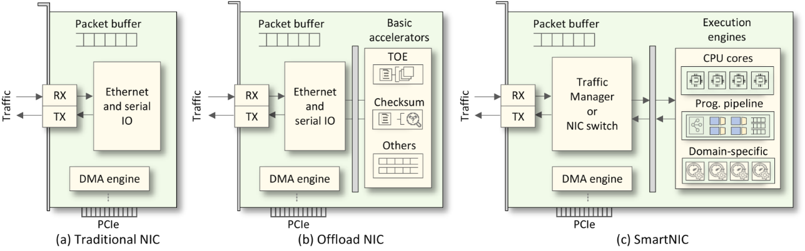
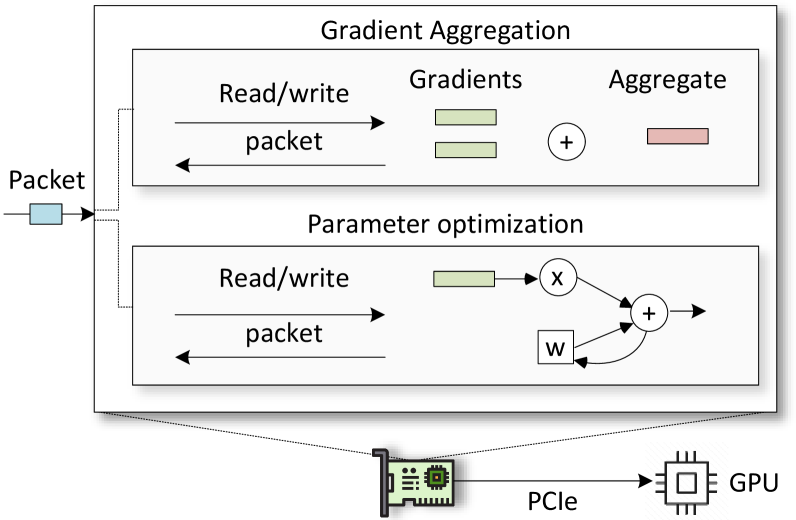

<!-- \_class: title -->

# Advanced Computer Networks

## Kapitel 8 · Netze für KI (Networks for AI)

Wintersemester 2026/2027
Master AI – Hochschule Fulda
Sebastian Rieger · MMNet

---

## Kapitelübersicht

## MRC?

**8.1 Warum KI-Netze anders sind**

- Trainings- vs. Inferenz-Workloads · Engpässe · Tail-Latency

**8.2 Topologie und Kollektive**

- Frontend- vs. Backend-Netz · Rail-optimized Clos · AllReduce, NCCL, SHARP

**8.3 Transport und Congestion Control**

- InfiniBand vs. RoCEv2 vs. Ultra Ethernet (UET) · ECN/PFC · Packet Spraying

**8.4 Hardware und Ausblick**

- SmartNICs/DPUs · GPUDirect RDMA · AI for Networking (etabliert vs. Hype)

---

## Lernziele

Nach diesem Kapitel sollten Sie wissen…

- warum **KI-Training** andere Netzanforderungen stellt als klassische Anwendungen
- wie **Backend-Netze** aufgebaut sind (Rail-optimized Clos, Oversubscription, Linkraten)
- was **kollektive Kommunikation** ist (AllReduce) und warum **Tail-Latency** zählt
- welche **Transport-Optionen** konkurrieren: InfiniBand, RoCEv2, Ultra Ethernet (UET)
- warum „**lossless Ethernet**" riskant ist und was ECN/DCQCN dagegen tun
- welche Rolle **DPUs**, **GPUDirect RDMA** und „**AI for Networking**" spielen — belastbar vs. Hype

> **Bezug zur Referenzliteratur:** 7E §13.4 (Domain-Specific Congestion Control), §15 (RPC/RDMA) — [7e.systemsapproach.org](https://7e.systemsapproach.org/)

---

<!-- \_class: section-break -->

# 8.1 Warum KI-Netze anders sind

Trainings- und Inferenz-Workloads · Engpässe · Tail-Latency

---

## Trainings- und Inferenz-Workloads

**Training**

- Massive Parallelisierung über GPUs/TPUs
- Häufige Synchronisation (Gradienten)
- Große Datenmengen, Shuffle der Trainingsdaten
- Empfindlich gegenüber Latenz **und** Durchsatz

**Inferenz**

- Echtzeit- bzw. Near-Real-Time-Anforderungen
- Sehr hohe Request-Raten
- Pre-/Post-Processing direkt am Rand des Systems

**Gemeinsam**

- Extrem viel **East-West**-Traffic im Rechenzentrum
- Verkehr ist **sprunghaft (bursty)** und schlecht vorhersagbar
- Collectives erzeugen **Incast**: viele Ströme auf ein Ziel

🧠 Ein einzelner Trainings-Job erzeugt mehr East-West-Traffic als ein ganzes Bürogebäude. Was folgt daraus für Netz-Design und Betrieb?

---

## Warum traditionelle Netze nicht reichen

**Die Engpässe**

- Bandbreite: verteiltes Training bewegt permanent große Datenmengen
- Latenz: synchrone Phasen warten auf den langsamsten Teilnehmer
- Congestion: Incast überlastet einzelne Uplinks; Datenpfade ohne Application Awareness

**Warum klassische DC-Netze scheitern**

- Schon kleine Verluste oder Latenz-Spitzen kosten **Tage bis Wochen** Trainingszeit
- Oversubscription und ECMP-Hash-Kollisionen treffen genau die Collectives; Multicast ist teuer
- Starre ASICs → programmierbare Bausteine (P4/DPU) werden gebraucht

*Beispiel und Messungen: Meta, „RDMA over Ethernet for Distributed AI Training at Meta Scale“, SIGCOMM 2024*

---

## Die entscheidende Metrik: Tail-Latency

- Bei synchronem Training bestimmt der **langsamste** Teilnehmer die Dauer des Schritts
- Der Mittelwert sagt daher nichts — entscheidend sind **p99/p99.9** und **Straggler** (einzelne langsame Knoten)
- Ein einzelner warmer ASIC, eine degradierte Faser oder ein Hash-Konflikt reichen, um den ganzen Job zu bremsen
- Konsequenz: Netze für KI werden auf **Tail-Latency** optimiert, nicht auf Durchschnittsdurchsatz

**Fazit:** „Im Mittel schnell" ist wertlos — im KI-Netz zählt der **schlechteste** Fall.

🧠 Klassische SLA-Metriken (Durchsatz, Verfügbarkeit) greifen hier nicht. Welche Kennzahl würden Sie in einem KI-Netz monitoren?

---

<!-- \_class: section-break -->

# 8.2 Topologie und Kollektive

Frontend- vs. Backend-Netz · Rail-optimized Clos · AllReduce, NCCL, SHARP

---

## Zwei Netze in einem Cluster

**Backend-Netz (GPU-zu-GPU)**

- Trägt die **Collectives** des Trainings
- Sehr hohe Linkraten (400/800 GbE, 1,6 TbE in Sicht), Oversubscription oft 1:1
- RDMA-Transport, kleine Puffer, kein Storage-Traffic

**Frontend-Netz**

- Storage, Checkpoints, Management, Modell-/Daten-Ingest
- Konventionelles Ethernet, klassische Oversubscription — kann Training ins Stocken bringen → **strikte Trennung**

- Diese Trennung ist der wichtigste Strukturunterschied zu klassischen Rechenzentren; innerhalb eines Racks verkabeln GPU-Servernetze (NVL72-Klasse), das Netz verbindet die Racks

---

## Rail-optimized Clos

- Klassisches Clos/Fat-Tree: jeder Leaf mit **jedem** Spine verbunden
- **Rail-optimized:** GPUs mit gleichem Index („Rail") über alle Server werden an dasselbe Spine-Paar geführt
  - Collectives bleiben dadurch überwiegend **innerhalb eines Rails**
  - weniger Pfadvielfalt nötig, kürzere Kabelwege, besser planbarer Verkehr
- Beispiel: Meta trainiert Llama 3 in zwei 24.000-GPU-Clustern — eines mit **RoCE**, eines mit **InfiniBand**
- Konsequenz für die Lehre: Fat-Tree-Wissen bleibt gültig, aber die **Verkabelungslogik folgt der Kommunikationsstruktur**, nicht der Topologie-Theorie

*Quelle: Meta Engineering (03/2024) · SIGCOMM 2024, „RDMA over Ethernet for Distributed AI Training at Meta Scale“*

---

## Kollektive Kommunikation: AllReduce

- **AllReduce** addiert Gradienten über alle Teilnehmer und stellt das Ergebnis jedem bereit
- Zwei Standardverfahren: **Ring-AllReduce** (Chunks im Ring, bandbreitenoptimal für große Nachrichten) und **Tree-AllReduce** (latenzoptimal für kleine Nachrichten)
- **NCCL** wählt das Verfahren abhängig von Nachrichtengröße, Topologie und Transport (IB oder RoCE)
- **In-Network-Aggregation:** mit **SHARP** rechnet der Switch Teilsummen selbst → halbiert den Verkehr
- Kollektive erklären Incast, Multi-Path-Bedarf und Tail-Latency

💡 Praktikum (Lab L6): Ring-AllReduce als Skript simulieren, Laufzeit gegen Link-Delay/Loss variieren — ohne GPU-Hardware. Referenz: [NCCL-Dokumentation](https://docs.nvidia.com/deeplearning/nccl/user-guide/docs/)

---

<!-- \_class: section-break -->

# 8.3 Transport und Congestion Control

InfiniBand · RoCEv2 · Ultra Ethernet (UET) · ECN/PFC · Packet Spraying

---

## Transport-Optionen: IB, RoCEv2, UET

|           | InfiniBand                  | RoCEv2                            | Ultra Ethernet (UET)                         |
|-----------|-----------------------------|-----------------------------------|----------------------------------------------|
| Basis     | eigene Fabrik (HDR/NDR/XDR) | Ethernet + UDP                    | Ethernet, offene Spezifikation               |
| Verlust   | lossless per Design         | lossless nötig (PFC) **oder** ECN | **kein** lossless-Zwang                      |
| Mehrpfad  | eingeschränkt               | ECMP (Flow-Hash)                  | **Packet Spraying** vorgesehen               |
| Ökosystem | proprietär, etabliert       | multi-vendor, breit               | Konsortium (Linux Foundation)                |
| Reifegrad | produktiv                   | produktiv                         | **Spec 1.0 seit 11.06.2025** (aktuell 1.0.3) |

- **UET** (Ultra Ethernet Transport) ist der Transport-Teil der UEC-Spezifikation: senderbasierte Congestion Control, Packet Spraying, Credits gegen Incast, QoS
- Ziel: InfiniBand-Performance im Ethernet-Ökosystem — ohne die Fragilität von PFC

💡 [Ultra Ethernet Consortium](https://ultraethernet.org/) — Spec 1.0 und White Paper · 🧠 Warum ist „lossless" im Ethernet ein Problem, in InfiniBand aber Konstruktionsprinzip?

---

## Congestion Control im KI-Netz

- **ECN** (Explicit Congestion Notification): Switches markieren Pakete, statt sie zu verwerfen — Standard-Baustein im KI-Netz
- **DCQCN:** ECN-basiertes Verfahren für RoCEv2 (Microsoft); senderseitige Reaktion auf Markierungen
- **HPCC** (Alibaba) und **Swift** (Google): nutzen präzise Latenz-/Telemetrie-Informationen statt reiner Markierungen
- **PFC (Priority Flow Control):** erzeugt „lossless Ethernet" — aber erzeugt Head-of-Line-Blocking und kann **Deadlocks** verursachen
- Deshalb: moderne Fabrics setzen auf **ECN + congestion control** statt PFC, oder verlassen die lossless-Annahme ganz (UET)

*7E §13.4 (Domain-Specific Congestion Control) · §8.3 (Active Queue Management)*

---

## Load Balancing: ECMP vs. Packet Spraying

- **ECMP** verteilt **Flows** per Hash. Bei wenigen, großen Flows (typisch im Training) führt das zu **Hash-Kollisionen** — einige Links sind voll, andere leer
- **Packet Spraying** verteilt **einzelne Pakete** über alle Pfade → gute Auslastung, aber **Reordering**
- Reordering kostet: größere Reorder-Puffer, angepasste Transport-Implementierungen — genau hier setzt UET an
- Konsequenz: Lastverteilung im KI-Netz verschiebt sich von „Flow" zu „Packet/Bit"

**Traditionelles DC-Netz**

- Fokus North-South, Verkehr aggregieren; Metrik: Weiterleitungseffizienz

**KI-Netz**

- Dominanz East-West; Metrik: **Tail-Latency** und Auslastung

---

<!-- \_class: section-break -->

# 8.4 Hardware und Ausblick

SmartNICs/DPUs · GPUDirect RDMA · AI for Networking

---

## SmartNICs und DPUs

- **SmartNIC:** Netzwerkkarte mit eigener Rechenleistung — offloadet Paketfilterung, Verschlüsselung, Kompression, teils AllReduce
- **DPU/IPU:** vollständige Infrastruktur-Prozessoren (Arm-Kerne, Beschleuniger, programmierbare Pipeline) — z. B. NVIDIA **BlueField**, AMD **Pensando**, Intel **IPU**
- Vorteile im KI-Kontext:
  - Beschleunigte Datenverarbeitung, Entlastung der Host-CPU
  - **RDMA** und **GPUDirect RDMA**: die NIC schreibt direkt in den GPU-Speicher
  - Traffic Shaping passend zum Workload

*Quelle: Comprehensive Survey on SmartNICs, 5/2024*

---

## DPU-Generationen und -Programmierbarkeit

| DPU                | Transistoren | SPECint | Rechenleistung | Durchsatz  |
|--------------------|--------------|---------|----------------|------------|
| BlueField-2 (2020) | 7 Mrd.       | 9       | 0,7 TOPS       | 200 Gbit/s |
| BlueField-3 (2022) | 22 Mrd.      | 42      | 1,5 TOPS       | 400 Gbit/s |
| BlueField-4 (2024) | 64 Mrd.      | 160     | 1.000 TOPS     | 800 Gbit/s |

- **DOCA** als einheitliches Entwicklungsmodell über die Generationen
- AMD **Pensando**: programmierbare Ingress/Egress-Pipelines (P4-Erbe aus Kapitel 5) plus Toolchain `SSDK`
- Damit ist die **Data-Plane-Programmierbarkeit** dort angekommen, wo die Daten entstehen: am Server

*Quellen: Understanding the Power of NVIDIA's BlueField-3 DPU (11/2024) · Comprehensive Survey on SmartNICs (5/2024)*

---

## Was DPUs für Training und Inferenz leisten

**Training**

- Gradienten-Synchronisation (AllReduce, MPI, PyTorch) wird von der NIC mitgetragen
- Geringere CPU-Last, höherer Durchsatz für Modell-Updates
- Beispiel: GPUDirect RDMA mit BlueField oder Pensando

**Inferenz**

- Hohe Parallelität von Vorhersage-Anfragen, sehr niedrige Latenz
- Lastverteilung zwischen Inferenz-Systemen
- Inline-Verarbeitung (Pre-/Post-Processing)

🧠 Latenz und Durchsatz sind Ziele in Konflikt. Welches Verfahren würden Sie für ein **Inferenz**-Cluster priorisieren — und warum?

*Quelle: Comprehensive Survey on SmartNICs, 5/2024*

---

## AI for Networking: etabliert vs. Hype

**Etabliert**

- **Telemetrie + ML:** Anomalie-Erkennung, Kapazitätsprognose, Ausfall-Früherkennung
- **Netz-Digital-Twins:** Betriebszustände simulieren (MMNet-Forschung, KIT)
- **Intent-based Networking:** Absichten beschreiben, Konfiguration ableiten

**In Erprobung / Hype**

- **LLM-Agents für NetOps:** Tickets, Root-Cause — noch nicht belastbar
- Vollautonome Netze („Zero Touch") — Verantwortung bleibt beim Menschen
- „AI-designed protocols" — Forschungsfeld, keine Produkte

🧠 Wo würden Sie KI in *Ihrem* Netz einsetzen — und wo würden Sie es nicht? Was ist die Kosten/Nutzen-Frage?

*💡 [ETSI ZSM – Zero-touch Automation](https://www.etsi.org/technologies/zero-touch-network-service-management) · vgl. Kapitel 3 (SDN, Telemetrie)*

---

## Diskussion

**Offene Fragen**

- Kompromisse beim Einsatz von SmartNICs in großem Maßstab?
- Ist „lossless" noch nötig, wenn Congestion Control gut genug ist?

**Was sich dauerhaft ändert**

- Tail-Latency statt Mittelwert als Zielgröße
- Strikte Trennung von Backend- und Frontend-Netzen
- Data-Plane-Programmierbarkeit (P4/DPU) als Standardbaustein

---

## Lernzielkontrolle ✍️🧠

- Warum reichen klassische DC-Netze für KI-Training nicht aus?
- Was ist der Unterschied zwischen Frontend- und Backend-Netz?
- Wie funktioniert Rail-optimized Clos und warum wird es verwendet?
- Erklären Sie Ring-AllReduce und Tree-AllReduce — wann nimmt man was?
- Warum ist Tail-Latency die entscheidende Metrik?
- Welche Nachteile hat PFC, und welche Alternative gibt es?
- Was unterscheidet UET von RoCEv2?
- Wann hilft Packet Spraying — und was kostet es?
- Was leistet GPUDirect RDMA?
- Nennen Sie je ein Beispiel für belastbares „AI for Networking" und für Hype.

---

## Praktische Übungen und Demo-Links 🛠️🧑‍🔬

1. **Incast erzeugen (Lab L6):** Leaf-Spine mit FRR, mehrere Sender gleichzeitig (`iperf3 -P`), Linkauslastung mit `ss -ti` beobachten
2. **Tail-Latency sichtbar machen:** alle Flow-Dauern messen und p99 gegen den Mittelwert stellen — Straggler finden
3. **ECN/AQM aktivieren:** Markierung statt Verlust beobachten (`tc qdisc`, `sysctl`), Effekt auf Incast messen
4. **ECMP vs. Packet Spraying:** erst Standard-ECMP mit Hash-Kollisionen provozieren, dann Hash-Rotation/P4-Variante vergleichen
5. **Kollektive simulieren:** Ring-AllReduce-Skript, Laufzeit gegen Delay/Loss variieren
   - 💡 [NCCL-Dokumentation](https://docs.nvidia.com/deeplearning/nccl/user-guide/docs/) als Referenz für die Verfahren
6. **Hersteller- und Konsortium-Quellen lesen und einordnen:** 💡 [UEC 1.0](https://ultraethernet.org/) · 💡 [NVIDIA Spectrum-X](https://www.nvidia.com/en-us/networking/spectrumx/) · 💡 [Meta-RoCE-Paper](https://cs.stanford.edu/~keithw/sigcomm2024/sigcomm24-final246-acmpaginated.pdf)

---

## Weiterführende Literatur & Links 💡

**Primärquellen**

- 💡 [UEC Spec 1.0 / White Paper](https://ultraethernet.org/)
- 💡 [Meta, RDMA over Ethernet (SIGCOMM 2024)](https://cs.stanford.edu/~keithw/sigcomm2024/sigcomm24-final246-acmpaginated.pdf)
- 💡 [Meta: Building GenAI Infrastructure (03/2024)](https://engineering.fb.com/2024/03/12/data-center-engineering/building-metas-genai-infrastructure/)
- 💡 [NCCL User Guide](https://docs.nvidia.com/deeplearning/nccl/user-guide/docs/)

**Referenzliteratur**

- 💡 [7E §13.4 – Domain-Specific Congestion Control](https://7e.systemsapproach.org/congestion.html)
- 💡 [7E §15 – Message Transactions (RPC/RDMA)](https://7e.systemsapproach.org/message.html)
- 💡 [7E §8.3 – Active Queue Management](https://7e.systemsapproach.org/capacity.html)

**Praxis & Ausblick**

- 💡 [NVIDIA Spectrum-X](https://www.nvidia.com/en-us/networking/spectrumx/) *(Herstellerangaben!)*
- 💡 [AMD Pensando DPU](https://www.amd.com/en/products/data-processing-units/pensando.html)
- 💡 [ETSI ZSM – Zero-touch Automation](https://www.etsi.org/technologies/zero-touch-network-service-management)
- 💡 [Kapitel 6 – P4/DPU-Grundlagen](6-AdvCompNet-P4-ProgrammableDataPlane.md)

> 🧠 Interesse an einer Abschlussarbeit zu KI-Netzen, DPUs oder Netz-Digital-Twins? Das MMNet forscht genau dort.
